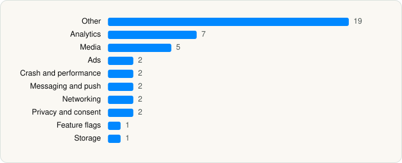

<picture><source media="(prefers-color-scheme: dark)" srcset="../../../../assets/logo/logo-dark.svg"></picture> [Tech Stack](../../../../README.md) / [NBA MEDIA VENTURES, LLC](../../../../companies/nba-media-ventures-llc.md) / NBA

# NBA: Live Games & Scores

<picture><source media="(prefers-color-scheme: dark)" srcset="../../../../assets/badges/ios-dark.svg"></picture> <picture><source media="(prefers-color-scheme: dark)" srcset="../../../../assets/badges/inactive-dark.svg"></picture> <picture><source media="(prefers-color-scheme: dark)" srcset="../../../../assets/badges/floor-dark.svg"></picture> <picture><source media="(prefers-color-scheme: dark)" srcset="../../../../assets/badges/encrypted-dark.svg"></picture>

[App Store](https://apps.apple.com/app/id484672289) · [latest.json](latest.json)

| | |
|---|---|
| Company | [NBA MEDIA VENTURES, LLC](../../../../companies/nba-media-ventures-llc.md) |
| Store id | `484672289` |
| Bundle / package id | `com.nbaimd.gametime.universal` |
| Latest version | 120722.1 (analysed 2026-06-19) |
| Versions tracked | 1 |
| SDKs in latest version | 43 |
| Languages | C/C++, Metal (shaders), Objective-C, Swift |
| UI | SwiftUI, UIKit |
| Build | Swift Package Manager (SwiftPM) |
| Minimum OS | iOS 17.2 (built with Xcode 26.5, SDK iphoneos26.5) |
| Devices / ABIs | iPhone, iPad |
| Localisations | 13 |
| Capabilities | 7 |
| Declares tracking | Yes |
| Tracked | No. Kept for history. |

## SDKs by category

<picture><source media="(prefers-color-scheme: dark)" srcset="../../../../assets/charts/apps/ios/nba-media-ventures-llc/nba-dark.svg"></picture>

- **Other** (19): AccessEnabler 3.9.2, AkamaiBMP 4.0.6, AkamaiBMP-companion 4.0.6, AVFoundationCollector 3.20.0, BBMediaKit 1.0, BitmovinCollector 3.20.0, ComponentBuffet, CoreCollector 3.20.0, CQuickJS 1.0, EaseLiveSDK 2.17.1, Lodash, MicroAppMirror 1.1.1, MKBrandBrigadeSDK 1.0, MKWatermarkingSDK 1.0, MultiViewFeature, OPiNFramework 9.10.0, StorytellerGAMIntegration 11.3.3, StorytellerSDK 11.3.3, TentpoleDomain
- **Analytics** (7): Amplitude 1.0, AppsFlyerLib 1.0, Branch, BrazeKit 11.9.0, ComScore 1.0, CrowdinSDK, Kochava 8.2.0
- **Media** (5): BitmovinPlayer 3.104.0, BitmovinPlayerAnalytics 3.104.0, BitmovinPlayerCore 3.104.0, GoogleCast 4.8.3, MKPlayer 1.57.0
- **Ads** (2): Google Mobile Ads (AdMob), GoogleMobileAds 12.9.0
- **Crash and performance** (2): DatadogCore, NewRelic 7.7.1
- **Messaging and push** (2): BrazeUI, OneSignal 1.0
- **Networking** (2): Ably, Starscream
- **Privacy and consent** (2): OTPublishersHeadlessSDK 202511.1.0, UserMessagingPlatform 2.7.0
- **Feature flags** (1): Experiment
- **Storage** (1): ZIPFoundation

Frameworks (31)

ActivityKit (Live Activities), AdServices (Apple Search Ads attribution), AdSupport (IDFA), App Tracking Transparency (ATT), Authentication Services (Sign in with Apple / passkeys), AVFoundation (audio/video), AVKit, Background Tasks, CallKit (VoIP), Combine (reactive), Core Data, Core Image, Core Location, Core Motion, CryptoKit, DeviceCheck / App Attest, Group Activities (SharePlay), Local Authentication (Face ID / Touch ID), Media Player, MessageUI (mail / SMS compose), MetalKit, Network.framework, PassKit (Wallet / Apple Pay), SafariServices, SiriKit (Intents), StoreKit (in-app purchase), SwiftUI, UIKit, User Notifications, Watch Connectivity, WidgetKit (widgets)

Capabilities (7)

App Groups, Associated Domains (Universal Links), Background App Refresh, Background Audio, Background Push, Keychain Sharing, Push Notifications (APNs)

## Version history

| Version | Analysed | Store update | SDKs | Change | SDK list is a floor | Binary encrypted | File |
|---|---|---|---|---|---|---|---|
| 120722.1 | 2026-06-19 |  | 43 |  | Yes | Yes | [120722.1.json](120722.1.json) |

---

Generated by `scripts/build_readme.py` from the JSON files. Do not edit by hand.
