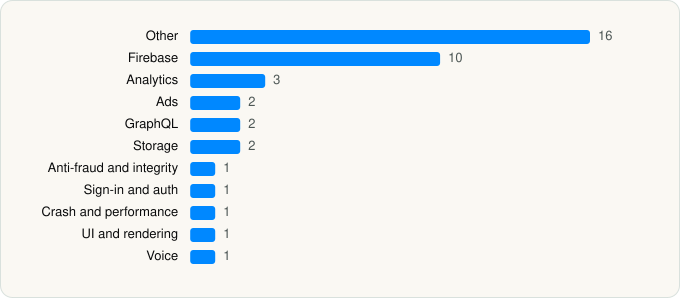

<picture><source media="(prefers-color-scheme: dark)" srcset="../../../../assets/logo/logo-dark.svg"></picture> [Tech Stack](../../../../README.md) / [Netflix, Inc.](../../../../companies/netflix-inc.md) / Netflix Game Controller

# Netflix Game Controller

<picture><source media="(prefers-color-scheme: dark)" srcset="../../../../assets/badges/ios-dark.svg"></picture> <picture><source media="(prefers-color-scheme: dark)" srcset="../../../../assets/badges/active-dark.svg"></picture> <picture><source media="(prefers-color-scheme: dark)" srcset="../../../../assets/badges/floor-dark.svg"></picture> <picture><source media="(prefers-color-scheme: dark)" srcset="../../../../assets/badges/encrypted-dark.svg"></picture>

[App Store](https://apps.apple.com/app/id6447582581) · [latest.json](latest.json)

| | |
|---|---|
| Company | [Netflix, Inc.](../../../../companies/netflix-inc.md) |
| Store id | `6447582581` |
| Bundle / package id | `com.netflix.ssicapp` |
| Latest version | 3.21 (analysed 2026-11-01) |
| Versions tracked | 1 |
| SDKs in latest version | 40 |
| Languages | C/C++, Objective-C, Swift |
| UI | Lottie (animations), SwiftUI, UIKit |
| Build | Swift Package Manager (SwiftPM) |
| Minimum OS | iOS 18.0 (built with Xcode 27.1, SDK iphoneos27.1) |
| Devices / ABIs | iPhone, iPad |
| Localisations | 40 |
| Capabilities | 9 |
| Declares tracking | No |
| Tracked | Yes |

## SDKs by category

<picture><source media="(prefers-color-scheme: dark)" srcset="../../../../assets/charts/apps/ios/netflix-inc/netflix-game-controller-dark.svg"></picture>

- **Other** (16): AgoraAiNoiseSuppressionExtension 4.7.0, Agorafdkaac 4.7.0, AgoraffmpegExtension 4.7.0, AgoraRtmKit 2.2.8, AgoraSoundTouch 4.7.0, aosl 1.3.16, Callouts, Emojis, HawkinsCommerce, HawkinsComponents, IdentityEditor 3.21, ModalPresentation, NFURLSession 3.21, NGCCDXUI, Pictograms, ProfileProtocol
- **Firebase** (10): FBLPromises, Firebase, FirebaseCore, FirebaseCoreInternal, FirebaseInstallations, FirebaseRemoteConfig, GoogleDataTransport, GoogleUtilities 3.21, nanopb, Promises
- **Analytics** (3): FirebaseAnalytics 12.8.0, GoogleAppMeasurement 12.8.0, GoogleAppMeasurementIdentitySupport 12.8.0
- **Ads** (2): EducationalInterstitial 3.21, GoogleAdsOnDeviceConversion 3.2.0
- **GraphQL** (2): Apollo, ApolloAPI
- **Storage** (2): GRDB, ZIPFoundation
- **Anti-fraud and integrity** (1): RecaptchaEnterprise 1.0
- **Sign-in and auth** (1): AuthenticationUI
- **Crash and performance** (1): FirebaseCrashlytics
- **UI and rendering** (1): Lottie
- **Voice** (1): AgoraRtcKit 4.7.0

Frameworks (24)

ActivityKit (Live Activities), AVFoundation (audio/video), Background Tasks, CallKit (VoIP), Combine (reactive), Core Image, Core ML, Core Motion, CryptoKit, DeviceCheck / App Attest, MetalKit, MetricKit (diagnostics), Network.framework, Photos, PhotosUI, SafariServices, SpriteKit, StoreKit (in-app purchase), SwiftUI, UIKit, User Notifications, Vision, VisionKit (document/data scanning), WidgetKit (widgets)

Capabilities (9)

App Groups, Associated Domains (Universal Links), Background App Refresh, Background Audio, Background Processing, Background Push, Game Center, Push Notifications (APNs), Time-Sensitive Notifications

## Version history

| Version | Analysed | Store update | SDKs | Change | SDK list is a floor | Binary encrypted | File |
|---|---|---|---|---|---|---|---|
| 3.21 | 2026-11-01 |  | 40 |  | Yes | Yes | [3.21.json](3.21.json) |

---

Generated by `scripts/build_readme.py` from the JSON files. Do not edit by hand.
