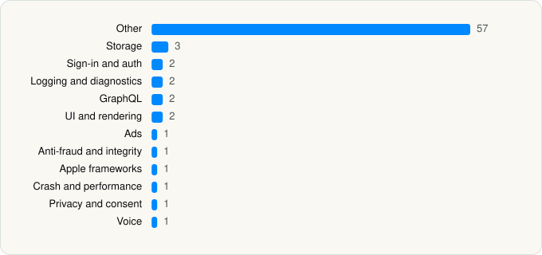

<picture><source media="(prefers-color-scheme: dark)" srcset="../../../../assets/logo/logo-dark.svg"></picture> [Tech Stack](../../../../README.md) / [Netflix, Inc.](../../../../companies/netflix-inc.md) / Netflix

# Netflix

<picture><source media="(prefers-color-scheme: dark)" srcset="../../../../assets/badges/ios-dark.svg"></picture> <picture><source media="(prefers-color-scheme: dark)" srcset="../../../../assets/badges/inactive-dark.svg"></picture> <picture><source media="(prefers-color-scheme: dark)" srcset="../../../../assets/badges/floor-dark.svg"></picture> <picture><source media="(prefers-color-scheme: dark)" srcset="../../../../assets/badges/encrypted-dark.svg"></picture>

[App Store](https://apps.apple.com/app/id363590051) · [latest.json](latest.json)

| | |
|---|---|
| Company | [Netflix, Inc.](../../../../companies/netflix-inc.md) |
| Store id | `363590051` |
| Bundle / package id | `com.netflix.Netflix` |
| Latest version | 18.34.0 (analysed 2026-06-19) |
| Versions tracked | 1 |
| SDKs in latest version | 74 |
| Languages | C/C++, Objective-C, Swift |
| UI | Lottie (animations), SwiftUI, UIKit |
| Build | Swift Package Manager (SwiftPM) |
| Minimum OS | iOS 18.0 (built with Xcode 26.2, SDK iphoneos26.2) |
| Devices / ABIs | iPhone, iPad |
| Localisations | 40 |
| Capabilities | 8 |
| Declares tracking | No |
| Tracked | No. Kept for history. |

## SDKs by category

<picture><source media="(prefers-color-scheme: dark)" srcset="../../../../assets/charts/apps/ios/netflix-inc/netflix-dark.svg"></picture>

- **Other** (57): ABTests, AltCastBroadcast, AppRecoveryInternal 1.0, AppRecoveryPublic 1.0, ArgoMenusObjC, ArgoNavigationUIObjC, ArgoPlaylists, AudioSubtitleSelector, AudioSubtitleSelectorFeatureImpl, Callouts, CDXAPI 1.0, DEPPUI, DiscoveryGamesUI, DisplayPage, DisplayPageObjC, Emojis, ExpiredSurveys, FirstRunExperiencesObjC, Graphics, Habitat 1.0, HawkinsComponents, IdentityEditor, iPhoneFeedbackTool, LiveActivity, LiveFastPath, LiveSurveys, MDXAPI 1.0, MetadataKit, MinimalDependencies 1.0, NFCW444 1.0, NFLXStoreLocation 1.0, NFNetworkState 1.0, NFPlayerLib 1.0, NFPlayerModels 1.0, NFURLSession 1.0, NFWebCrypto 1.0, NrdAPI 1.0, NrdConstants 1.0, NtlEventValidatorInternal, Pictograms, PlayerLockButton, PlayerUIDev, PlayerUIModels, PlaygraphModels 1.0, PlaygraphModelsInternal 1.0, ProfileGate, ProfileProtocol, PushNotifications, RuntimeWarningReporter 1.0, SearchUI, SecureStorageObjC, SemanticCatalogSupport, ShareSheet, StartupErrorTracker 1.0, StartupErrorTrackerInternal 1.0, StartupErrorTrackerObjC 1.0, SyntheticVerticalVideo
- **Storage** (3): GRDB, PlatformCommonAPI 1.0, SQLite 1.0
- **Sign-in and auth** (2): AuthenticationUI, LoginInternalObjC
- **Logging and diagnostics** (2): ClientLogger 1.0, ClientLoggerProfiler 1.0
- **GraphQL** (2): Apollo, ApolloAPI
- **UI and rendering** (2): Lottie, ProfileGateAnimation
- **Ads** (1): EducationalInterstitial
- **Anti-fraud and integrity** (1): RecaptchaEnterprise 1.0
- **Apple frameworks** (1): OrderedCollections 1.0
- **Crash and performance** (1): Bugsnag
- **Privacy and consent** (1): PushConsentFlow
- **Voice** (1): TwilioVoice 6.11.2

Frameworks (25)

ActivityKit (Live Activities), App Tracking Transparency (ATT), Authentication Services (Sign in with Apple / passkeys), AVFoundation (audio/video), AVKit, Background Tasks, CallKit (VoIP), Combine (reactive), Core Data, Core Image, Core Motion, CryptoKit, DeviceCheck / App Attest, Media Player, MessageUI (mail / SMS compose), MetricKit (diagnostics), Natural Language, Network.framework, SafariServices, StoreKit (in-app purchase), SwiftData (persistence), SwiftUI, UIKit, User Notifications, WidgetKit (widgets)

Capabilities (8)

App Groups, Associated Domains (Universal Links), Background App Refresh, Background Audio, Background Processing, Background Push, Keychain Sharing, Push Notifications (APNs)

## Version history

| Version | Analysed | Store update | SDKs | Change | SDK list is a floor | Binary encrypted | File |
|---|---|---|---|---|---|---|---|
| 18.34.0 | 2026-06-19 |  | 74 |  | Yes | Yes | [18.34.0.json](18.34.0.json) |

---

Generated by `scripts/build_readme.py` from the JSON files. Do not edit by hand.
