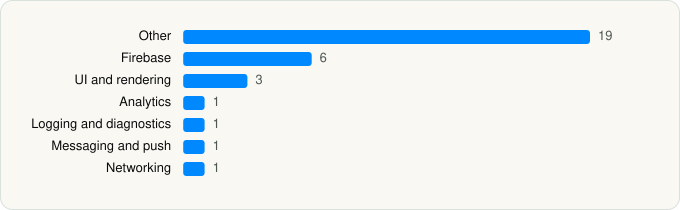

<picture><source media="(prefers-color-scheme: dark)" srcset="../../../../assets/logo/logo-dark.svg"></picture> [Tech Stack](../../../../README.md) / [New York Road Runners, Inc.](../../../../companies/new-york-road-runners-inc.md) / New York Road Runners

# New York Road Runners

<picture><source media="(prefers-color-scheme: dark)" srcset="../../../../assets/badges/ios-dark.svg"></picture> <picture><source media="(prefers-color-scheme: dark)" srcset="../../../../assets/badges/inactive-dark.svg"></picture> <picture><source media="(prefers-color-scheme: dark)" srcset="../../../../assets/badges/floor-dark.svg"></picture> <picture><source media="(prefers-color-scheme: dark)" srcset="../../../../assets/badges/encrypted-dark.svg"></picture>

[App Store](https://apps.apple.com/app/id6742177802) · [latest.json](latest.json)

| | |
|---|---|
| Company | [New York Road Runners, Inc.](../../../../companies/new-york-road-runners-inc.md) |
| Store id | `6742177802` |
| Bundle / package id | `com.tcs.nyrr` |
| Latest version | 3.0.0 (analysed 2026-11-01) |
| Versions tracked | 1 |
| SDKs in latest version | 32 |
| Languages | C/C++, Metal (shaders), Objective-C, React Native / JavaScript, Swift |
| UI | Lottie (animations), SwiftUI, UIKit |
| Build | Swift Package Manager (SwiftPM) |
| Minimum OS | iOS 16.4 (built with Xcode 26.4.1, SDK iphoneos26.4) |
| Devices / ABIs | iPhone |
| Localisations | 1 |
| Capabilities | 2 |
| Declares tracking | No |
| Tracked | No. Kept for history. |

## SDKs by category

<picture><source media="(prefers-color-scheme: dark)" srcset="../../../../assets/charts/apps/ios/new-york-road-runners-inc/new-york-road-runners-dark.svg"></picture>

- **Other** (19): boost, BrazeLocation 16.0.0, EXConstants 56.0.24, ExpoFileSystem 1.0, ExpoImage 1.0, ExpoLocation 1.0, ExpoMediaLibrary 1.0, ExpoModulesCore 1.0, ExpoModulesJSI 1.0, ExpoModulesWorklets 1.0, ExpoPrint 1.0, ExpoVideo 1.0, EXUpdates 56.0.25, folly, hermesvm 1.0.0, libavif 1.0, React 1.0, ReactNativeDependencies 1.0, RNViewShotPrivacyInfo 5.1.0
- **Firebase** (6): FBLPromises 2.4.1, FirebaseCore 12.10.0, FirebaseCoreInternal 12.10.0, FirebaseInstallations 12.10.0, GoogleUtilities 8.1.3, nanopb 3.30910.0
- **UI and rendering** (3): Lottie 4.6.0, RNSVGFilters 15.15.4, SDWebImage 1.0
- **Analytics** (1): BrazeKit 16.0.0
- **Logging and diagnostics** (1): glog
- **Messaging and push** (1): BrazeUI 16.0.0
- **Networking** (1): ReachabilitySwift 5.2.4

Frameworks (22)

ActivityKit (Live Activities), Authentication Services (Sign in with Apple / passkeys), AVFoundation (audio/video), AVKit, Combine (reactive), Core Image, Core Location, Core Motion, CryptoKit, Local Authentication (Face ID / Touch ID), Media Player, Network.framework, Photos, PhotosUI, SafariServices, StoreKit (in-app purchase), Swift Charts, SwiftUI, UIKit, User Notifications, VisionKit (document/data scanning), WidgetKit (widgets)

Capabilities (2)

Background Audio, Push Notifications (APNs)

## Version history

| Version | Analysed | Store update | SDKs | Change | SDK list is a floor | Binary encrypted | File |
|---|---|---|---|---|---|---|---|
| 3.0.0 | 2026-11-01 |  | 32 |  | Yes | Yes | [3.0.0.json](3.0.0.json) |

---

Generated by `scripts/build_readme.py` from the JSON files. Do not edit by hand.
