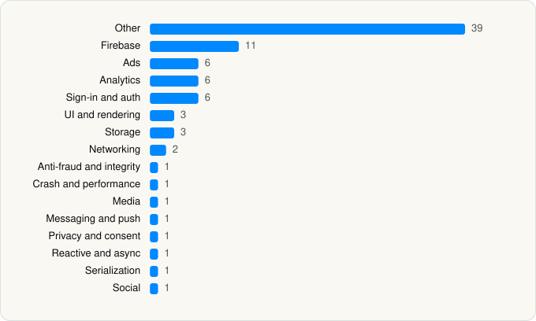

<picture><source media="(prefers-color-scheme: dark)" srcset="../../../../assets/logo/logo-dark.svg"></picture> [Tech Stack](../../../../README.md) / [NewLeaf Publishing](../../../../companies/newleaf-publishing.md) / ReelShort

# ReelShort - Stream Drama & TV

<picture><source media="(prefers-color-scheme: dark)" srcset="../../../../assets/badges/ios-dark.svg"></picture> <picture><source media="(prefers-color-scheme: dark)" srcset="../../../../assets/badges/inactive-dark.svg"></picture> <picture><source media="(prefers-color-scheme: dark)" srcset="../../../../assets/badges/floor-dark.svg"></picture> <picture><source media="(prefers-color-scheme: dark)" srcset="../../../../assets/badges/encrypted-dark.svg"></picture>

[App Store](https://apps.apple.com/app/id1636235979) · [latest.json](latest.json)

| | |
|---|---|
| Company | [NewLeaf Publishing](../../../../companies/newleaf-publishing.md) |
| Store id | `1636235979` |
| Bundle / package id | `com.newleaf.app.ios.vic` |
| Latest version | 4.2.00 (analysed 2026-10-24) |
| Versions tracked | 1 |
| SDKs in latest version | 84 |
| Languages | C/C++, Metal (shaders), Objective-C, React Native / JavaScript, Swift |
| UI | Lottie (animations), SwiftUI, UIKit |
| Build | Swift Package Manager (SwiftPM) |
| Minimum OS | iOS 15.0 (built with Xcode 26.6, SDK iphoneos26.5) |
| Devices / ABIs | iPhone, iPad |
| Localisations | 22 |
| Capabilities | 9 |
| Declares tracking | Yes |
| Tracked | No. Kept for history. |

## SDKs by category

<picture><source media="(prefers-color-scheme: dark)" srcset="../../../../assets/charts/apps/ios/newleaf-publishing/reelshort-dark.svg"></picture>

- **Other** (39): 1.0.0, AdsGlobalSDK 8.2.0, alivcffmpeg 1.0, AliyunOSSiOS 2.10.22, AliyunPlayer 1.0, CMSEventTracking 0.1.0, CMSIM 0.2.0, DTCoreText 1.6.27, DTFoundation 1.7.19, hermesvm 0.12.0, HyprMX 6.4.2, IQKeyboardManager 6.5.19, IronSourceAdQualityPrivacyInfo 9.9.0, IronSourcePrivacyInfo 9.5.0, JJException 0.2.13, KVOController 1.2.0, Masonry 1.1.0, MBProgressHUD 1.2.0, MJRefresh 3.7.8, PAGAdSDK 8.2.0, PlaytimeMonetize 4.3.0, RSCache 1.0.0, RSDesignToken 0.1.0, RSFoundationKit 0.1.0, RSLog 1.0.1, RSModuleCore 0.1.0, RSShare 1.0.0, RSUIComponents 0.1.0, SDCycleScrollView 1.82.0, sqlcipher 1.4.8, TikTokBusinessSDK 8.2.0, TikTokOpenAuthSDK 2.5.0, UICKeyChainStore 2.2.1, UnityCoherenceLib 0.1.0, WCDBObjc 2.1.16, YYCategories 1.0.4, YYModel 1.0.4, YYText 1.0.7, ZLCollectionViewFlowLayout 1.4.9
- **Firebase** (11): AppCheck 11.2.0, FBLPromises 2.4.0, Firebase 12.17.0, FirebaseCore 12.17.0, FirebaseCoreInternal 12.17.0, FirebaseInstallations 12.17.0, FirebaseRemoteConfig 12.17.0, GoogleDataTransport 10.1.1, GoogleUtilities 8.1.0, nanopb 3.30910.0, Promises 2.4.0
- **Ads** (6): AppLovin 13.6.1, FBAudienceNetwork 1.0, Google Mobile Ads (AdMob), GoogleMobileAds 13.7.0, MolocoSDK 4.9.0, VungleAds 7.7.6
- **Analytics** (6): AppsFlyerLib 6.18.1, Facebook SDK, FBAEMKit 1.0, FBSDKCoreKit 1.0, TikTokOpenSDK 2.5.0, TikTokOpenShareSDK 2.5.0
- **Sign-in and auth** (6): AppAuth 1.7.6, Facebook Login, FBSDKLoginKit 1.0, GoogleSignIn 8.0.0, GTMAppAuth 4.1.1, GTMSessionFetcher 3.5.0
- **UI and rendering** (3): Lottie 4.6.0, SDWebImage 5.21.3, SVGAPlayer 2.5.7
- **Storage** (3): MMKV 2.4.0, MMKVCore 2.4.0, SSZipArchive 2.4.3
- **Networking** (2): AFNetworking 4.0.2, Alamofire 5.10.2
- **Anti-fraud and integrity** (1): Fingerprint 1.4.1
- **Crash and performance** (1): FirebaseCrashlytics 12.17.0
- **Media** (1): GoogleInteractiveMediaAds 3.24.0
- **Messaging and push** (1): FirebaseMessaging 12.17.0
- **Privacy and consent** (1): UserMessagingPlatform 3.1.0
- **Reactive and async** (1): ReactiveObjC 3.1.1
- **Serialization** (1): Protobuf 3.25.3
- **Social** (1): FBSDKShareKit 1.0

Frameworks (31)

ActivityKit (Live Activities), AdServices (Apple Search Ads attribution), AdSupport (IDFA), App Tracking Transparency (ATT), Authentication Services (Sign in with Apple / passkeys), AVFoundation (audio/video), AVKit, Combine (reactive), Core Image, Core Location, Core ML, Core Motion, CryptoKit, DeviceCheck / App Attest, EventKit (Calendar / Reminders), Local Authentication (Face ID / Touch ID), MapKit, Media Player, MessageUI (mail / SMS compose), MetalKit, MetricKit (diagnostics), Network.framework, Photos, SafariServices, SceneKit, SiriKit (Intents), StoreKit (in-app purchase), SwiftUI, UIKit, User Notifications, WidgetKit (widgets)

Capabilities (9)

App Attest, App Groups, Associated Domains (Universal Links), Background Audio, Background Push, Communication Notifications, Push Notifications (APNs), Sign in with Apple, Time-Sensitive Notifications

## Version history

| Version | Analysed | Store update | SDKs | Change | SDK list is a floor | Binary encrypted | File |
|---|---|---|---|---|---|---|---|
| 4.2.00 | 2026-10-24 | 2026-09-28 | 84 |  | Yes | Yes | [4.2.00.json](4.2.00.json) |

---

Generated by `scripts/build_readme.py` from the JSON files. Do not edit by hand.
