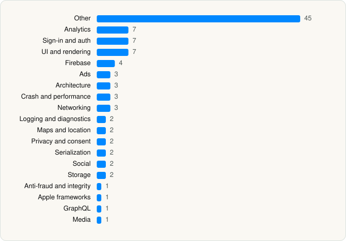

<picture><source media="(prefers-color-scheme: dark)" srcset="../../../../assets/logo/logo-dark.svg"></picture> [Tech Stack](../../../../README.md) / [Nextdoor](../../../../companies/nextdoor.md) / Nextdoor

# Nextdoor: Neighborhood Network

<picture><source media="(prefers-color-scheme: dark)" srcset="../../../../assets/badges/ios-dark.svg"></picture> <picture><source media="(prefers-color-scheme: dark)" srcset="../../../../assets/badges/active-dark.svg"></picture> <picture><source media="(prefers-color-scheme: dark)" srcset="../../../../assets/badges/floor-dark.svg"></picture> <picture><source media="(prefers-color-scheme: dark)" srcset="../../../../assets/badges/encrypted-dark.svg"></picture>

[App Store](https://apps.apple.com/app/id640360962) · [latest.json](latest.json)

| | |
|---|---|
| Company | [Nextdoor](../../../../companies/nextdoor.md) |
| Store id | `640360962` |
| Bundle / package id | `com.nextdoor.nextdoor` |
| Latest version | 6.201.2 (analysed 2026-06-19) |
| Versions tracked | 1 |
| SDKs in latest version | 98 |
| Languages | C/C++, Objective-C, Swift |
| UI | SwiftUI, UIKit |
| Build | Swift Package Manager (SwiftPM) |
| Minimum OS | iOS 17.0 (built with Xcode 26.3, SDK iphoneos26.2) |
| Devices / ABIs | iPhone, iPad |
| Localisations | 13 |
| Capabilities | 9 |
| Declares tracking | Yes |
| Tracked | Yes |

## SDKs by category

<picture><source media="(prefers-color-scheme: dark)" srcset="../../../../assets/charts/apps/ios/nextdoor/nextdoor-dark.svg"></picture>

- **Other** (45): AppLib, Blocks, combine-schedulers, ContactMap, CwlCatchException, CwlPreconditionTesting, dd-sdk-ios, EnableNotificationsPrompts, facebook-ios-sdk, gtm-session-fetcher, Incognia 6.17.0, IncogniaCore 6.17.0, IncogniaCoreWrapper, IncogniaTrial 6.17.0, IncogniaTrialWrapper, IncogniaWrapper, ios-branch-sdk-spm, LiveLocalUpdatesUI, Maps, MetaAdapter 6.21.1, mobile-sdk-ios, NDFoundation, NDSharing, NDUIKit, Nimble, Quick, Reactions, stream-chat-swift, StreamChat, swift-algorithms, swift-case-paths, swift-clocks, swift-concurrency-extras, swift-custom-dump, swift-dependencies, swift-identified-collections, swift-numerics, swift-package-manager-google-mobile-ads, swift-snapshot-testing, swift-syntax, swiftui-navigation, TrackingEventSchemas, Turf 4.0.0, turf-swift, xctest-dynamic-overlay
- **Analytics** (7): Branch, FacebookAEM, FacebookCore, FBAEMKit 1.0, FBSDKCoreKit 1.0, GoogleAppMeasurement, Qualtrics 2.17.0
- **Sign-in and auth** (7): AppAuth, BusinessSolutions, FacebookLogin, FBSDKLoginKit 1.0, GoogleSignIn, GTMAppAuth, GTMSessionFetcher
- **UI and rendering** (7): Charts, DGCharts, Lottie, Mantis, Nuke, StreamChatUI, SVGView
- **Firebase** (4): FBLPromises, GoogleUtilities, nanopb, Promises
- **Ads** (3): FBAudienceNetwork 1.0, Google Mobile Ads (AdMob), GoogleMobileAds 12.6.0
- **Architecture** (3): ComposableArchitecture, swift-composable-architecture, Swinject
- **Crash and performance** (3): DatadogCore, PLCrashReporter, Sentry 8.53.2
- **Networking** (3): Reachability.swift, socket.io-client-swift, Starscream
- **Logging and diagnostics** (2): FLEX, swift-log
- **Maps and location** (2): Mapbox 24.24.1, MapboxMaps
- **Privacy and consent** (2): Didomi 2.42.0, UserMessagingPlatform 3.1.0
- **Serialization** (2): swift-protobuf, SwiftProtobuf
- **Social** (2): FacebookShare, FBSDKShareKit 1.0
- **Storage** (2): SQLite.swift, swift-package-manager-google-user-messaging-platform
- **Anti-fraud and integrity** (1): Persona2 2.36.1
- **Apple frameworks** (1): swift-collections
- **GraphQL** (1): Apollo
- **Media** (1): GoogleInteractiveMediaAds 3.27.4

Frameworks (37)

AdServices (Apple Search Ads attribution), AdSupport (IDFA), App Tracking Transparency (ATT), Authentication Services (Sign in with Apple / passkeys), AVFoundation (audio/video), AVKit, CallKit (VoIP), Combine (reactive), Contacts, Core Data, Core Image, Core Location, Core Motion, CryptoKit, DeviceCheck / App Attest, EventKit (Calendar / Reminders), Local Authentication (Face ID / Touch ID), MapKit, Media Player, MessageUI (mail / SMS compose), MetalKit, MetricKit (diagnostics), Network.framework, PassKit (Wallet / Apple Pay), PDFKit, Photos, PhotosUI, SafariServices, SiriKit (Intents), StoreKit (in-app purchase), Swift Charts, SwiftData (persistence), SwiftUI, UIKit, User Notifications, Vision, VisionKit (document/data scanning)

Capabilities (9)

App Groups, Associated Domains (Universal Links), Background App Refresh, Background Processing, Background Push, Communication Notifications, Keychain Sharing, Push Notifications (APNs), Sign in with Apple

## Version history

| Version | Analysed | Store update | SDKs | Change | SDK list is a floor | Binary encrypted | File |
|---|---|---|---|---|---|---|---|
| 6.201.2 | 2026-06-19 |  | 98 |  | Yes | Yes | [6.201.2.json](6.201.2.json) |

---

Generated by `scripts/build_readme.py` from the JSON files. Do not edit by hand.
