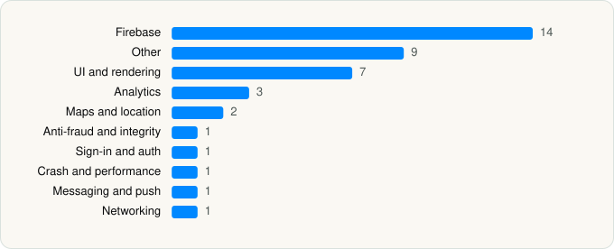

<picture><source media="(prefers-color-scheme: dark)" srcset="../../../../assets/logo/logo-dark.svg"></picture> [Tech Stack](../../../../README.md) / [noon E Commerce](../../../../companies/noon-e-commerce.md) / Dubai Mall Online

# Dubai Mall Online

<picture><source media="(prefers-color-scheme: dark)" srcset="../../../../assets/badges/ios-dark.svg"></picture> <picture><source media="(prefers-color-scheme: dark)" srcset="../../../../assets/badges/inactive-dark.svg"></picture> <picture><source media="(prefers-color-scheme: dark)" srcset="../../../../assets/badges/floor-dark.svg"></picture> <picture><source media="(prefers-color-scheme: dark)" srcset="../../../../assets/badges/encrypted-dark.svg"></picture>

[App Store](https://apps.apple.com/app/id6759314623) · [latest.json](latest.json)

| | |
|---|---|
| Company | [noon E Commerce](../../../../companies/noon-e-commerce.md) |
| Store id | `6759314623` |
| Bundle / package id | `com.shopdm.iosapp` |
| Latest version | 1.0.4 (analysed 2026-11-15) |
| Versions tracked | 1 |
| SDKs in latest version | 40 |
| Languages | C/C++, Metal (shaders), Objective-C, React Native / JavaScript, Swift |
| UI | SwiftUI, UIKit |
| Build | Swift Package Manager (SwiftPM) |
| Minimum OS | iOS 15.6 (built with Xcode 26.3, SDK iphoneos26.2) |
| Devices / ABIs | iPhone |
| Localisations | 3 |
| Capabilities | 4 |
| Declares tracking | Yes |
| Tracked | No. Kept for history. |

## SDKs by category

<picture><source media="(prefers-color-scheme: dark)" srcset="../../../../assets/charts/apps/ios/noon-e-commerce/dubai-mall-online-dark.svg"></picture>

- **Firebase** (14): FBLPromises 2.4.0, Firebase 11.5.0, FirebaseAuth 11.5.0, FirebaseCore 11.5.0, FirebaseCoreInternal 11.5.0, FirebaseFirestore 11.5.0, FirebaseInstallations 11.5.0, FirebaseRemoteConfig 11.5.0, GoogleDataTransport 10.1.0, GoogleUtilities 8.1.0, gRPC, leveldb 1.22.6, nanopb 3.30910.0, Promises 2.4.0
- **Other** (9): dayjs, Lodash, Moment.js, OpenSSL 3.6.0000, ReactNativeBlobUtilPrivacyInfo 0.22.2, RNCameraRollPrivacyInfo 7.10.2, RNImagePickerPrivacyInfo 7.2.3, RNPermissionsPrivacyInfo 5.3.0, xcprivacy 1.20240116.2
- **UI and rendering** (7): hermes 0.12.0, Lottie, React Native, React Native Reanimated, react-native-svg, RNSVGFilters 15.15.5, SDWebImage 5.21.3
- **Analytics** (3): Adjust 1.0, Amplitude, Facebook SDK
- **Maps and location** (2): GMSCore 6.51.0, GoogleMaps 7.4.0
- **Anti-fraud and integrity** (1): RecaptchaEnterprise 18.6.0
- **Sign-in and auth** (1): GTMSessionFetcher 4.5.0
- **Crash and performance** (1): FirebaseCrashlytics 11.5.0
- **Messaging and push** (1): FirebaseMessaging 11.5.0
- **Networking** (1): Axios

Frameworks (28)

AdServices (Apple Search Ads attribution), AdSupport (IDFA), App Tracking Transparency (ATT), Authentication Services (Sign in with Apple / passkeys), AVFoundation (audio/video), AVKit, Combine (reactive), Core Data, Core Image, Core Location, Core Motion, CryptoKit, DeviceCheck / App Attest, Local Authentication (Face ID / Touch ID), MapKit, Media Player, MessageUI (mail / SMS compose), MetricKit (diagnostics), Network.framework, PassKit (Wallet / Apple Pay), PDFKit, Photos, PhotosUI, SafariServices, StoreKit (in-app purchase), SwiftUI, UIKit, User Notifications

Capabilities (4)

Apple Pay, Associated Domains (Universal Links), Background Push, Push Notifications (APNs)

## Version history

| Version | Analysed | Store update | SDKs | Change | SDK list is a floor | Binary encrypted | File |
|---|---|---|---|---|---|---|---|
| 1.0.4 | 2026-11-15 |  | 40 |  | Yes | Yes | [1.0.4.json](1.0.4.json) |

---

Generated by `scripts/build_readme.py` from the JSON files. Do not edit by hand.
