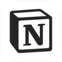
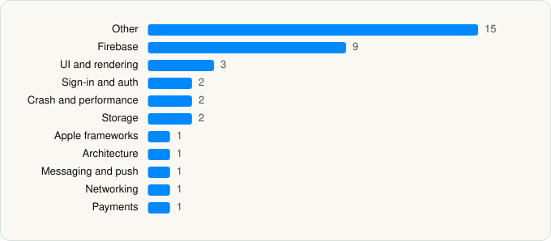

<picture><source media="(prefers-color-scheme: dark)" srcset="../../../../assets/logo/logo-dark.svg"></picture> [Tech Stack](../../../../README.md) / [Notion Labs, Incorporated](../../../../companies/notion-labs-incorporated.md) / Notion

# Notion: Notes, Tasks, AI

<picture><source media="(prefers-color-scheme: dark)" srcset="../../../../assets/badges/ios-dark.svg"></picture> <picture><source media="(prefers-color-scheme: dark)" srcset="../../../../assets/badges/active-dark.svg"></picture> <picture><source media="(prefers-color-scheme: dark)" srcset="../../../../assets/badges/floor-dark.svg"></picture> <picture><source media="(prefers-color-scheme: dark)" srcset="../../../../assets/badges/encrypted-dark.svg"></picture>

[App Store](https://apps.apple.com/app/id1232780281) · [latest.json](latest.json)

| | |
|---|---|
| Company | [Notion Labs, Incorporated](../../../../companies/notion-labs-incorporated.md) |
| Store id | `1232780281` |
| Bundle / package id | `notion.id` |
| Latest version | 0.4.2133 (analysed 2026-06-19) |
| Versions tracked | 2 |
| SDKs in latest version | 38 |
| Languages | C/C++, Objective-C, Swift |
| UI | SwiftUI, UIKit |
| Build | Swift Package Manager (SwiftPM) |
| Minimum OS | iOS 17.0 (built with Xcode 26.3, SDK iphoneos26.2) |
| Devices / ABIs | iPhone, iPad |
| Localisations | 22 |
| Capabilities | 11 |
| Declares tracking | No |
| Tracked | Yes |

## SDKs by category

<picture><source media="(prefers-color-scheme: dark)" srcset="../../../../assets/charts/apps/ios/notion-labs-incorporated/notion-dark.svg"></picture>

- **Other** (15): AppCoreUI, Asset, AssistantUI, DeviceKit, EmojiPickerUI, HomeFeature, IDSchemaFFI 1.0, IntuneMAMSwift 21.2.0, IntuneMAMSwiftStub 21.2.0, Lodash, MobileActionBarFeature, NfmParser 1.0, RecentsHomeFeature, RichTextUI, UpgradeFeature
- **Firebase** (9): FBLPromises, Firebase, FirebaseCore, FirebaseCoreInternal, FirebaseInstallations, GoogleDataTransport, GoogleUtilities, nanopb, Promises
- **UI and rendering** (3): KaTeX, Kingfisher, SwiftyGif
- **Sign-in and auth** (2): MSAL 2.5.1, PasskeyPromptFeature
- **Crash and performance** (2): FirebaseCrashlytics, Sentry 8.49.0
- **Storage** (2): GRDB, SQLiteService
- **Apple frameworks** (1): Collections 1.0
- **Architecture** (1): ComposableArchitecture
- **Messaging and push** (1): FirebaseMessaging
- **Networking** (1): Starscream
- **Payments** (1): RevenueCat

Frameworks (27)

ActivityKit (Live Activities), AdServices (Apple Search Ads attribution), App Intents, Authentication Services (Sign in with Apple / passkeys), AVFoundation (audio/video), AVKit, Background Tasks, Combine (reactive), Core Data, Core Image, CryptoKit, Group Activities (SharePlay), Local Authentication (Face ID / Touch ID), MessageUI (mail / SMS compose), MetricKit (diagnostics), Network.framework, Photos, PhotosUI, SafariServices, SiriKit (Intents), StoreKit (in-app purchase), Swift Charts, SwiftUI, UIKit, User Notifications, VisionKit (document/data scanning), WidgetKit (widgets)

Capabilities (11)

App Groups, Associated Domains (Universal Links), Background App Refresh, Background Audio, Background Processing, Background Push, Communication Notifications, Keychain Sharing, Push Notifications (APNs), Sign in with Apple, SiriKit

## Version history

| Version | Analysed | Store update | SDKs | Change | SDK list is a floor | Binary encrypted | File |
|---|---|---|---|---|---|---|---|
| 0.4.2133 | 2026-06-19 |  | 38 | +2 / −1 | Yes | Yes | [0.4.2133.json](0.4.2133.json) |
| 0.4.2130 | 2026-06-02 |  | 37 |  | Yes | Yes | [0.4.2130.json](0.4.2130.json) |

### SDK changes between versions

- 0.4.2130 → 0.4.2133: added KaTeX, Lodash; removed Sharing

---

Generated by `scripts/build_readme.py` from the JSON files. Do not edit by hand.
