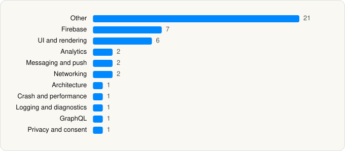

<picture><source media="(prefers-color-scheme: dark)" srcset="../../../../assets/logo/logo-dark.svg"></picture> [Tech Stack](../../../../README.md) / [Onskeskyen ApS](../../../../companies/onskeskyen-aps.md) / GoWish

# GoWish - Your Digital Wishlist

<picture><source media="(prefers-color-scheme: dark)" srcset="../../../../assets/badges/ios-dark.svg"></picture> <picture><source media="(prefers-color-scheme: dark)" srcset="../../../../assets/badges/inactive-dark.svg"></picture> <picture><source media="(prefers-color-scheme: dark)" srcset="../../../../assets/badges/floor-dark.svg"></picture> <picture><source media="(prefers-color-scheme: dark)" srcset="../../../../assets/badges/encrypted-dark.svg"></picture>

[App Store](https://apps.apple.com/app/id1605170923) · [latest.json](latest.json)

| | |
|---|---|
| Company | [Onskeskyen ApS](../../../../companies/onskeskyen-aps.md) |
| Store id | `1605170923` |
| Bundle / package id | `com.gowish.app` |
| Latest version | 9.2.4 (analysed 2026-11-02) |
| Versions tracked | 1 |
| SDKs in latest version | 45 |
| Languages | C/C++, Metal (shaders), Objective-C, React Native / JavaScript, Swift |
| UI | Intercom UI, Lottie (animations), SwiftUI, UIKit |
| Build | Swift Package Manager (SwiftPM) |
| Minimum OS | iOS 16.4 (built with Xcode 26.6, SDK iphoneos26.5) |
| Devices / ABIs | iPhone, iPad |
| Localisations | 12 |
| Capabilities | 4 |
| Declares tracking | Yes |
| Tracked | No. Kept for history. |

## SDKs by category

<picture><source media="(prefers-color-scheme: dark)" srcset="../../../../assets/charts/apps/ios/onskeskyen-aps/gowish-dark.svg"></picture>

- **Other** (21): boost, EXConstants 57.0.22, ExpoContacts 1.0, ExpoFileSystem 1.0, ExpoImage 1.0, ExpoMediaLibrary 1.0, ExpoModulesCore 1.0, ExpoModulesJSI 1.0, ExpoModulesWorklets 1.0, ExpoVideo 1.0, ExpoWidgets 57.0.27, EXUpdates 57.0.26, folly, hermesvm 1.0.0, libavif 1.0, Lodash, React 1.0, ReactNativeDependencies 1.0, RNDeviceInfoPrivacyInfo 14.1.1, RNViewShotPrivacyInfo 5.1.0, UsercentricsUI 2.28.1
- **Firebase** (7): FBLPromises 2.4.1, FirebaseCore 12.6.0, FirebaseCoreInternal 12.6.0, FirebaseInstallations 12.6.0, GoogleDataTransport 10.1.1, GoogleUtilities 8.1.5, nanopb 3.30910.0
- **UI and rendering** (6): Lottie 4.6.0, React Native, React Native Reanimated, react-native-svg, RNSVGFilters 15.15.4, SDWebImage 1.0
- **Analytics** (2): Amplitude 1.0, AppsFlyerLib 6.17.9
- **Messaging and push** (2): FirebaseMessaging 12.6.0, Intercom 19.5.7
- **Networking** (2): Axios, ReachabilitySwift 5.2.4
- **Architecture** (1): Redux
- **Crash and performance** (1): Sentry 8.58.0
- **Logging and diagnostics** (1): glog
- **GraphQL** (1): Apollo GraphQL
- **Privacy and consent** (1): Usercentrics 1.0

Frameworks (34)

ActivityKit (Live Activities), AdSupport (IDFA), App Intents, App Tracking Transparency (ATT), Authentication Services (Sign in with Apple / passkeys), AVFoundation (audio/video), AVKit, Combine (reactive), Contacts, Core Data, Core Image, Core Location, Core Motion, CryptoKit, DeviceCheck / App Attest, Local Authentication (Face ID / Touch ID), MapKit, Media Player, MessageUI (mail / SMS compose), MetalKit, MetricKit (diagnostics), Network.framework, PDFKit, Photos, PhotosUI, SafariServices, SiriKit (Intents), StoreKit (in-app purchase), Swift Charts, SwiftUI, UIKit, User Notifications, VisionKit (document/data scanning), WidgetKit (widgets)

Capabilities (4)

App Groups, Associated Domains (Universal Links), Background Push, Push Notifications (APNs)

## Version history

| Version | Analysed | Store update | SDKs | Change | SDK list is a floor | Binary encrypted | File |
|---|---|---|---|---|---|---|---|
| 9.2.4 | 2026-11-02 |  | 45 |  | Yes | Yes | [9.2.4.json](9.2.4.json) |

---

Generated by `scripts/build_readme.py` from the JSON files. Do not edit by hand.
