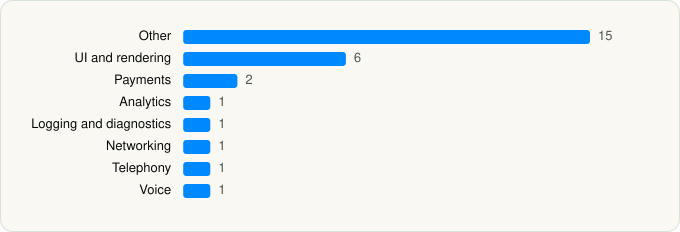

<picture><source media="(prefers-color-scheme: dark)" srcset="../../../../assets/logo/logo-dark.svg"></picture> [Tech Stack](../../../../README.md) / [OpenAI OpCo, LLC](../../../../companies/openai-opco-llc.md) / ChatGPT

# ChatGPT

<picture><source media="(prefers-color-scheme: dark)" srcset="../../../../assets/badges/ios-dark.svg"></picture> <picture><source media="(prefers-color-scheme: dark)" srcset="../../../../assets/badges/active-dark.svg"></picture> <picture><source media="(prefers-color-scheme: dark)" srcset="../../../../assets/badges/floor-dark.svg"></picture> <picture><source media="(prefers-color-scheme: dark)" srcset="../../../../assets/badges/encrypted-dark.svg"></picture>

[App Store](https://apps.apple.com/app/id6448311069) · [latest.json](latest.json)

| | |
|---|---|
| Company | [OpenAI OpCo, LLC](../../../../companies/openai-opco-llc.md) |
| Store id | `6448311069` |
| Bundle / package id | `com.openai.chat` |
| Latest version | 1.2026.286 (analysed 2026-10-23) |
| Versions tracked | 3 |
| SDKs in latest version | 28 |
| Languages | C/C++, Metal (shaders), Objective-C, Swift |
| UI | Lottie (animations), SwiftUI, UIKit |
| Build | Swift Package Manager (SwiftPM) |
| Minimum OS | iOS 18.0 (built with Xcode 27.1, SDK iphoneos27.1) |
| Devices / ABIs | iPhone, iPad |
| Localisations | 64 |
| Capabilities | 13 |
| Declares tracking | No |
| Tracked | Yes |

## SDKs by category

<picture><source media="(prefers-color-scheme: dark)" srcset="../../../../assets/charts/apps/ios/openai-opco-llc/chatgpt-dark.svg"></picture>

- **Other** (15): CalpicoCoreUI, CodexRemoteCore, CodexRemoteThread, DeviceHaptics, DotBall, EmojiKit, Environment, ExperianIDVerifySDK 0.1.1, Network, OAIEmojiPicker, OrbitCharacters, SwiftCSV, Threads, TibroCore, TibroVoiceBackground
- **UI and rendering** (6): Highlight.js 11.11.1, Highlightr, KaTeX, Kingfisher, Lottie 4.6.1, OAIMarkdown
- **Payments** (2): LinkKit 6.5.2, Stripe
- **Analytics** (1): Segment
- **Logging and diagnostics** (1): Logger
- **Networking** (1): Reachability
- **Telephony** (1): PhoneNumberKit
- **Voice** (1): LiveKit 1.0

Frameworks (46)

ActivityKit (Live Activities), AdServices (Apple Search Ads attribution), AdSupport (IDFA), App Intents, App Tracking Transparency (ATT), Authentication Services (Sign in with Apple / passkeys), AVFoundation (audio/video), AVKit, Background Tasks, CallKit (VoIP), Combine (reactive), Contacts, Core Data, Core Image, Core Location, Core Motion, CryptoKit, DeviceCheck / App Attest, EventKit (Calendar / Reminders), HealthKit, Local Authentication (Face ID / Touch ID), MapKit, Media Player, MessageUI (mail / SMS compose), MetalKit, MetricKit (diagnostics), Natural Language, Network.framework, PassKit (Wallet / Apple Pay), PDFKit, PencilKit, Photos, PhotosUI, PushKit (VoIP push), SafariServices, SceneKit, SiriKit (Intents), Speech (recognition), StoreKit (in-app purchase), Swift Charts, SwiftUI, UIKit, User Notifications, Vision, VisionKit (document/data scanning), WidgetKit (widgets)

Capabilities (13)

App Groups, Apple Pay, Associated Domains (Universal Links), Background Audio, Background Push, CarPlay, Communication Notifications, HealthKit, Keychain Sharing, Push Notifications (APNs), Sign in with Apple, Time-Sensitive Notifications, VoIP

## Version history

| Version | Analysed | Store update | SDKs | Change | SDK list is a floor | Binary encrypted | File |
|---|---|---|---|---|---|---|---|
| 1.2026.286 | 2026-10-23 | 2026-10-22 | 28 | +10 / −24 | Yes | Yes | [1.2026.286.json](1.2026.286.json) |
| 1.2026.146 | 2026-06-19 |  | 42 | +3 / −3 | Yes | Yes | [1.2026.146.json](1.2026.146.json) |
| 1.2026.139 | 2026-06-01 |  | 42 |  | Yes | Yes | [1.2026.139.json](1.2026.139.json) |

### SDK changes between versions

- 1.2026.146 → 1.2026.286: added DotBall, Environment, ExperianIDVerifySDK, Logger, Network, OAIEmojiPicker, OrbitCharacters, Reachability, TibroCore, TibroVoiceBackground; removed Account, APIClient, APICore, Auth0, CalpicoCore, CodexAppServer, CodexRemote, CodexRemoteHost, CodexRemoteModels, Conversations, ConversationsCore, DatadogCore, DevicePhotos, Factory, Files, FileUploadService, OAIDiff, OAIStatsig, PhoneNumberUI, PhoneVerification, SharedSettings, SwiftUIStyleguide, Transceiver, Users
- 1.2026.139 → 1.2026.146: added CodexAppServer, Highlight.js, KaTeX; removed Assets, Localization, Onboarding

---

Generated by `scripts/build_readme.py` from the JSON files. Do not edit by hand.
