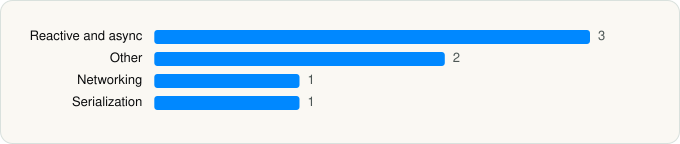

<picture><source media="(prefers-color-scheme: dark)" srcset="../../../../assets/logo/logo-dark.svg"></picture> [Tech Stack](../../../../README.md) / [국민건강보험공단](../../../../companies/or.md) / 모바일 건강보험증

# 모바일 건강보험증

<picture><source media="(prefers-color-scheme: dark)" srcset="../../../../assets/badges/ios-dark.svg"></picture> <picture><source media="(prefers-color-scheme: dark)" srcset="../../../../assets/badges/inactive-dark.svg"></picture> <picture><source media="(prefers-color-scheme: dark)" srcset="../../../../assets/badges/floor-dark.svg"></picture> <picture><source media="(prefers-color-scheme: dark)" srcset="../../../../assets/badges/encrypted-dark.svg"></picture>

[App Store](https://apps.apple.com/app/id6444602589) · [latest.json](latest.json)

| | |
|---|---|
| Company | [국민건강보험공단](../../../../companies/or.md) |
| Store id | `6444602589` |
| Bundle / package id | `kr.or.nhiq` |
| Latest version | 3.43.0 (analysed 2026-11-21) |
| Versions tracked | 1 |
| SDKs in latest version | 7 |
| Languages | C/C++, Objective-C, Swift |
| UI | UIKit |
| Build | Swift Package Manager (SwiftPM) |
| Minimum OS | iOS 13.0 (built with Xcode 26.0.1, SDK iphoneos26.0) |
| Devices / ABIs | iPhone |
| Localisations | 5 |
| Capabilities | 2 |
| Declares tracking | No |
| Tracked | No. Kept for history. |

## SDKs by category

<picture><source media="(prefers-color-scheme: dark)" srcset="../../../../assets/charts/apps/ios/or/app-dark.svg"></picture>

- **Reactive and async** (3): RxCocoa 6.9.0, RxRelay 6.9.0, RxSwift 6.9.0
- **Other** (2): bio 1.0, iScreenSAFER 1.1.00
- **Networking** (1): Alamofire 5.11.2
- **Serialization** (1): SwiftyJSON 5.0.2

Frameworks (9)

AVFoundation (audio/video), Combine (reactive), Core Image, Core NFC, CryptoKit, Local Authentication (Face ID / Touch ID), MessageUI (mail / SMS compose), Network.framework, UIKit

Capabilities (2)

Background Push, Push Notifications (APNs)

## Version history

| Version | Analysed | Store update | SDKs | Change | SDK list is a floor | Binary encrypted | File |
|---|---|---|---|---|---|---|---|
| 3.43.0 | 2026-11-21 |  | 7 |  | Yes | Yes | [3.43.0.json](3.43.0.json) |

---

Generated by `scripts/build_readme.py` from the JSON files. Do not edit by hand.
