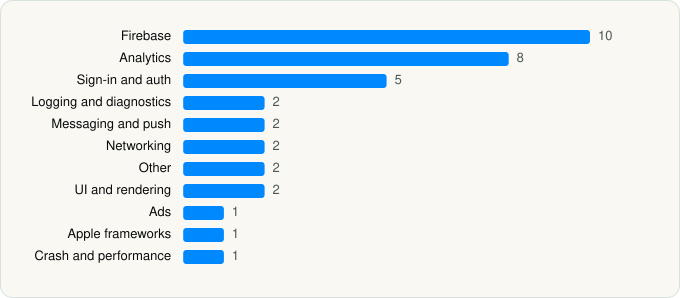

<picture><source media="(prefers-color-scheme: dark)" srcset="../../../../assets/logo/logo-dark.svg"></picture> [Tech Stack](../../../../README.md) / [Otter.ai, Inc.](../../../../companies/otter-ai-inc.md) / Otter Transcribe Voice Notes

# Otter Transcribe Voice Notes

<picture><source media="(prefers-color-scheme: dark)" srcset="../../../../assets/badges/ios-dark.svg"></picture> <picture><source media="(prefers-color-scheme: dark)" srcset="../../../../assets/badges/active-dark.svg"></picture> <picture><source media="(prefers-color-scheme: dark)" srcset="../../../../assets/badges/floor-dark.svg"></picture> <picture><source media="(prefers-color-scheme: dark)" srcset="../../../../assets/badges/encrypted-dark.svg"></picture>

[App Store](https://apps.apple.com/app/id1276437113) · [latest.json](latest.json)

| | |
|---|---|
| Company | [Otter.ai, Inc.](../../../../companies/otter-ai-inc.md) |
| Store id | `1276437113` |
| Bundle / package id | `com.aisense.otter` |
| Latest version | 3.111.0 (analysed 2026-11-10) |
| Versions tracked | 2 |
| SDKs in latest version | 36 |
| Languages | C/C++, Objective-C, Swift |
| UI | Lottie (animations), SwiftUI, UIKit |
| Build | Swift Package Manager (SwiftPM) |
| Minimum OS | iOS 16.0 (built with Xcode 27.1, SDK iphoneos27.1) |
| Devices / ABIs | iPhone, iPad |
| Localisations | 1 |
| Capabilities | 10 |
| Declares tracking | Yes |
| Tracked | Yes |

## SDKs by category

<picture><source media="(prefers-color-scheme: dark)" srcset="../../../../assets/charts/apps/ios/otter-ai-inc/otter-transcribe-voice-notes-dark.svg"></picture>

- **Firebase** (10): FBLPromises, Firebase, FirebaseCore, FirebaseCoreInternal, FirebaseInstallations, FirebaseRemoteConfig, GoogleDataTransport, GoogleUtilities, nanopb, Promises
- **Analytics** (8): Amplitude, AppsFlyerLib 1.0, BrazeKit 15.1.0, FirebaseAnalytics 11.15.0, GoogleAppMeasurement 11.15.0, GoogleAppMeasurementIdentitySupport 11.15.0, RudderStackAnalytics, UserLeapKit 4.8.5
- **Sign-in and auth** (5): AppAuth, GoogleSignIn, GTMAppAuth, GTMSessionFetcher, MSAL 1.9.0
- **Logging and diagnostics** (2): CocoaLumberjack, Logger 1.0
- **Messaging and push** (2): BrazeUI, OneSignal 1.0
- **Networking** (2): Alamofire, Starscream
- **Other** (2): SwiftExtensions 1.0, SwiftyDropbox
- **UI and rendering** (2): Lottie 4.5.2, SDWebImage
- **Ads** (1): GoogleAdsOnDeviceConversion 2.1.0
- **Apple frameworks** (1): OrderedCollections 1.0
- **Crash and performance** (1): FirebaseCrashlytics

Frameworks (28)

ActivityKit (Live Activities), AdSupport (IDFA), App Intents, App Tracking Transparency (ATT), Authentication Services (Sign in with Apple / passkeys), AVFoundation (audio/video), Background Tasks, Combine (reactive), Contacts, Core Image, Core Motion, CryptoKit, DeviceCheck / App Attest, EventKit (Calendar / Reminders), Local Authentication (Face ID / Touch ID), MapKit, Media Player, MetricKit (diagnostics), Network.framework, Photos, PhotosUI, SafariServices, SiriKit (Intents), StoreKit (in-app purchase), SwiftUI, UIKit, User Notifications, WidgetKit (widgets)

Capabilities (10)

App Groups, Associated Domains (Universal Links), Background App Refresh, Background Audio, Background Processing, Background Push, Keychain Sharing, Push Notifications (APNs), Sign in with Apple, SiriKit

## Version history

| Version | Analysed | Store update | SDKs | Change | SDK list is a floor | Binary encrypted | File |
|---|---|---|---|---|---|---|---|
| 3.111.0 | 2026-11-10 | 2026-10-30 | 36 | +0 / −0 | Yes | Yes | [3.111.0.json](3.111.0.json) |
| 3.110.1 | 2026-10-24 | 2026-10-22 | 36 |  | Yes | Yes | [3.110.1.json](3.110.1.json) |

---

Generated by `scripts/build_readme.py` from the JSON files. Do not edit by hand.
