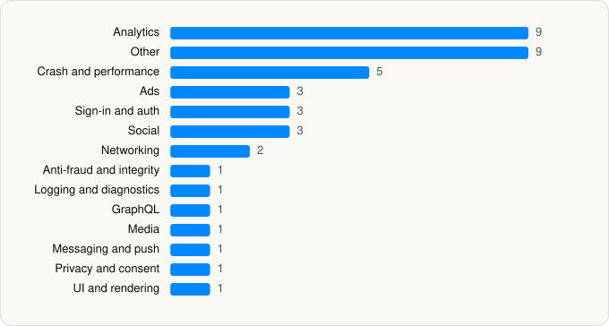

<picture><source media="(prefers-color-scheme: dark)" srcset="../../../../assets/logo/logo-dark.svg"></picture> [Tech Stack](../../../../README.md) / [Pandora Media, LLC](../../../../companies/pandora-media-llc.md) / Pandora

# Pandora: Music & Podcasts

<picture><source media="(prefers-color-scheme: dark)" srcset="../../../../assets/badges/ios-dark.svg"></picture> <picture><source media="(prefers-color-scheme: dark)" srcset="../../../../assets/badges/active-dark.svg"></picture> <picture><source media="(prefers-color-scheme: dark)" srcset="../../../../assets/badges/floor-dark.svg"></picture> <picture><source media="(prefers-color-scheme: dark)" srcset="../../../../assets/badges/encrypted-dark.svg"></picture>

[App Store](https://apps.apple.com/app/id284035177) · [latest.json](latest.json)

| | |
|---|---|
| Company | [Pandora Media, LLC](../../../../companies/pandora-media-llc.md) |
| Store id | `284035177` |
| Bundle / package id | `com.pandora` |
| Latest version | 2606.1 (analysed 2026-06-19) |
| Versions tracked | 1 |
| SDKs in latest version | 41 |
| Languages | C/C++, Objective-C, Swift |
| UI | SwiftUI, UIKit |
| Build | Swift Package Manager (SwiftPM) |
| Minimum OS | iOS 15.0 (built with Xcode 26.0.1, SDK iphoneos26.0) |
| Devices / ABIs | iPhone, iPad |
| Localisations | 0 |
| Capabilities | 10 |
| Declares tracking | Yes |
| Tracked | Yes |

## SDKs by category

<picture><source media="(prefers-color-scheme: dark)" srcset="../../../../assets/charts/apps/ios/pandora-media-llc/pandora-dark.svg"></picture>

- **Analytics** (9): AEPCore, AEPServices, Branch, ComScore 1.0, FacebookAEM, FacebookCore, FBAEMKit 1.0, FBSDKCoreKit 1.0, SCSDKCoreKit 2.5.0
- **Other** (9): AdswizzSDK 7.13.5, AdswizzSDKCore 7.13.5, AdswizzSDKPrivacyDataCore 1.0, BMWAppKitIdentities, ConfigCore 1.0, Filters 1.0, HoundifySDK 1.2.3, StatsCollector, WazeAudio 1.3
- **Crash and performance** (5): Datadog 1.0, DatadogCore, DatadogCrashReporting, DatadogRUM, KSCrash
- **Ads** (3): Google Mobile Ads (AdMob), GoogleMobileAds 11.3.0, ProgrammaticAccessLibrary 2.5.3
- **Sign-in and auth** (3): FacebookLogin, FBSDKLoginKit 1.0, SCSDKLoginKit 2.5.0
- **Social** (3): FacebookShare, FBSDKShareKit 1.0, SCSDKCreativeKit 2.5.0
- **Networking** (2): AFNetworking 1.0, Alamofire
- **Anti-fraud and integrity** (1): HUMAN 4.3.2
- **Logging and diagnostics** (1): Logging 1.0
- **GraphQL** (1): GraphQLService 1.0
- **Media** (1): GoogleCast
- **Messaging and push** (1): Airship
- **Privacy and consent** (1): UserMessagingPlatform 2.3.0
- **UI and rendering** (1): SDWebImage

Frameworks (30)

ActivityKit (Live Activities), AdServices (Apple Search Ads attribution), AdSupport (IDFA), App Tracking Transparency (ATT), Authentication Services (Sign in with Apple / passkeys), AVFoundation (audio/video), AVKit, CallKit (VoIP), Combine (reactive), Contacts, Core Data, Core Image, Core Location, Core Motion, CryptoKit, DeviceCheck / App Attest, EventKit (Calendar / Reminders), Media Player, MessageUI (mail / SMS compose), Network.framework, Photos, SafariServices, SiriKit (Intents), Speech (recognition), StoreKit (in-app purchase), SwiftUI, UIKit, User Notifications, Watch Connectivity, WidgetKit (widgets)

Capabilities (10)

App Groups, Associated Domains (Universal Links), Background App Refresh, Background Audio, Background Push, CarPlay, External Accessory, Multipath networking, Push Notifications (APNs), SiriKit

## Version history

| Version | Analysed | Store update | SDKs | Change | SDK list is a floor | Binary encrypted | File |
|---|---|---|---|---|---|---|---|
| 2606.1 | 2026-06-19 |  | 41 |  | Yes | Yes | [2606.1.json](2606.1.json) |

---

Generated by `scripts/build_readme.py` from the JSON files. Do not edit by hand.
