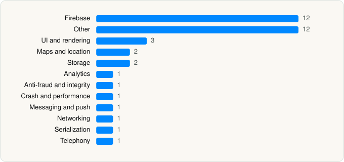

<picture><source media="(prefers-color-scheme: dark)" srcset="../../../../assets/logo/logo-dark.svg"></picture> [Tech Stack](../../../../README.md) / [Parkin PJSC](../../../../companies/parkin-pjsc.md) / Parkin

# Parkin

<picture><source media="(prefers-color-scheme: dark)" srcset="../../../../assets/badges/ios-dark.svg"></picture> <picture><source media="(prefers-color-scheme: dark)" srcset="../../../../assets/badges/inactive-dark.svg"></picture> <picture><source media="(prefers-color-scheme: dark)" srcset="../../../../assets/badges/floor-dark.svg"></picture> <picture><source media="(prefers-color-scheme: dark)" srcset="../../../../assets/badges/encrypted-dark.svg"></picture>

[App Store](https://apps.apple.com/app/id6657993734) · [latest.json](latest.json)

| | |
|---|---|
| Company | [Parkin PJSC](../../../../companies/parkin-pjsc.md) |
| Store id | `6657993734` |
| Bundle / package id | `com.parkin.parkinapp` |
| Latest version | 1.7.2 (analysed 2026-11-10) |
| Versions tracked | 1 |
| SDKs in latest version | 38 |
| Languages | C/C++, Metal (shaders), Objective-C, Swift |
| UI | Lottie (animations), SwiftUI, UIKit |
| Build | Swift Package Manager (SwiftPM) |
| Minimum OS | iOS 15.0 (built with Xcode 26.6, SDK iphoneos26.5) |
| Devices / ABIs | iPhone |
| Localisations | 2 |
| Capabilities | 10 |
| Declares tracking | Yes |
| Tracked | No. Kept for history. |

## SDKs by category

<picture><source media="(prefers-color-scheme: dark)" srcset="../../../../assets/charts/apps/ios/parkin-pjsc/parkin-dark.svg"></picture>

- **Firebase** (12): AppCheck 11.3.2, FBLPromises 2.4.1, Firebase 12.19.0, FirebaseAppCheck 12.19.0, FirebaseCore 12.19.0, FirebaseCoreInternal 12.19.0, FirebaseInstallations 12.19.0, FirebaseRemoteConfig 12.19.0, GoogleDataTransport 10.1.1, GoogleUtilities 8.1.4, nanopb 3.30910.0, Promises 2.4.1
- **Other** (12): Cosmos, GooglePlaces 9.4.1, GooglePlacesSwift 0.5.1, IQKeyboardCore, IQKeyboardManagerSwift, IQKeyboardNotification, IQKeyboardReturnManager, IQKeyboardToolbar, IQKeyboardToolbarManager, IQTextInputViewNotification, IQTextView, WearEngineSDK
- **UI and rendering** (3): DGCharts 5.1.0, Kingfisher, Lottie 4.6.1
- **Maps and location** (2): GMSCore 6.98.0, GoogleMaps 8.4.0
- **Storage** (2): SQLite, ZIPFoundation 0.9.19
- **Analytics** (1): AppsFlyerLib 1.0
- **Anti-fraud and integrity** (1): RecaptchaInterop 101.0.0
- **Crash and performance** (1): FirebaseCrashlytics 12.19.0
- **Messaging and push** (1): OneSignal 1.0
- **Networking** (1): Alamofire
- **Serialization** (1): SwiftyJSON
- **Telephony** (1): PhoneNumberKit

Frameworks (31)

ActivityKit (Live Activities), AdSupport (IDFA), App Intents, App Tracking Transparency (ATT), AVFoundation (audio/video), Combine (reactive), Contacts, Core Bluetooth, Core Data, Core Image, Core Location, CryptoKit, DeviceCheck / App Attest, EventKit (Calendar / Reminders), Local Authentication (Face ID / Touch ID), MapKit, MessageUI (mail / SMS compose), Network.framework, PassKit (Wallet / Apple Pay), PDFKit, Photos, SafariServices, SiriKit (Intents), Speech (recognition), StoreKit (in-app purchase), Swift Charts, SwiftUI, UIKit, User Notifications, Watch Connectivity, WidgetKit (widgets)

Capabilities (10)

App Groups, Apple Pay, Associated Domains (Universal Links), Background App Refresh, Background Processing, Background Push, CarPlay, Keychain Sharing, Push Notifications (APNs), SiriKit

## Version history

| Version | Analysed | Store update | SDKs | Change | SDK list is a floor | Binary encrypted | File |
|---|---|---|---|---|---|---|---|
| 1.7.2 | 2026-11-10 |  | 38 |  | Yes | Yes | [1.7.2.json](1.7.2.json) |

---

Generated by `scripts/build_readme.py` from the JSON files. Do not edit by hand.
