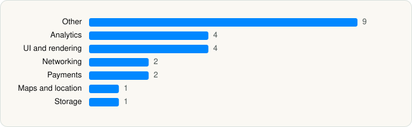

<picture><source media="(prefers-color-scheme: dark)" srcset="../../../../assets/logo/logo-dark.svg"></picture> [Tech Stack](../../../../README.md) / [Partiful](../../../../companies/partiful.md) / Partiful

# Partiful: Party Invite Maker

<picture><source media="(prefers-color-scheme: dark)" srcset="../../../../assets/badges/ios-dark.svg"></picture> <picture><source media="(prefers-color-scheme: dark)" srcset="../../../../assets/badges/inactive-dark.svg"></picture> <picture><source media="(prefers-color-scheme: dark)" srcset="../../../../assets/badges/floor-dark.svg"></picture> <picture><source media="(prefers-color-scheme: dark)" srcset="../../../../assets/badges/encrypted-dark.svg"></picture>

[App Store](https://apps.apple.com/app/id1662982304) · [latest.json](latest.json)

| | |
|---|---|
| Company | [Partiful](../../../../companies/partiful.md) |
| Store id | `1662982304` |
| Bundle / package id | `com.partiful.partiful` |
| Latest version | 3.10.23 (analysed 2026-11-02) |
| Versions tracked | 1 |
| SDKs in latest version | 23 |
| Languages | C/C++, Metal (shaders), Objective-C, React Native / JavaScript, Swift |
| UI | Lottie (animations), SwiftUI, UIKit |
| Build | Swift Package Manager (SwiftPM) |
| Minimum OS | iOS 16.4 (built with Xcode 26.6, SDK iphoneos26.5) |
| Devices / ABIs | iPhone |
| Localisations | 1 |
| Capabilities | 8 |
| Declares tracking | Yes |
| Tracked | No. Kept for history. |

## SDKs by category

<picture><source media="(prefers-color-scheme: dark)" srcset="../../../../assets/charts/apps/ios/partiful/partiful-dark.svg"></picture>

- **Other** (9): dayjs, EXConstants 57.0.17, ExpoModulesJSI 1.0, EXUpdates 57.0.17, GiphyUISDK 2.2.16, hermesvm 1.0.0, Lodash, MapLibre 6.26.0, PurchasesHybridCommon 19.14.1
- **Analytics** (4): Amplitude 1.0, Branch 3.12.2, Mixpanel, Segment 1.7.3
- **UI and rendering** (4): Lottie 4.6.0, React Native Reanimated, RNSVGFilters 15.15.4, SDWebImage 5.21.7
- **Networking** (2): Axios, ReachabilitySwift 5.2.4
- **Payments** (2): RevenueCat, Stripe 25.10.0
- **Maps and location** (1): Mapbox
- **Storage** (1): MMKV

Frameworks (35)

ActivityKit (Live Activities), AdServices (Apple Search Ads attribution), Authentication Services (Sign in with Apple / passkeys), AVFoundation (audio/video), AVKit, Combine (reactive), Contacts, Core Data, Core Image, Core Location, Core Motion, CryptoKit, DeviceCheck / App Attest, EventKit (Calendar / Reminders), Local Authentication (Face ID / Touch ID), MapKit, Media Player, MessageUI (mail / SMS compose), MetalKit, MetricKit (diagnostics), Network.framework, PassKit (Wallet / Apple Pay), PDFKit, Photos, PhotosUI, SafariServices, SiriKit (Intents), StoreKit (in-app purchase), Swift Charts, SwiftUI, UIKit, User Notifications, Vision, VisionKit (document/data scanning), WidgetKit (widgets)

Capabilities (8)

App Groups, Apple Pay, Associated Domains (Universal Links), Background App Refresh, Background Push, Communication Notifications, Push Notifications (APNs), Wallet passes

## Version history

| Version | Analysed | Store update | SDKs | Change | SDK list is a floor | Binary encrypted | File |
|---|---|---|---|---|---|---|---|
| 3.10.23 | 2026-11-02 |  | 23 |  | Yes | Yes | [3.10.23.json](3.10.23.json) |

---

Generated by `scripts/build_readme.py` from the JSON files. Do not edit by hand.
