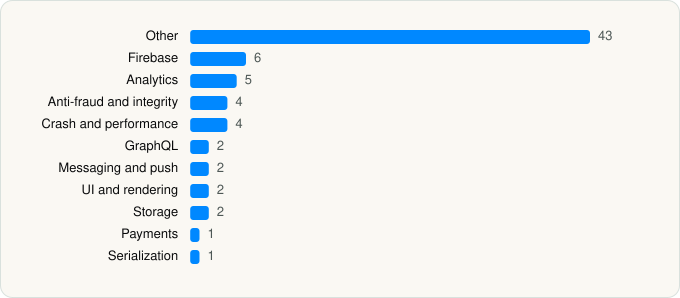

<picture><source media="(prefers-color-scheme: dark)" srcset="../../../../assets/logo/logo-dark.svg"></picture> [Tech Stack](../../../../README.md) / [PayPal, Inc.](../../../../companies/paypal-inc.md) / PayPal

# PayPal - Pay, Send, Save

<picture><source media="(prefers-color-scheme: dark)" srcset="../../../../assets/badges/ios-dark.svg"></picture> <picture><source media="(prefers-color-scheme: dark)" srcset="../../../../assets/badges/active-dark.svg"></picture> <picture><source media="(prefers-color-scheme: dark)" srcset="../../../../assets/badges/floor-dark.svg"></picture> <picture><source media="(prefers-color-scheme: dark)" srcset="../../../../assets/badges/encrypted-dark.svg"></picture>

[App Store](https://apps.apple.com/app/id283646709) · [latest.json](latest.json)

| | |
|---|---|
| Company | [PayPal, Inc.](../../../../companies/paypal-inc.md) |
| Store id | `283646709` |
| Bundle / package id | `com.yourcompany.PPClient` |
| Latest version | 10.8.1 (analysed 2026-10-24) |
| Versions tracked | 1 |
| SDKs in latest version | 72 |
| Languages | C/C++, Objective-C, Swift |
| UI | Lottie (animations), SwiftUI, UIKit |
| Build | Swift Package Manager (SwiftPM) |
| Minimum OS | iOS 17.4 (built with Xcode 26.2, SDK iphoneos26.2) |
| Devices / ABIs | iPhone |
| Localisations | 37 |
| Capabilities | 10 |
| Declares tracking | Yes |
| Tracked | Yes |

## SDKs by category

<picture><source media="(prefers-color-scheme: dark)" srcset="../../../../assets/charts/apps/ios/paypal-inc/paypal-dark.svg"></picture>

- **Other** (43): Connect 3.1.1, CoreDataDome 1.0, CryptoSwift 1.8.4, DaonDocument 1.9.0, DaonFaceQuality 3.2.1, DaonFaceSDK 5.1.1, DyScan 1.0, FaceTecSDK 9.7.137, HceSdk 1.2.1, IngoCoreUx 7.3.2, IngoSdk 7.3.2, IngoSdkUx 7.3.2, IngoSDKWrapper, IngoSharedSdk 1.0, iZettleSDK 4.67.0, KnotAPI 1.1.1, Lodash, LuciqSDK 19.7.0, MChipEngine 1.0, Microblink 5.18.0, MiSnap 5.11.1, MiSnapAssetManager 5.11.1, MiSnapBarcodeScanner 5.11.1, MiSnapCamera 5.11.1, MiSnapCore 5.11.1, MiSnapScience 5.11.1, MiSnapUX 5.11.1, MobileFlow 3.48.0, MobileProtect 26.4.4, MobileProtectTelemetry 26.4.4, Mpsdk 1.0, MpsdkComponentInterface 1.0, MpsdkHttpManager 1.0, MpsdkRemoteManagement 1.0, OpenSSL 3.6.0001, PDSCore 1.0, PDSTokens, SwiftBigInt 6.0.1, Threads, TrustKit, TSHPaySDK 7.2.3, VIHCEFramework 1.0, ZettleTapToPay 4.67.0
- **Firebase** (6): FBLPromises, FirebaseCore, FirebaseCoreInternal, FirebaseInstallations, GoogleDataTransport, GoogleUtilities 1.0
- **Analytics** (5): Adjust 1.0, AdjustSdk, AEPCore, AEPServices, Qualtrics 2.37.0
- **Anti-fraud and integrity** (4): DaonFaceLivenessBlink 5.1.1, FraudForce 5.6.0, MobileProtectAntiFraud 26.4.4, PPRiskMagnes
- **Crash and performance** (4): DatadogCore, DatadogCrashReporting, DatadogRUM, KSCrash
- **GraphQL** (2): Apollo, ApolloAPI
- **Messaging and push** (2): FirebaseMessaging, OneSignal
- **UI and rendering** (2): Lottie 4.5.2, React Native
- **Storage** (2): KeychainAccess 4.2.2, MpsdkDatabase 1.0
- **Payments** (1): LinkKit
- **Serialization** (1): SwiftProtobuf

Frameworks (36)

AdSupport (IDFA), App Tracking Transparency (ATT), Authentication Services (Sign in with Apple / passkeys), AVFoundation (audio/video), AVKit, Background Tasks, Combine (reactive), Contacts, Core Data, Core Image, Core Location, Core ML, Core Motion, Core NFC, CryptoKit, DeviceCheck / App Attest, Local Authentication (Face ID / Touch ID), MapKit, MessageUI (mail / SMS compose), MetricKit (diagnostics), Network.framework, PassKit (Wallet / Apple Pay), PDFKit, PencilKit, Photos, PhotosUI, SafariServices, SceneKit, StoreKit (in-app purchase), Swift Charts, SwiftData (persistence), SwiftUI, UIKit, User Notifications, Vision, Watch Connectivity

Capabilities (10)

App Groups, Associated Domains (Universal Links), Background App Refresh, Background Audio, Background Push, Keychain Sharing, NFC, Push Notifications (APNs), Time-Sensitive Notifications, VoIP

## Version history

| Version | Analysed | Store update | SDKs | Change | SDK list is a floor | Binary encrypted | File |
|---|---|---|---|---|---|---|---|
| 10.8.1 | 2026-10-24 | 2026-10-22 | 72 |  | Yes | Yes | [10.8.1.json](10.8.1.json) |

---

Generated by `scripts/build_readme.py` from the JSON files. Do not edit by hand.
