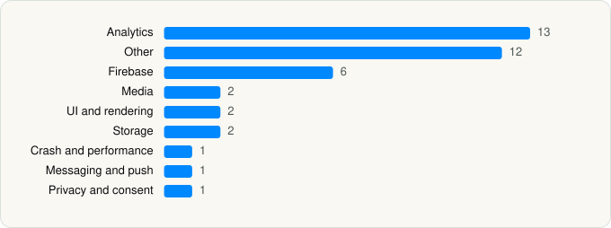

<picture><source media="(prefers-color-scheme: dark)" srcset="../../../../assets/logo/logo-dark.svg"></picture> [Tech Stack](../../../../README.md) / [Peacock TV LLC](../../../../companies/peacock-tv-llc.md) / Peacock TV

# Peacock TV: Stream TV & Movies

<picture><source media="(prefers-color-scheme: dark)" srcset="../../../../assets/badges/ios-dark.svg"></picture> <picture><source media="(prefers-color-scheme: dark)" srcset="../../../../assets/badges/active-dark.svg"></picture> <picture><source media="(prefers-color-scheme: dark)" srcset="../../../../assets/badges/floor-dark.svg"></picture> <picture><source media="(prefers-color-scheme: dark)" srcset="../../../../assets/badges/encrypted-dark.svg"></picture>

[App Store](https://apps.apple.com/app/id1508186374) · [latest.json](latest.json)

| | |
|---|---|
| Company | [Peacock TV LLC](../../../../companies/peacock-tv-llc.md) |
| Store id | `1508186374` |
| Bundle / package id | `com.peacocktv.peacock` |
| Latest version | 7.5.21 (analysed 2026-06-19) |
| Versions tracked | 1 |
| SDKs in latest version | 40 |
| Languages | C/C++, Objective-C, Swift |
| UI | Lottie (animations), SwiftUI, UIKit |
| Build | Swift Package Manager (SwiftPM) |
| Minimum OS | iOS 16.0 (built with Xcode 26.3, SDK iphoneos26.2) |
| Devices / ABIs | iPhone, iPad |
| Localisations | 21 |
| Capabilities | 5 |
| Declares tracking | Yes |
| Tracked | Yes |

## SDKs by category

<picture><source media="(prefers-color-scheme: dark)" srcset="../../../../assets/charts/apps/ios/peacock-tv-llc/peacock-tv-dark.svg"></picture>

- **Analytics** (13): AEPCore, AEPServices, Branch, BrazeKit 9.3.0, BrazeLocation 9.3.0, ComScore 1.0, ConvivaSDK 4.2.4, FirebaseAnalytics 10.28.0, GoogleAppMeasurement 10.28.0, GoogleAppMeasurementIdentitySupport 10.28.0, mParticle, mParticle-Appboy, NielsenAppApi 9.4.0
- **Other** (12): APIGuard 4.7.2, CVCommon 1.0, CVOpenMeasurement, CVUtility 1.0, CVWatermarking 1.0, DesignSystemCore, Impl, Nbcuni1 1.4.2, NBCUOTT-Settings, PlayerUi, SPSLib 1.0, SPSLib-companion 1.0
- **Firebase** (6): FBLPromises, FirebaseCore, FirebaseCoreInternal, FirebaseInstallations, GoogleUtilities, nanopb
- **Media** (2): GoogleCast 4.8.3, mamba
- **UI and rendering** (2): Kingfisher, Lottie 4.5.0
- **Storage** (2): GRDB, SAMKeychain
- **Crash and performance** (1): NewRelic 7.5.5
- **Messaging and push** (1): BrazeUI
- **Privacy and consent** (1): OTPublishersHeadlessSDK 202512.1.0

Frameworks (24)

ActivityKit (Live Activities), AdServices (Apple Search Ads attribution), AdSupport (IDFA), App Tracking Transparency (ATT), AVFoundation (audio/video), AVKit, Background Tasks, Combine (reactive), Core Data, Core Image, Core Location, Core Motion, CryptoKit, DeviceCheck / App Attest, Local Authentication (Face ID / Touch ID), Media Player, MetricKit (diagnostics), Network.framework, Photos, SafariServices, StoreKit (in-app purchase), SwiftUI, UIKit, User Notifications

Capabilities (5)

Associated Domains (Universal Links), Background Audio, Background Push, Keychain Sharing, Push Notifications (APNs)

## Version history

| Version | Analysed | Store update | SDKs | Change | SDK list is a floor | Binary encrypted | File |
|---|---|---|---|---|---|---|---|
| 7.5.21 | 2026-06-19 |  | 40 |  | Yes | Yes | [7.5.21.json](7.5.21.json) |

---

Generated by `scripts/build_readme.py` from the JSON files. Do not edit by hand.
