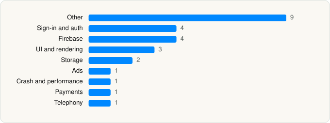

<picture><source media="(prefers-color-scheme: dark)" srcset="../../../../assets/logo/logo-dark.svg"></picture> [Tech Stack](../../../../README.md) / [Perplexity AI, Inc.](../../../../companies/perplexity-ai-inc.md) / Perplexity

# Perplexity - AI Search & Chat

<picture><source media="(prefers-color-scheme: dark)" srcset="../../../../assets/badges/ios-dark.svg"></picture> <picture><source media="(prefers-color-scheme: dark)" srcset="../../../../assets/badges/active-dark.svg"></picture> <picture><source media="(prefers-color-scheme: dark)" srcset="../../../../assets/badges/floor-dark.svg"></picture> <picture><source media="(prefers-color-scheme: dark)" srcset="../../../../assets/badges/encrypted-dark.svg"></picture>

[App Store](https://apps.apple.com/app/id1668000334) · [latest.json](latest.json)

| | |
|---|---|
| Company | [Perplexity AI, Inc.](../../../../companies/perplexity-ai-inc.md) |
| Store id | `1668000334` |
| Bundle / package id | `ai.perplexity.app` |
| Latest version | 26.42.0 (analysed 2026-10-24) |
| Versions tracked | 1 |
| SDKs in latest version | 26 |
| Languages | C/C++, Metal (shaders), Objective-C, Swift |
| UI | SwiftUI, UIKit |
| Build | Swift Package Manager (SwiftPM) |
| Minimum OS | iOS 18.0 (built with Xcode 27.1, SDK iphoneos27.1) |
| Devices / ABIs | iPhone, iPad |
| Localisations | 75 |
| Capabilities | 14 |
| Declares tracking | No |
| Tracked | Yes |

## SDKs by category

<picture><source media="(prefers-color-scheme: dark)" srcset="../../../../assets/charts/apps/ios/perplexity-ai-inc/perplexity-dark.svg"></picture>

- **Other** (9): DesignTokens, DynamicJSON 1.0, EppoFlagging 1.0, FactoryKit, GULUserDefaults 1.0, libaic 0.21.3, Semver 1.0, third-party-IsAppEncrypted 1.0, YouTubePlayerKit 1.0
- **Sign-in and auth** (4): AppAuth, GoogleSignIn, GTMAppAuth, GTMSessionFetcher
- **Firebase** (4): AppCheck 1.0, FBLPromises, GoogleUtilities 1.0, nanopb
- **UI and rendering** (3): cmark-gfm 1.0, KaTeX, Nuke 1.0
- **Storage** (2): GRDB, NukeUI 1.0
- **Ads** (1): GoogleAdsOnDeviceConversion 2.3.0
- **Crash and performance** (1): Sentry 9.29.2
- **Payments** (1): RevenueCat
- **Telephony** (1): PhoneNumberKit

Frameworks (34)

ActivityKit (Live Activities), AdServices (Apple Search Ads attribution), AdSupport (IDFA), App Intents, Authentication Services (Sign in with Apple / passkeys), AVFoundation (audio/video), Combine (reactive), Contacts, Core Data, Core Image, Core Location, Core Motion, CryptoKit, DeviceCheck / App Attest, HealthKit, Local Authentication (Face ID / Touch ID), MapKit, Media Player, MetalKit, MetricKit (diagnostics), MusicKit, Network.framework, PDFKit, PencilKit, Photos, PhotosUI, SafariServices, SiriKit (Intents), StoreKit (in-app purchase), Swift Charts, SwiftUI, UIKit, User Notifications, WidgetKit (widgets)

Capabilities (14)

App Attest, App Groups, Apple Pay, Associated Domains (Universal Links), Background Audio, Background Push, CarPlay, HealthKit, Keychain Sharing, Push Notifications (APNs), Sign in with Apple, SiriKit, Time-Sensitive Notifications, WeatherKit

## Version history

| Version | Analysed | Store update | SDKs | Change | SDK list is a floor | Binary encrypted | File |
|---|---|---|---|---|---|---|---|
| 26.42.0 | 2026-10-24 | 2026-10-23 | 26 |  | Yes | Yes | [26.42.0.json](26.42.0.json) |

---

Generated by `scripts/build_readme.py` from the JSON files. Do not edit by hand.
