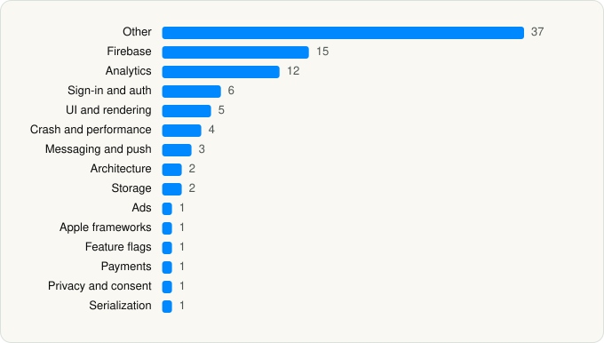

<picture><source media="(prefers-color-scheme: dark)" srcset="../../../../assets/logo/logo-dark.svg"></picture> [Tech Stack](../../../../README.md) / [Photoroom](../../../../companies/photoroom.md) / Photoroom

# Photoroom: AI Photo Editor

<picture><source media="(prefers-color-scheme: dark)" srcset="../../../../assets/badges/ios-dark.svg"></picture> <picture><source media="(prefers-color-scheme: dark)" srcset="../../../../assets/badges/active-dark.svg"></picture> <picture><source media="(prefers-color-scheme: dark)" srcset="../../../../assets/badges/floor-dark.svg"></picture> <picture><source media="(prefers-color-scheme: dark)" srcset="../../../../assets/badges/encrypted-dark.svg"></picture>

[App Store](https://apps.apple.com/app/id1455009060) · [latest.json](latest.json)

| | |
|---|---|
| Company | [Photoroom](../../../../companies/photoroom.md) |
| Store id | `1455009060` |
| Bundle / package id | `com.dr1ven.eraser` |
| Latest version | 2026.45.01 (analysed 2026-11-02) |
| Versions tracked | 2 |
| SDKs in latest version | 87 |
| Languages | C/C++, Metal (shaders), Objective-C, Swift |
| UI | Intercom UI, Lottie (animations), SwiftUI, UIKit |
| Build | Swift Package Manager (SwiftPM) |
| Minimum OS | iOS 18.0 (built with Xcode 27.2, SDK iphoneos27.2) |
| Devices / ABIs | iPhone, iPad |
| Localisations | 30 |
| Capabilities | 7 |
| Declares tracking | Yes |
| Tracked | Yes |

## SDKs by category

<picture><source media="(prefers-color-scheme: dark)" srcset="../../../../assets/charts/apps/ios/photoroom/photoroom-dark.svg"></picture>

- **Other** (30): absl 1.20250512.2, abslWrapper, AIImages, AlgoliaSearchClient, AssistiveCamera, combine-schedulers, engine 0.0, Filters, Lokalise 1.0.2, opensslWrapper, Resize, swift-async-algorithms, swift-atomics, swift-case-paths, swift-clocks, swift-concurrency-extras, swift-custom-dump, swift-dependencies, swift-identified-collections, swift-issue-reporting, swift-navigation, swift-numerics, swift-parsing, swift-perception, swift-sharing, swift-snapshot-testing, swift-syntax, swift-url-routing, SwiftyBeaver, VideoRoom
- **Firebase** (16): abseil, AppCheck, FBLPromises, Firebase, FirebaseAuth, FirebaseCore, FirebaseCoreInternal, FirebaseFirestore, FirebaseInstallations, FirebaseRemoteConfig, GoogleDataTransport, GoogleUtilities, gRPC, leveldb, nanopb, Promises
- **Analytics** (12): Adjust 1.0, AdjustSdk, Amplitude 1.0, analytics-connector-ios, BrazeKit 19.1.0, FacebookAEM, FacebookCore, FBAEMKit 1.0, FBSDKCoreKit 1.0, FirebaseAnalytics 13.0.1, GoogleAppMeasurement 13.0.1, GoogleAppMeasurementIdentitySupport 13.0.1
- **Sign-in and auth** (7): AppAuth, FacebookLogin, FBSDKLoginKit 1.0, GoogleSignIn, GTMAppAuth, GTMSessionFetcher, InteropForGoogle
- **UI and rendering** (5): Lottie, Nuke, SDWebImage, SDWebImageSwiftUI, SwiftMessages
- **Crash and performance** (4): DatadogCore, KSCrash, opentelemetry, Sentry 9.31.0
- **Messaging and push** (3): braze-swift-sdk, BrazeUI, Intercom 19.9.1
- **Architecture** (2): ComposableArchitecture, swift-composable-architecture
- **Storage** (2): CachingPlayerItem, Glassformation
- **Ads** (1): GoogleAdsOnDeviceConversion 3.7.0
- **Apple frameworks** (1): swift-collections
- **Feature flags** (1): Experiment
- **Payments** (1): RevenueCat
- **Privacy and consent** (1): Didomi 2.52.1
- **Serialization** (1): AnyCodable

Frameworks (32)

ActivityKit (Live Activities), AdServices (Apple Search Ads attribution), AdSupport (IDFA), App Tracking Transparency (ATT), Authentication Services (Sign in with Apple / passkeys), AVFoundation (audio/video), AVKit, Background Tasks, Combine (reactive), Core Data, Core Image, Core Location, Core Motion, CryptoKit, DeviceCheck / App Attest, Local Authentication (Face ID / Touch ID), Media Player, MetalKit, MetricKit (diagnostics), Natural Language, Network.framework, PDFKit, Photos, PhotosUI, SafariServices, SiriKit (Intents), StoreKit (in-app purchase), Swift Charts, SwiftUI, UIKit, User Notifications, Vision

Capabilities (7)

App Groups, Associated Domains (Universal Links), Background Push, Communication Notifications, Keychain Sharing, Push Notifications (APNs), Sign in with Apple

## Version history

| Version | Analysed | Store update | SDKs | Change | SDK list is a floor | Binary encrypted | File |
|---|---|---|---|---|---|---|---|
| 2026.45.01 | 2026-11-02 | 2026-11-02 | 87 | +3 / −8 | Yes | Yes | [2026.45.01.json](2026.45.01.json) |
| 2026.43.01 | 2026-10-24 | 2026-10-19 | 92 |  | Yes | Yes | [2026.43.01.json](2026.43.01.json) |

### SDK changes between versions

- 2026.43.01 → 2026.45.01: added AlgoliaSearchClient, AppCheck, InteropForGoogle; removed algoliasearch-client-swift, app-check, dd-sdk-ios, facebook-ios-sdk, google-ads-on-device-conversion-ios-sdk, gtm-session-fetcher, interop-ios-for-google-sdks, purchases-ios

---

Generated by `scripts/build_readme.py` from the JSON files. Do not edit by hand.
