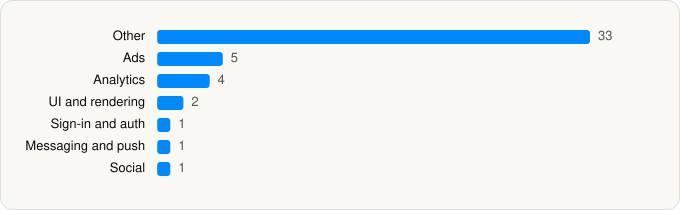

<picture><source media="(prefers-color-scheme: dark)" srcset="../../../../assets/logo/logo-dark.svg"></picture> [Tech Stack](../../../../README.md) / [PicsArt, Inc.](../../../../companies/picsart-inc.md) / Picsart AI Photo Editor, Video

# Picsart AI Photo Editor, Video

<picture><source media="(prefers-color-scheme: dark)" srcset="../../../../assets/badges/ios-dark.svg"></picture> <picture><source media="(prefers-color-scheme: dark)" srcset="../../../../assets/badges/inactive-dark.svg"></picture> <picture><source media="(prefers-color-scheme: dark)" srcset="../../../../assets/badges/floor-dark.svg"></picture> <picture><source media="(prefers-color-scheme: dark)" srcset="../../../../assets/badges/encrypted-dark.svg"></picture>

[App Store](https://apps.apple.com/app/id587366035) · [latest.json](latest.json)

| | |
|---|---|
| Company | [PicsArt, Inc.](../../../../companies/picsart-inc.md) |
| Store id | `587366035` |
| Bundle / package id | `com.picsart.studio` |
| Latest version | 30.9.2 (analysed 2026-10-24) |
| Versions tracked | 1 |
| SDKs in latest version | 47 |
| Languages | C/C++, Metal (shaders), Objective-C, Swift |
| UI | Lottie (animations), SwiftUI, UIKit |
| Build | Swift Package Manager (SwiftPM) |
| Minimum OS | iOS 15.0 (built with Xcode 26.4, SDK iphoneos26.4) |
| Devices / ABIs | iPhone, iPad |
| Localisations | 30 |
| Capabilities | 8 |
| Declares tracking | Yes |
| Tracked | No. Kept for history. |

## SDKs by category

<picture><source media="(prefers-color-scheme: dark)" srcset="../../../../assets/charts/apps/ios/picsart-inc/picsart-ai-photo-editor-video-dark.svg"></picture>

- **Other** (33): AsyncNetObjC, Blooper, Captions, Cascade, CascadeTokens, CrashReporting, CTNotificationContent 1.0, CTNotificationService, EffectsProvider, EmptyStateView, ExportService, ForceUpdate, FoundationExtensions, Highlight, InternalUIComponents, JediHTTPServer, LegacyObjc, LegacyObjcCore, MediaView, OfferScreens, OnboardIQ, PhotoChooser, PhotoChooserCoreObjC, PIEffects, RegistrationLib, Reshape, SocialDSLib, SofyAI, StickerChooser, StoreKitLib, VideoEditor, VideoEditorUI, VideoObjectRemoval
- **Ads** (5): AppLovin 13.6.2, FBAudienceNetwork 1.0, Google Mobile Ads (AdMob), InMobiSDK 11.1.1, MonetizationAds
- **Analytics** (4): Adjust 1.0, AdjustSdk, Facebook SDK, SCSDKCoreKit 1.14
- **UI and rendering** (2): Lottie 4.5.2, SDWebImage
- **Sign-in and auth** (1): SCSDKLoginKit 1.14
- **Messaging and push** (1): CleverTap
- **Social** (1): SCSDKCreativeKit 1.14

Frameworks (32)

AdSupport (IDFA), App Tracking Transparency (ATT), ARKit, Authentication Services (Sign in with Apple / passkeys), AVFoundation (audio/video), AVKit, Background Tasks, Combine (reactive), Contacts, Core Data, Core Image, Core Location, Core Motion, CryptoKit, Local Authentication (Face ID / Touch ID), Media Player, MessageUI (mail / SMS compose), MetalKit, MetricKit (diagnostics), Network.framework, Photos, PhotosUI, SafariServices, SceneKit, SiriKit (Intents), Speech (recognition), StoreKit (in-app purchase), SwiftUI, UIKit, User Notifications, Vision, WidgetKit (widgets)

Capabilities (8)

App Groups, Associated Domains (Universal Links), Background App Refresh, Background Push, iCloud, iCloud Key-Value Storage, Push Notifications (APNs), Sign in with Apple

## Version history

| Version | Analysed | Store update | SDKs | Change | SDK list is a floor | Binary encrypted | File |
|---|---|---|---|---|---|---|---|
| 30.9.2 | 2026-10-24 | 2026-10-06 | 47 |  | Yes | Yes | [30.9.2.json](30.9.2.json) |

---

Generated by `scripts/build_readme.py` from the JSON files. Do not edit by hand.
