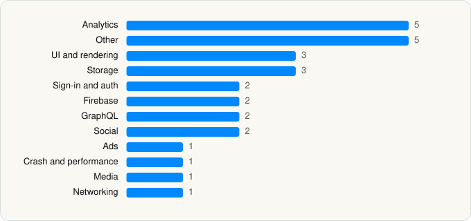

<picture><source media="(prefers-color-scheme: dark)" srcset="../../../../assets/logo/logo-dark.svg"></picture> [Tech Stack](../../../../README.md) / [Pinterest, Inc.](../../../../companies/pinterest-inc.md) / Pinterest

# Pinterest

<picture><source media="(prefers-color-scheme: dark)" srcset="../../../../assets/badges/ios-dark.svg"></picture> <picture><source media="(prefers-color-scheme: dark)" srcset="../../../../assets/badges/active-dark.svg"></picture> <picture><source media="(prefers-color-scheme: dark)" srcset="../../../../assets/badges/floor-dark.svg"></picture> <picture><source media="(prefers-color-scheme: dark)" srcset="../../../../assets/badges/encrypted-dark.svg"></picture>

[App Store](https://apps.apple.com/app/id429047995) · [latest.json](latest.json)

| | |
|---|---|
| Company | [Pinterest, Inc.](../../../../companies/pinterest-inc.md) |
| Store id | `429047995` |
| Bundle / package id | `pinterest` |
| Latest version | 14.21 (analysed 2026-06-19) |
| Versions tracked | 1 |
| SDKs in latest version | 28 |
| Languages | C/C++, Metal (shaders), Objective-C, Swift |
| UI | Lottie (animations), SwiftUI, UIKit |
| Build | Swift Package Manager (SwiftPM) |
| Minimum OS | iOS 16.0 (built with Xcode 26.2, SDK iphoneos26.2) |
| Devices / ABIs | iPhone, iPad |
| Localisations | 45 |
| Capabilities | 10 |
| Declares tracking | Yes |
| Tracked | Yes |

## SDKs by category

<picture><source media="(prefers-color-scheme: dark)" srcset="../../../../assets/charts/apps/ios/pinterest-inc/pinterest-dark.svg"></picture>

- **Analytics** (5): Branch, Facebook SDK, FBAEMKit 1.0, FBSDKCoreKit 1.0, SCSDKCoreKit 1.15
- **Other** (5): CreationExtension 14.21, Quikkly 3.4.18, ShuffleCore, WidgetIntent 1, XRendererSwiftWrapperFramework 1.0
- **UI and rendering** (3): DGCharts, DifferenceKit 1.0, Lottie 4.4.2
- **Storage** (3): FMDB 2.7.7, ZipArchive, ZIPFoundation
- **Sign-in and auth** (2): FBSDKLoginKit 1.0, GoogleSignIn
- **Firebase** (2): FBLPromises, Promises
- **GraphQL** (2): Apollo 1, ApolloAPI 1
- **Social** (2): FBSDKShareKit 1.0, SCSDKCreativeKit 1.15
- **Ads** (1): Google Mobile Ads (AdMob)
- **Crash and performance** (1): Bugsnag 6.32.2
- **Media** (1): YouTubeiOSPlayerHelper
- **Networking** (1): Cronet 109.0.5414

Frameworks (35)

AdSupport (IDFA), App Intents, App Tracking Transparency (ATT), Authentication Services (Sign in with Apple / passkeys), AVFoundation (audio/video), AVKit, Combine (reactive), Contacts, Core Data, Core Image, Core Location, Core ML, Core Motion, CryptoKit, DeviceCheck / App Attest, EventKit (Calendar / Reminders), Local Authentication (Face ID / Touch ID), MapKit, MessageUI (mail / SMS compose), MetalKit, MetricKit (diagnostics), Network.framework, PencilKit, Photos, PhotosUI, SafariServices, SiriKit (Intents), Speech (recognition), StoreKit (in-app purchase), SwiftData (persistence), SwiftUI, UIKit, User Notifications, Vision, WidgetKit (widgets)

Capabilities (10)

App Groups, Associated Domains (Universal Links), Background App Refresh, Background Audio, Background Push, Communication Notifications, Keychain Sharing, Push Notifications (APNs), Sign in with Apple, SiriKit

## Version history

| Version | Analysed | Store update | SDKs | Change | SDK list is a floor | Binary encrypted | File |
|---|---|---|---|---|---|---|---|
| 14.21 | 2026-06-19 |  | 28 |  | Yes | Yes | [14.21.json](14.21.json) |

## Model-written summary

> SwiftUI/UIKit iOS app with 7 extensions, App Intents/Siri shortcuts, 504 Metal shaders, and 29 third-party SDKs

Written by a language model from the detected signals (`inferred[]`). It is commentary, not measurement.

---

Generated by `scripts/build_readme.py` from the JSON files. Do not edit by hand.
