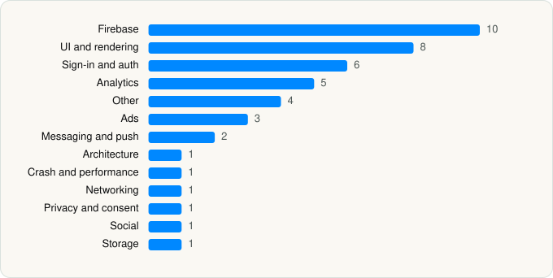

<picture><source media="(prefers-color-scheme: dark)" srcset="../../../../assets/logo/logo-dark.svg"></picture> [Tech Stack](../../../../README.md) / [Playful Rewards](../../../../companies/playful-rewards.md) / PLAYFUL REWARDS

# PLAYFUL REWARDS: Earn Rewards

<picture><source media="(prefers-color-scheme: dark)" srcset="../../../../assets/badges/ios-dark.svg"></picture> <picture><source media="(prefers-color-scheme: dark)" srcset="../../../../assets/badges/active-dark.svg"></picture> <picture><source media="(prefers-color-scheme: dark)" srcset="../../../../assets/badges/floor-dark.svg"></picture> <picture><source media="(prefers-color-scheme: dark)" srcset="../../../../assets/badges/encrypted-dark.svg"></picture>

[App Store](https://apps.apple.com/app/id1631584032) · [latest.json](latest.json)

| | |
|---|---|
| Company | [Playful Rewards](../../../../companies/playful-rewards.md) |
| Store id | `1631584032` |
| Bundle / package id | `com.theoremreach.WizardBucks` |
| Latest version | 3.2.2 (analysed 2026-11-04) |
| Versions tracked | 1 |
| SDKs in latest version | 44 |
| Languages | C/C++, Metal (shaders), Objective-C, React Native / JavaScript, Swift |
| UI | Lottie (animations), SwiftUI, UIKit |
| Build | Swift Package Manager (SwiftPM) |
| Minimum OS | iOS 16.6 (built with Xcode 27.0, SDK iphoneos27.0) |
| Devices / ABIs | iPhone, iPad |
| Localisations | 0 |
| Capabilities | 6 |
| Declares tracking | Yes |
| Tracked | Yes |

## SDKs by category

<picture><source media="(prefers-color-scheme: dark)" srcset="../../../../assets/charts/apps/ios/playful-rewards/playful-rewards-dark.svg"></picture>

- **Firebase** (10): FBLPromises 2.4.1, Firebase 12.3.0, FirebaseCore 12.3.0, FirebaseCoreInternal 12.3.0, FirebaseInstallations 12.3.0, FirebaseRemoteConfig 12.3.0, GoogleDataTransport 10.1.1, GoogleUtilities 8.1.4, nanopb 3.30910.0, Promises 2.4.1
- **UI and rendering** (8): FlashList, hermes 0.12.0, Lottie 4.5.0, React Native, React Native Reanimated, react-native-svg, RNSVGFilters 15.12.1, SDWebImage 5.21.7
- **Sign-in and auth** (6): AppAuth 2.1.0, Facebook Login, FBSDKLoginKit 1.0, GoogleSignIn 9.2.0, GTMAppAuth 5.0.0, GTMSessionFetcher 3.5.0
- **Analytics** (5): Amplitude, AppsFlyerLib 6.17.9, Facebook SDK, FBAEMKit 1.0, FBSDKCoreKit 1.0
- **Other** (4): EXConstants 18.0.13, FBSDKGamingServicesKit 1.0, RNDeviceInfoPrivacyInfo 14.1.1, TapResearchSDK 3.6.3
- **Ads** (3): AppLovin 7.12.8, Google Mobile Ads (AdMob), GoogleMobileAds 13.11.0
- **Messaging and push** (2): FirebaseMessaging 12.3.0, OneSignal 1.0
- **Architecture** (1): React Navigation
- **Crash and performance** (1): FirebaseCrashlytics 12.3.0
- **Networking** (1): Axios
- **Privacy and consent** (1): UserMessagingPlatform 3.1.0
- **Social** (1): FBSDKShareKit 1.0
- **Storage** (1): MMKV

Frameworks (25)

ActivityKit (Live Activities), AdSupport (IDFA), App Tracking Transparency (ATT), Authentication Services (Sign in with Apple / passkeys), AVFoundation (audio/video), AVKit, Combine (reactive), Core Image, Core Location, Core Motion, CryptoKit, DeviceCheck / App Attest, Local Authentication (Face ID / Touch ID), Media Player, MessageUI (mail / SMS compose), MetalKit, MetricKit (diagnostics), Network.framework, Photos, SafariServices, StoreKit (in-app purchase), SwiftUI, UIKit, User Notifications, WidgetKit (widgets)

Capabilities (6)

App Attest, Associated Domains (Universal Links), Background App Refresh, Background Push, Push Notifications (APNs), Sign in with Apple

## Version history

| Version | Analysed | Store update | SDKs | Change | SDK list is a floor | Binary encrypted | File |
|---|---|---|---|---|---|---|---|
| 3.2.2 | 2026-11-04 | 2026-11-02 | 44 |  | Yes | Yes | [3.2.2.json](3.2.2.json) |

---

Generated by `scripts/build_readme.py` from the JSON files. Do not edit by hand.
