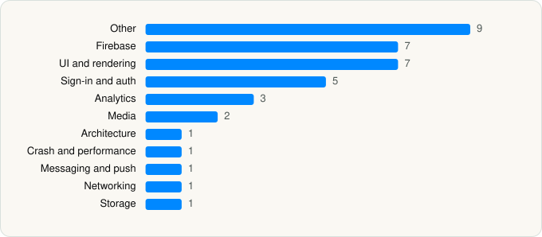

<picture><source media="(prefers-color-scheme: dark)" srcset="../../../../assets/logo/logo-dark.svg"></picture> [Tech Stack](../../../../README.md) / [Plex Inc.](../../../../companies/plex-inc.md) / Plex

# Plex: Find Movies and TV Shows

<picture><source media="(prefers-color-scheme: dark)" srcset="../../../../assets/badges/ios-dark.svg"></picture> <picture><source media="(prefers-color-scheme: dark)" srcset="../../../../assets/badges/inactive-dark.svg"></picture> <picture><source media="(prefers-color-scheme: dark)" srcset="../../../../assets/badges/floor-dark.svg"></picture> <picture><source media="(prefers-color-scheme: dark)" srcset="../../../../assets/badges/encrypted-dark.svg"></picture>

[App Store](https://apps.apple.com/app/id383457673) · [latest.json](latest.json)

| | |
|---|---|
| Company | [Plex Inc.](../../../../companies/plex-inc.md) |
| Store id | `383457673` |
| Bundle / package id | `com.plexapp.plex` |
| Latest version | 2026.11.0 (analysed 2026-06-19) |
| Versions tracked | 1 |
| SDKs in latest version | 38 |
| Languages | C/C++, Metal (shaders), Objective-C, React Native / JavaScript, Swift |
| UI | Lottie (animations), SwiftUI, UIKit |
| Build | Swift Package Manager (SwiftPM) |
| Minimum OS | iOS 16.0 (built with Xcode 26.0.1, SDK iphoneos26.0) |
| Devices / ABIs | iPhone, iPad |
| Localisations | 0 |
| Capabilities | 8 |
| Declares tracking | No |
| Tracked | No. Kept for history. |

## SDKs by category

<picture><source media="(prefers-color-scheme: dark)" srcset="../../../../assets/charts/apps/ios/plex-inc/plex-dark.svg"></picture>

- **Other** (9): CocoaLumberjackPrivacy 3.8.5, hermesvm 0.12.0, KSPlayer, PrivacyInfo, RNDeviceInfoPrivacyInfo 15.0.2, RNImagePickerPrivacyInfo 8.2.1, RNPermissionsPrivacyInfo 5.4.4, VizbeeHomeOSKit 1.0.4, VizbeeKit 6.9.0
- **Firebase** (7): FBLPromises 2.4.0, FirebaseCore 12.8.0, FirebaseCoreInternal 12.8.0, FirebaseInstallations 12.8.0, GoogleDataTransport 10.1.0, GoogleUtilities 8.1.0, nanopb 3.30910.0
- **UI and rendering** (7): FlashList, Lottie 4.6.0, React Native, React Native Reanimated, react-native-svg, RNSVGFilters 15.15.3, SDWebImage 5.21.0
- **Sign-in and auth** (5): AppAuth 2.0.0, GoogleSignIn 9.1.0, GTMAppAuth 5.0.0, GTMSessionFetcher 3.5.0, VizbeeHomeSSOKit 1.0.3
- **Analytics** (3): Amplitude, FullStory 1.68.0, Kochava 7.6.0
- **Media** (2): GoogleCast 4.8.0, GoogleInteractiveMediaAds 3.23.0
- **Architecture** (1): React Navigation
- **Crash and performance** (1): Sentry 8.58.0
- **Messaging and push** (1): FirebaseMessaging 12.8.0
- **Networking** (1): Axios
- **Storage** (1): SSZipArchive 2.5.5

Frameworks (29)

AdServices (Apple Search Ads attribution), AdSupport (IDFA), App Tracking Transparency (ATT), Authentication Services (Sign in with Apple / passkeys), AVFoundation (audio/video), AVKit, Combine (reactive), Core Data, Core Image, Core Location, Core Motion, CryptoKit, DeviceCheck / App Attest, Local Authentication (Face ID / Touch ID), Media Player, MessageUI (mail / SMS compose), MetalKit, MetricKit (diagnostics), Network.framework, PDFKit, Photos, PhotosUI, SafariServices, SiriKit (Intents), StoreKit (in-app purchase), SwiftUI, UIKit, User Notifications, VisionKit (document/data scanning)

Capabilities (8)

App Groups, Associated Domains (Universal Links), Background App Refresh, Background Audio, Background Push, Keychain Sharing, Push Notifications (APNs), Sign in with Apple

## Version history

| Version | Analysed | Store update | SDKs | Change | SDK list is a floor | Binary encrypted | File |
|---|---|---|---|---|---|---|---|
| 2026.11.0 | 2026-06-19 |  | 38 |  | Yes | Yes | [2026.11.0.json](2026.11.0.json) |

## Model-written summary

> Hybrid React Native-Swift iOS app with 8 Metal shaders, Plex/Firebase backends, Google Cast, and Sentry/Amplitude analytics

Written by a language model from the detected signals (`inferred[]`). It is commentary, not measurement.

---

Generated by `scripts/build_readme.py` from the JSON files. Do not edit by hand.
