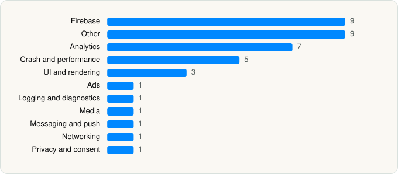

<picture><source media="(prefers-color-scheme: dark)" srcset="../../../../assets/logo/logo-dark.svg"></picture> [Tech Stack](../../../../README.md) / [Pluto.tv](../../../../companies/pluto-tv.md) / PlutoTV

# PlutoTV: Stream Free Movies/TV

<picture><source media="(prefers-color-scheme: dark)" srcset="../../../../assets/badges/ios-dark.svg"></picture> <picture><source media="(prefers-color-scheme: dark)" srcset="../../../../assets/badges/inactive-dark.svg"></picture> <picture><source media="(prefers-color-scheme: dark)" srcset="../../../../assets/badges/floor-dark.svg"></picture> <picture><source media="(prefers-color-scheme: dark)" srcset="../../../../assets/badges/encrypted-dark.svg"></picture>

[App Store](https://apps.apple.com/app/id751712884) · [latest.json](latest.json)

| | |
|---|---|
| Company | [Pluto.tv](../../../../companies/pluto-tv.md) |
| Store id | `751712884` |
| Bundle / package id | `tv.pluto.ios` |
| Latest version | 5.75.1 (analysed 2026-06-19) |
| Versions tracked | 1 |
| SDKs in latest version | 39 |
| Languages | C/C++, Objective-C, Swift |
| UI | Lottie (animations), SwiftUI, UIKit |
| Build | Swift Package Manager (SwiftPM) |
| Minimum OS | iOS 16.0 (built with Xcode 26.2, SDK iphoneos26.2) |
| Devices / ABIs | iPhone, iPad |
| Localisations | 10 |
| Capabilities | 7 |
| Declares tracking | Yes |
| Tracked | No. Kept for history. |

## SDKs by category

<picture><source media="(prefers-color-scheme: dark)" srcset="../../../../assets/charts/apps/ios/pluto-tv/plutotv-dark.svg"></picture>

- **Firebase** (9): FBLPromises, Firebase, FirebaseCore, FirebaseCoreInternal, FirebaseInstallations, GoogleDataTransport, GoogleUtilities, nanopb, Promises
- **Other** (9): Avia 16.5.0, AviaTrackingCore 4.6.2, AviaTrackingFathom 1.0, AviaTrackingKantarBarb 4.1.2, AviaTrackingNPAW 4.0.9, CrashReporter, PTVL10n 1.0, YouboraAVPlayerAdapter 6.5.13, YouboraLib 6.5.13
- **Analytics** (7): BrazeKit 13.1.0, ComScore 1.0, FirebaseAnalytics 10.23.0, GoogleAppMeasurement 10.23.0, GoogleAppMeasurementIdentitySupport 10.23.0, Kochava 9.0.0, NielsenAppApi 9.3.0
- **Crash and performance** (5): DatadogCore, DatadogCrashReporting, DatadogRUM, FirebaseCrashlytics, PLCrashReporter
- **UI and rendering** (3): Kingfisher, Lottie 1.0, MaterialDialogs
- **Ads** (1): ProgrammaticAccessLibrary 2.7.0
- **Logging and diagnostics** (1): Logging 1.0
- **Media** (1): GoogleCast 4.8.4
- **Messaging and push** (1): BrazeUI
- **Networking** (1): Alamofire
- **Privacy and consent** (1): OTPublishersHeadlessSDK 202510.2.4

Frameworks (24)

ActivityKit (Live Activities), AdServices (Apple Search Ads attribution), AdSupport (IDFA), App Tracking Transparency (ATT), AVFoundation (audio/video), AVKit, CallKit (VoIP), Combine (reactive), Core Data, Core Image, Core Motion, DeviceCheck / App Attest, Group Activities (SharePlay), Media Player, MetricKit (diagnostics), Network.framework, SafariServices, SceneKit, SpriteKit, StoreKit (in-app purchase), SwiftUI, UIKit, User Notifications, WidgetKit (widgets)

Capabilities (7)

App Groups, Associated Domains (Universal Links), Background App Refresh, Background Audio, Background Push, Keychain Sharing, Push Notifications (APNs)

## Version history

| Version | Analysed | Store update | SDKs | Change | SDK list is a floor | Binary encrypted | File |
|---|---|---|---|---|---|---|---|
| 5.75.1 | 2026-06-19 |  | 39 |  | Yes | Yes | [5.75.1.json](5.75.1.json) |

## Model-written summary

> SwiftUI/UIKit iOS free-streaming app with Firebase backend, multi-vendor analytics (Braze, Datadog, ComScore), Google Cast, and widget/notification extensions

Written by a language model from the detected signals (`inferred[]`). It is commentary, not measurement.

---

Generated by `scripts/build_readme.py` from the JSON files. Do not edit by hand.
