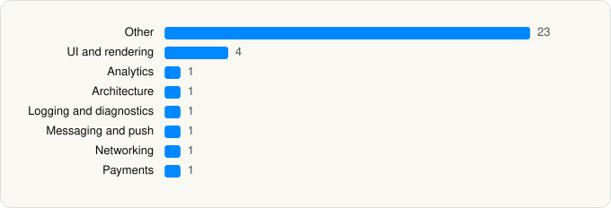

<picture><source media="(prefers-color-scheme: dark)" srcset="../../../../assets/logo/logo-dark.svg"></picture> [Tech Stack](../../../../README.md) / [Posh Group Inc.](../../../../companies/posh-group-inc.md) / Posh

# Posh – Create & Find Events

<picture><source media="(prefers-color-scheme: dark)" srcset="../../../../assets/badges/ios-dark.svg"></picture> <picture><source media="(prefers-color-scheme: dark)" srcset="../../../../assets/badges/inactive-dark.svg"></picture> <picture><source media="(prefers-color-scheme: dark)" srcset="../../../../assets/badges/floor-dark.svg"></picture> <picture><source media="(prefers-color-scheme: dark)" srcset="../../../../assets/badges/encrypted-dark.svg"></picture>

[App Store](https://apps.apple.com/app/id1556928106) · [latest.json](latest.json)

| | |
|---|---|
| Company | [Posh Group Inc.](../../../../companies/posh-group-inc.md) |
| Store id | `1556928106` |
| Bundle / package id | `com.poshgroup.POSH` |
| Latest version | 8.25.0 (analysed 2026-11-04) |
| Versions tracked | 2 |
| SDKs in latest version | 32 |
| Languages | C/C++, Metal (shaders), Objective-C, React Native / JavaScript, Swift |
| UI | Intercom UI, Lottie (animations), SwiftUI, UIKit |
| Build | Swift Package Manager (SwiftPM) |
| Minimum OS | iOS 16.4 (built with Xcode 26.6, SDK iphoneos26.5) |
| Devices / ABIs | iPhone, iPad |
| Localisations | 0 |
| Capabilities | 8 |
| Declares tracking | No |
| Tracked | No. Kept for history. |

## SDKs by category

<picture><source media="(prefers-color-scheme: dark)" srcset="../../../../assets/charts/apps/ios/posh-group-inc/posh-dark.svg"></picture>

- **Other** (23): boost, EXConstants 57.0.17, ExpoContacts 1.0, ExpoFileSystem 1.0, ExpoImage 1.0, ExpoImageManipulator 1.0, ExpoLocation 1.0, ExpoMediaLibrary 1.0, ExpoModulesCore 1.0, ExpoModulesJSI 1.0, ExpoModulesWorklets 1.0, ExpoVideo 1.0, EXUpdates 57.0.21, folly, hermesvm 1.0.0, libavif 1.0, Lodash, Moment.js, Mute 0.6.1, React 1.0, ReactNativeDependencies 1.0, RNDeviceInfoPrivacyInfo 10.14.0, Rudder 1.33.0
- **UI and rendering** (4): Lottie 4.6.0, React Native Reanimated, RNSVGFilters 15.15.4, SDWebImage 1.0
- **Analytics** (1): Mixpanel 5.2.0
- **Logging and diagnostics** (1): glog
- **Messaging and push** (1): Intercom 19.5.7
- **Networking** (1): ReachabilitySwift 5.2.4
- **Payments** (1): Stripe 5.7.0

Frameworks (33)

Authentication Services (Sign in with Apple / passkeys), AVFoundation (audio/video), AVKit, Combine (reactive), Contacts, Core Bluetooth, Core Data, Core Image, Core Location, Core Motion, Core NFC, CryptoKit, DeviceCheck / App Attest, EventKit (Calendar / Reminders), Local Authentication (Face ID / Touch ID), MapKit, Media Player, MetricKit (diagnostics), Network.framework, PassKit (Wallet / Apple Pay), PDFKit, Photos, PhotosUI, SafariServices, SiriKit (Intents), StoreKit (in-app purchase), Swift Charts, SwiftUI, UIKit, User Notifications, Vision, VisionKit (document/data scanning), WidgetKit (widgets)

Capabilities (8)

Apple Pay, Associated Domains (Universal Links), Background App Refresh, Background Audio, Background Push, Bluetooth (central), NFC, Push Notifications (APNs)

## Version history

| Version | Analysed | Store update | SDKs | Change | SDK list is a floor | Binary encrypted | File |
|---|---|---|---|---|---|---|---|
| 8.25.0 | 2026-11-04 | 2026-11-03 | 32 | +0 / −1 | Yes | Yes | [8.25.0.json](8.25.0.json) |
| 8.24.0 | 2026-11-01 | 2026-10-26 | 33 |  | Yes | Yes | [8.24.0.json](8.24.0.json) |

### SDK changes between versions

- 8.24.0 → 8.25.0: removed React Navigation

---

Generated by `scripts/build_readme.py` from the JSON files. Do not edit by hand.
