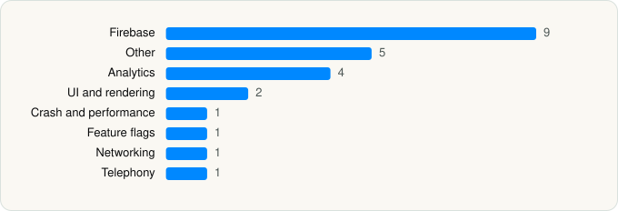

<picture><source media="(prefers-color-scheme: dark)" srcset="../../../../assets/logo/logo-dark.svg"></picture> [Tech Stack](../../../../README.md) / [Posten](../../../../companies/posten.md) / Bring Tracking

# Bring Tracking

<picture><source media="(prefers-color-scheme: dark)" srcset="../../../../assets/badges/ios-dark.svg"></picture> <picture><source media="(prefers-color-scheme: dark)" srcset="../../../../assets/badges/active-dark.svg"></picture> <picture><source media="(prefers-color-scheme: dark)" srcset="../../../../assets/badges/floor-dark.svg"></picture> <picture><source media="(prefers-color-scheme: dark)" srcset="../../../../assets/badges/encrypted-dark.svg"></picture>

[App Store](https://apps.apple.com/app/id6468981790) · [latest.json](latest.json)

| | |
|---|---|
| Company | [Posten](../../../../companies/posten.md) |
| Store id | `6468981790` |
| Bundle / package id | `no.bring.sporing` |
| Latest version | 8.4.9 (analysed 2026-11-05) |
| Versions tracked | 1 |
| SDKs in latest version | 24 |
| Languages | C/C++, Metal (shaders), Objective-C, Swift |
| UI | Lottie (animations), SwiftUI, UIKit |
| Build | Swift Package Manager (SwiftPM) |
| Minimum OS | iOS 16.6 (built with Xcode 27.0, SDK iphoneos27.0) |
| Devices / ABIs | iPhone, iPad |
| Localisations | 4 |
| Capabilities | 5 |
| Declares tracking | No |
| Tracked | Yes |

## SDKs by category

<picture><source media="(prefers-color-scheme: dark)" srcset="../../../../assets/charts/apps/ios/posten/bring-tracking-dark.svg"></picture>

- **Firebase** (9): FBLPromises, Firebase, FirebaseCore, FirebaseCoreInternal, FirebaseInstallations, GoogleDataTransport, GoogleUtilities, nanopb, Promises
- **Other** (5): Ampli 1.0, Factory, FactoryKit, Kindly 2.1.173, SwipBoxSDK 2.3.0
- **Analytics** (4): Amplitude 1.0, AnalyticsConnector 1.0, FirebaseAnalytics 12.19.2, GoogleAppMeasurement 12.19.2
- **UI and rendering** (2): Lottie, RiveRuntime 6.27.0
- **Crash and performance** (1): FirebaseCrashlytics
- **Feature flags** (1): Experiment
- **Networking** (1): Reachability
- **Telephony** (1): PhoneNumberKit

Frameworks (23)

ActivityKit (Live Activities), AVFoundation (audio/video), AVKit, Combine (reactive), Contacts, Core Bluetooth, Core Data, Core Image, Core Location, CryptoKit, Local Authentication (Face ID / Touch ID), MapKit, MessageUI (mail / SMS compose), MetalKit, Photos, PhotosUI, SafariServices, StoreKit (in-app purchase), Swift Charts, SwiftUI, UIKit, User Notifications, WidgetKit (widgets)

Capabilities (5)

Associated Domains (Universal Links), Background Location, Background Push, Bluetooth (central), Push Notifications (APNs)

## Version history

| Version | Analysed | Store update | SDKs | Change | SDK list is a floor | Binary encrypted | File |
|---|---|---|---|---|---|---|---|
| 8.4.9 | 2026-11-05 |  | 24 |  | Yes | Yes | [8.4.9.json](8.4.9.json) |

---

Generated by `scripts/build_readme.py` from the JSON files. Do not edit by hand.
