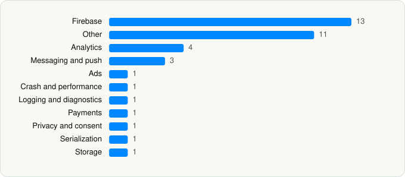

<picture><source media="(prefers-color-scheme: dark)" srcset="../../../../assets/logo/logo-dark.svg"></picture> [Tech Stack](../../../../README.md) / [PostNord Group AB](../../../../companies/postnord-group-ab.md) / PostNord

# PostNord - Track your parcels

<picture><source media="(prefers-color-scheme: dark)" srcset="../../../../assets/badges/ios-dark.svg"></picture> <picture><source media="(prefers-color-scheme: dark)" srcset="../../../../assets/badges/inactive-dark.svg"></picture> <picture><source media="(prefers-color-scheme: dark)" srcset="../../../../assets/badges/floor-dark.svg"></picture> <picture><source media="(prefers-color-scheme: dark)" srcset="../../../../assets/badges/encrypted-dark.svg"></picture>

[App Store](https://apps.apple.com/app/id396871673) · [latest.json](latest.json)

| | |
|---|---|
| Company | [PostNord Group AB](../../../../companies/postnord-group-ab.md) |
| Store id | `396871673` |
| Bundle / package id | `se.posten.SparaForsandelse` |
| Latest version | 8.81 (analysed 2026-11-24) |
| Versions tracked | 1 |
| SDKs in latest version | 38 |
| Languages | C/C++, Objective-C, Swift |
| UI | SwiftUI, UIKit |
| Build | Swift Package Manager (SwiftPM) |
| Minimum OS | iOS 15.0 (built with Xcode 26.6, SDK iphoneos26.5) |
| Devices / ABIs | iPhone |
| Localisations | 4 |
| Capabilities | 7 |
| Declares tracking | Yes |
| Tracked | No. Kept for history. |

## SDKs by category

<picture><source media="(prefers-color-scheme: dark)" srcset="../../../../assets/charts/apps/ios/postnord-group-ab/postnord-dark.svg"></picture>

- **Firebase** (13): abseil, FBLPromises, Firebase, FirebaseCore, FirebaseCoreInternal, FirebaseFirestore, FirebaseInstallations, FirebaseRemoteConfig, GoogleDataTransport, GoogleUtilities 1.0, gRPC, leveldb, nanopb
- **Other** (11): absl 1.20250512.2, abslWrapper, GULNSData 1.0, GULUserDefaults 1.0, opensslWrapper, ServiceCore 4.2.8, ServiceKnowledge 3.5.8, Shield, SMIMultimediaCommon 1.13.2, SwipBoxSDK 2.3.0, third-party-IsAppEncrypted 1.0
- **Analytics** (4): Branch, FirebaseAnalytics 13.0.1, GoogleAppMeasurement 13.0.1, GoogleAppMeasurementIdentitySupport 13.0.1
- **Messaging and push** (3): FirebaseMessaging, SMIClientCore 1.13.2, SMIClientUI 1.13.2
- **Ads** (1): GoogleAdsOnDeviceConversion 3.7.0
- **Crash and performance** (1): FirebaseCrashlytics
- **Logging and diagnostics** (1): ErrorLogger 1.0
- **Payments** (1): Adyen
- **Privacy and consent** (1): OTPublishersHeadlessSDK 202609.2.0
- **Serialization** (1): PotentCodables
- **Storage** (1): SQLCipher 1.0

Frameworks (34)

ActivityKit (Live Activities), AdServices (Apple Search Ads attribution), AdSupport (IDFA), App Intents, App Tracking Transparency (ATT), ARKit, Authentication Services (Sign in with Apple / passkeys), AVFoundation (audio/video), Combine (reactive), Contacts, Core Bluetooth, Core Data, Core Image, Core Location, Core Motion, CryptoKit, Local Authentication (Face ID / Touch ID), MapKit, MessageUI (mail / SMS compose), Network.framework, PassKit (Wallet / Apple Pay), PDFKit, Photos, PhotosUI, SafariServices, SceneKit, SiriKit (Intents), SpriteKit, StoreKit (in-app purchase), Swift Charts, SwiftUI, UIKit, User Notifications, WidgetKit (widgets)

Capabilities (7)

App Groups, Apple Pay, Associated Domains (Universal Links), Background App Refresh, Background Push, Bluetooth (central), Push Notifications (APNs)

## Version history

| Version | Analysed | Store update | SDKs | Change | SDK list is a floor | Binary encrypted | File |
|---|---|---|---|---|---|---|---|
| 8.81 | 2026-11-24 |  | 38 |  | Yes | Yes | [8.81.json](8.81.json) |

---

Generated by `scripts/build_readme.py` from the JSON files. Do not edit by hand.
