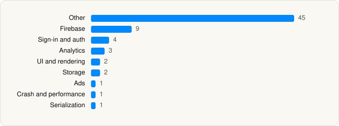

<picture><source media="(prefers-color-scheme: dark)" srcset="../../../../assets/logo/logo-dark.svg"></picture> [Tech Stack](../../../../README.md) / [Prisma labs, inc.](../../../../companies/prisma-labs-inc.md) / Lensa AI

# Lensa AI: Photo Editor

<picture><source media="(prefers-color-scheme: dark)" srcset="../../../../assets/badges/ios-dark.svg"></picture> <picture><source media="(prefers-color-scheme: dark)" srcset="../../../../assets/badges/active-dark.svg"></picture> <picture><source media="(prefers-color-scheme: dark)" srcset="../../../../assets/badges/floor-dark.svg"></picture> <picture><source media="(prefers-color-scheme: dark)" srcset="../../../../assets/badges/encrypted-dark.svg"></picture>

[App Store](https://apps.apple.com/app/id1436732536) · [latest.json](latest.json)

| | |
|---|---|
| Company | [Prisma labs, inc.](../../../../companies/prisma-labs-inc.md) |
| Store id | `1436732536` |
| Bundle / package id | `com.prisma-ai.lensa-app` |
| Latest version | 8.13.0 (analysed 2026-10-24) |
| Versions tracked | 1 |
| SDKs in latest version | 68 |
| Languages | C/C++, Metal (shaders), Objective-C, Swift |
| UI | Lottie (animations), SwiftUI, UIKit |
| Build | Swift Package Manager (SwiftPM) |
| Minimum OS | iOS 18.0 (built with Xcode 26.2, SDK iphoneos26.2) |
| Devices / ABIs | iPhone |
| Localisations | 9 |
| Capabilities | 5 |
| Declares tracking | No |
| Tracked | Yes |

## SDKs by category

<picture><source media="(prefers-color-scheme: dark)" srcset="../../../../assets/charts/apps/ios/prisma-labs-inc/lensa-ai-dark.svg"></picture>

- **Other** (45): AIBokeh, Authorization, AutoAdjuster, BackgroundHarmonisation, Beautifier, BodySkinRetouch, Bokeh, Brains, ColorGrader, CustomPicker, DepthMate, DeviceKit, EduardAI, FaceGeometryCalculator 1.0, FaceMesh, FiltersStore, FXEffects, Gallery, GenAI, Inpainter, LookUpTable, MaskAdjustment, MetalCore, MusicLibrary, Palette, Paywalls, PhotoEditingPackage, PhotoEditingScene, PhotoPreprocessing, PhotoProcessing, RealEngine, Reshape, ScreenshotGuard, SelectiveColor, SettingsModule, TextureStatistics, Tokens, UserSurvey, VideoEditorNew, VideoEngine, VideoRetouch, VideoTimeline, Vignette, Vortex, Warper
- **Firebase** (9): FBLPromises, Firebase, FirebaseCore, FirebaseCoreInternal, FirebaseInstallations, FirebaseRemoteConfig, GoogleDataTransport, nanopb, Promises
- **Sign-in and auth** (4): AppAuth, GoogleSignIn, GTMAppAuth, GTMSessionFetcher
- **Analytics** (3): Adjust, Amplitude, Facebook SDK
- **UI and rendering** (2): Lottie, SnapKit
- **Storage** (2): GRDB, ZIPFoundation
- **Ads** (1): Google Mobile Ads (AdMob)
- **Crash and performance** (1): FirebaseCrashlytics
- **Serialization** (1): SwiftProtobuf

Frameworks (26)

AdSupport (IDFA), App Tracking Transparency (ATT), Authentication Services (Sign in with Apple / passkeys), AVFoundation (audio/video), AVKit, Combine (reactive), Core Image, Core ML, CryptoKit, Local Authentication (Face ID / Touch ID), Media Player, MessageUI (mail / SMS compose), MetalKit, MetricKit (diagnostics), MusicKit, Network.framework, Photos, PhotosUI, SafariServices, SpriteKit, StoreKit (in-app purchase), SwiftUI, UIKit, User Notifications, Vision, WidgetKit (widgets)

Capabilities (5)

App Groups, Associated Domains (Universal Links), Keychain Sharing, Push Notifications (APNs), Sign in with Apple

## Version history

| Version | Analysed | Store update | SDKs | Change | SDK list is a floor | Binary encrypted | File |
|---|---|---|---|---|---|---|---|
| 8.13.0 | 2026-10-24 | 2026-09-29 | 68 |  | Yes | Yes | [8.13.0.json](8.13.0.json) |

---

Generated by `scripts/build_readme.py` from the JSON files. Do not edit by hand.
