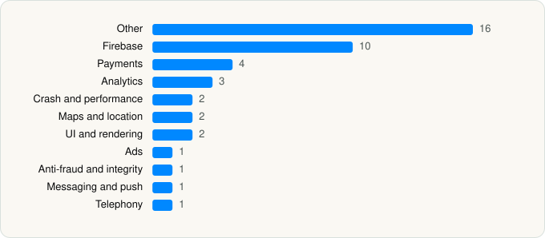

<picture><source media="(prefers-color-scheme: dark)" srcset="../../../../assets/logo/logo-dark.svg"></picture> [Tech Stack](../../../../README.md) / [Q Mobility](../../../../companies/q-mobility.md) / DARB

# DARB - Urban mobility

<picture><source media="(prefers-color-scheme: dark)" srcset="../../../../assets/badges/ios-dark.svg"></picture> <picture><source media="(prefers-color-scheme: dark)" srcset="../../../../assets/badges/inactive-dark.svg"></picture> <picture><source media="(prefers-color-scheme: dark)" srcset="../../../../assets/badges/floor-dark.svg"></picture> <picture><source media="(prefers-color-scheme: dark)" srcset="../../../../assets/badges/encrypted-dark.svg"></picture>

[App Store](https://apps.apple.com/app/id6752485055) · [latest.json](latest.json)

| | |
|---|---|
| Company | [Q Mobility](../../../../companies/q-mobility.md) |
| Store id | `6752485055` |
| Bundle / package id | `com.qmobility.darbx` |
| Latest version | 1.3.0 (analysed 2026-11-09) |
| Versions tracked | 1 |
| SDKs in latest version | 43 |
| Languages | C/C++, Metal (shaders), Objective-C, Swift |
| UI | Lottie (animations), SwiftUI, UIKit |
| Build | Swift Package Manager (SwiftPM) |
| Minimum OS | iOS 16.6 (built with Xcode 27.1, SDK iphoneos27.1) |
| Devices / ABIs | iPhone |
| Localisations | 2 |
| Capabilities | 4 |
| Declares tracking | No |
| Tracked | No. Kept for history. |

## SDKs by category

<picture><source media="(prefers-color-scheme: dark)" srcset="../../../../assets/charts/apps/ios/q-mobility/darb-dark.svg"></picture>

- **Other** (16): Activities, AppModule, Clarity 1.0, DesignTokens, Exemptions, Family, GuestMode, Home, Parking, Permits, RefinerInternalSDK 1.0, RefinerSDK 1.0, Support, Toll, UIToolkit, Vehicle
- **Firebase** (10): FBLPromises, Firebase, FirebaseCore, FirebaseCoreInternal, FirebaseInstallations, FirebaseRemoteConfig, GoogleDataTransport, GoogleUtilities 1.3.0, nanopb, Promises
- **Payments** (4): CheckoutComponentsSDK 1.0, CheckoutEventLoggerKit 1.0, ParkingSubscriptions, Payment
- **Analytics** (3): FirebaseAnalytics 12.19.2, GoogleAppMeasurement 12.19.2, GoogleAppMeasurementIdentitySupport 12.19.2
- **Crash and performance** (2): FirebaseCrashlytics, NewRelic 7.7.9
- **Maps and location** (2): GMSCore 26.37.0, GoogleMaps
- **UI and rendering** (2): Kingfisher, Lottie
- **Ads** (1): GoogleAdsOnDeviceConversion 3.7.0
- **Anti-fraud and integrity** (1): Fingerprint 2.17.2
- **Messaging and push** (1): FirebaseMessaging
- **Telephony** (1): libPhoneNumber

Frameworks (24)

ActivityKit (Live Activities), Authentication Services (Sign in with Apple / passkeys), AVFoundation (audio/video), Background Tasks, Combine (reactive), Contacts, Core Data, Core Image, Core Location, CryptoKit, Local Authentication (Face ID / Touch ID), MapKit, MessageUI (mail / SMS compose), MetricKit (diagnostics), Network.framework, PassKit (Wallet / Apple Pay), PDFKit, Photos, PhotosUI, StoreKit (in-app purchase), SwiftUI, UIKit, User Notifications, WidgetKit (widgets)

Capabilities (4)

App Groups, Apple Pay, Background Push, Push Notifications (APNs)

## Version history

| Version | Analysed | Store update | SDKs | Change | SDK list is a floor | Binary encrypted | File |
|---|---|---|---|---|---|---|---|
| 1.3.0 | 2026-11-09 |  | 43 |  | Yes | Yes | [1.3.0.json](1.3.0.json) |

---

Generated by `scripts/build_readme.py` from the JSON files. Do not edit by hand.
