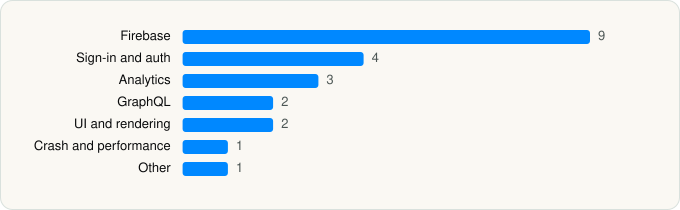

<picture><source media="(prefers-color-scheme: dark)" srcset="../../../../assets/logo/logo-dark.svg"></picture> [Tech Stack](../../../../README.md) / [Quora, Inc.](../../../../companies/quora-inc.md) / Poe

# Poe – Fast AI Chat

<picture><source media="(prefers-color-scheme: dark)" srcset="../../../../assets/badges/ios-dark.svg"></picture> <picture><source media="(prefers-color-scheme: dark)" srcset="../../../../assets/badges/active-dark.svg"></picture> <picture><source media="(prefers-color-scheme: dark)" srcset="../../../../assets/badges/floor-dark.svg"></picture> <picture><source media="(prefers-color-scheme: dark)" srcset="../../../../assets/badges/encrypted-dark.svg"></picture>

[App Store](https://apps.apple.com/app/id1640745955) · [latest.json](latest.json)

| | |
|---|---|
| Company | [Quora, Inc.](../../../../companies/quora-inc.md) |
| Store id | `1640745955` |
| Bundle / package id | `com.quora.app.Experts` |
| Latest version | 6.1.0 (analysed 2026-10-24) |
| Versions tracked | 1 |
| SDKs in latest version | 22 |
| Languages | C/C++, Objective-C, Swift |
| UI | SwiftUI, UIKit |
| Build | Swift Package Manager (SwiftPM) |
| Minimum OS | iOS 17.4 (built with Xcode 26.6, SDK iphoneos26.5) |
| Devices / ABIs | iPhone, iPad |
| Localisations | 10 |
| Capabilities | 8 |
| Declares tracking | No |
| Tracked | Yes |

## SDKs by category

<picture><source media="(prefers-color-scheme: dark)" srcset="../../../../assets/charts/apps/ios/quora-inc/poe-dark.svg"></picture>

- **Firebase** (9): FBLPromises, Firebase, FirebaseCore, FirebaseCoreInternal, FirebaseInstallations, GoogleDataTransport, GoogleUtilities, nanopb, Promises
- **Sign-in and auth** (4): AppAuth, GoogleSignIn, GTMAppAuth, GTMSessionFetcher
- **Analytics** (3): FirebaseAnalytics 12.8.0, GoogleAppMeasurement 12.8.0, UserLeapKit 4.8.5
- **GraphQL** (2): Apollo, ApolloAPI
- **UI and rendering** (2): MathJax, MathJaxSwift
- **Crash and performance** (1): FirebaseCrashlytics
- **Other** (1): SeekBar 1.0

Frameworks (24)

AdServices (Apple Search Ads attribution), AdSupport (IDFA), Authentication Services (Sign in with Apple / passkeys), AVFoundation (audio/video), AVKit, Combine (reactive), Contacts, CryptoKit, Local Authentication (Face ID / Touch ID), Media Player, MessageUI (mail / SMS compose), MetricKit (diagnostics), Network.framework, Photos, PhotosUI, SafariServices, SiriKit (Intents), Speech (recognition), StoreKit (in-app purchase), Swift Charts, SwiftUI, UIKit, User Notifications, WidgetKit (widgets)

Capabilities (8)

App Attest, App Groups, Associated Domains (Universal Links), Background Audio, Background Push, Communication Notifications, Push Notifications (APNs), Sign in with Apple

## Version history

| Version | Analysed | Store update | SDKs | Change | SDK list is a floor | Binary encrypted | File |
|---|---|---|---|---|---|---|---|
| 6.1.0 | 2026-10-24 | 2026-10-05 | 22 |  | Yes | Yes | [6.1.0.json](6.1.0.json) |

---

Generated by `scripts/build_readme.py` from the JSON files. Do not edit by hand.
