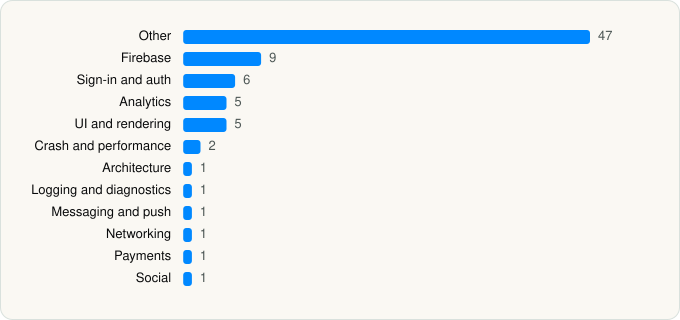

<picture><source media="(prefers-color-scheme: dark)" srcset="../../../../assets/logo/logo-dark.svg"></picture> [Tech Stack](../../../../README.md) / [Reco Social, Inc.](../../../../companies/reco-social-inc.md) / Reco Social

# Reco Social

<picture><source media="(prefers-color-scheme: dark)" srcset="../../../../assets/badges/ios-dark.svg"></picture> <picture><source media="(prefers-color-scheme: dark)" srcset="../../../../assets/badges/active-dark.svg"></picture> <picture><source media="(prefers-color-scheme: dark)" srcset="../../../../assets/badges/floor-dark.svg"></picture> <picture><source media="(prefers-color-scheme: dark)" srcset="../../../../assets/badges/encrypted-dark.svg"></picture>

[App Store](https://apps.apple.com/app/id6742024490) · [latest.json](latest.json)

| | |
|---|---|
| Company | [Reco Social, Inc.](../../../../companies/reco-social-inc.md) |
| Store id | `6742024490` |
| Bundle / package id | `com.recoapp` |
| Latest version | 1.8.6 (analysed 2026-11-02) |
| Versions tracked | 1 |
| SDKs in latest version | 82 |
| Languages | C/C++, Metal (shaders), Objective-C, React Native / JavaScript, Swift |
| UI | Lottie (animations), SwiftUI, UIKit |
| Build | Swift Package Manager (SwiftPM) |
| Minimum OS | iOS 16.4 (built with Xcode 27.1, SDK iphoneos27.1) |
| Devices / ABIs | iPhone, iPad |
| Localisations | 0 |
| Capabilities | 8 |
| Declares tracking | Yes |
| Tracked | Yes |

## SDKs by category

<picture><source media="(prefers-color-scheme: dark)" srcset="../../../../assets/charts/apps/ios/reco-social-inc/reco-social-dark.svg"></picture>

- **Other** (47): BanubaARCloudSDK 1.48.3, BanubaAudioBrowserSDK 1.48.3, BanubaLicenseServicingSDK 1.48.3, BanubaPhotoEditorSDK 1.2.10, BanubaSdk 1.48.3, BanubaSdkSimple 1.48.3, BanubaUtilities 1.48.3, BanubaVideoEditorCore 1.48.3, BanubaVideoEditorSDK 1.48.3, BNBAcneEyebagsRemoval 1.0, BNBBackground 1.0, BNBEffectPlayer 1.0, BNBEyes 1.0, BNBFaceTracker 1.0, BNBHair 1.0, BNBLicenseUtils 1.6.0, BNBLips 1.0, BNBScripting 1.0, BNBSdkApi 1.17.7, BNBSdkCore 1.17.7, BNBSkin 1.0, boost, dayjs, EXConstants 57.0.21, ExpoContacts 1.0, ExpoFileSystem 1.0, ExpoImage 1.0, ExpoImageManipulator 1.0, ExpoMediaLibrary 1.0, ExpoModulesCore 1.0, ExpoModulesJSI 1.0, ExpoModulesWorklets 1.0, ExpoVideo 1.0, EXUpdates 57.0.25, FBSDKGamingServicesKit 1.0, folly, hermesvm 1.0.0, libavif 1.0, Mute 0.6.1, PHPLCrashReporter 3.70.1, PurchasesHybridCommon 18.14.1, React 1.0, ReactNativeDependencies 1.0, RNDeviceInfoPrivacyInfo 15.0.2, RNViewShotPrivacyInfo 5.1.0, ShortKitSDK 0.2.95, VerisoulSDK
- **Firebase** (9): FBLPromises 2.4.1, FirebaseAuth 12.15.0, FirebaseCore 12.15.0, FirebaseCoreInternal 12.15.0, FirebaseInstallations 12.15.0, GoogleDataTransport 10.1.1, GoogleUtilities 8.1.5, nanopb 3.30910.0, Promises 2.4.1
- **Sign-in and auth** (6): AppAuth 2.1.0, Facebook Login, FBSDKLoginKit 1.0, GoogleSignIn 9.2.0, GTMAppAuth 5.0.0, GTMSessionFetcher 3.5.0
- **Analytics** (5): AppsFlyerLib 6.18.0, Facebook SDK, FBAEMKit 1.0, FBSDKCoreKit 1.0, PostHog 3.70.1
- **UI and rendering** (5): Lottie 4.6.0, React Native, React Native Reanimated, RNSVGFilters 15.15.4, SDWebImage 1.0
- **Crash and performance** (2): FirebaseCrashlytics 12.15.0, Sentry 8.58.0
- **Architecture** (1): React Navigation
- **Logging and diagnostics** (1): glog
- **Messaging and push** (1): Iterable 6.6.7
- **Networking** (1): ReachabilitySwift 5.2.4
- **Payments** (1): RevenueCat
- **Social** (1): FBSDKShareKit 1.0

Frameworks (30)

AdServices (Apple Search Ads attribution), AdSupport (IDFA), App Tracking Transparency (ATT), Authentication Services (Sign in with Apple / passkeys), AVFoundation (audio/video), AVKit, Combine (reactive), Contacts, Core Data, Core Image, Core Location, Core ML, Core Motion, CryptoKit, DeviceCheck / App Attest, Local Authentication (Face ID / Touch ID), Media Player, MessageUI (mail / SMS compose), MetalKit, MetricKit (diagnostics), Network.framework, PDFKit, Photos, PhotosUI, SafariServices, StoreKit (in-app purchase), SwiftUI, UIKit, User Notifications, VisionKit (document/data scanning)

Capabilities (8)

App Attest, App Groups, Associated Domains (Universal Links), Background Audio, Background Push, Push Notifications (APNs), Sign in with Apple, Time-Sensitive Notifications

## Version history

| Version | Analysed | Store update | SDKs | Change | SDK list is a floor | Binary encrypted | File |
|---|---|---|---|---|---|---|---|
| 1.8.6 | 2026-11-02 | 2026-10-23 | 82 |  | Yes | Yes | [1.8.6.json](1.8.6.json) |

---

Generated by `scripts/build_readme.py` from the JSON files. Do not edit by hand.
