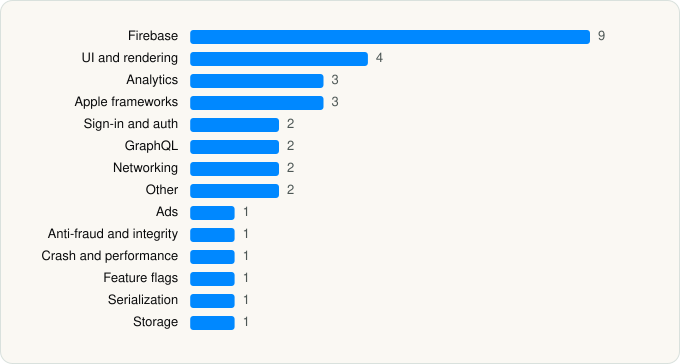

<picture><source media="(prefers-color-scheme: dark)" srcset="../../../../assets/logo/logo-dark.svg"></picture> [Tech Stack](../../../../README.md) / [REDDIT, INC.](../../../../companies/reddit-inc.md) / Reddit

# Reddit

<picture><source media="(prefers-color-scheme: dark)" srcset="../../../../assets/badges/ios-dark.svg"></picture> <picture><source media="(prefers-color-scheme: dark)" srcset="../../../../assets/badges/active-dark.svg"></picture> <picture><source media="(prefers-color-scheme: dark)" srcset="../../../../assets/badges/floor-dark.svg"></picture> <picture><source media="(prefers-color-scheme: dark)" srcset="../../../../assets/badges/encrypted-dark.svg"></picture>

[App Store](https://apps.apple.com/app/id1064216828) · [latest.json](latest.json)

| | |
|---|---|
| Company | [REDDIT, INC.](../../../../companies/reddit-inc.md) |
| Store id | `1064216828` |
| Bundle / package id | `com.reddit.Reddit` |
| Latest version | 2026.22.0 (analysed 2026-06-19) |
| Versions tracked | 1 |
| SDKs in latest version | 33 |
| Languages | C/C++, Metal (shaders), Objective-C, Swift |
| UI | Lottie (animations), SwiftUI, UIKit |
| Build | Swift Package Manager (SwiftPM) |
| Minimum OS | iOS 16.0 (built with Xcode 26.1, SDK iphoneos26.1) |
| Devices / ABIs | iPhone, iPad |
| Localisations | 35 |
| Capabilities | 9 |
| Declares tracking | Yes |
| Tracked | Yes |

## SDKs by category

<picture><source media="(prefers-color-scheme: dark)" srcset="../../../../assets/charts/apps/ios/reddit-inc/reddit-dark.svg"></picture>

- **Firebase** (9): FBLPromises, Firebase, FirebaseCore, FirebaseCoreInternal, FirebaseInstallations, GoogleDataTransport, GoogleUtilities, nanopb, Promises
- **UI and rendering** (4): DifferenceKit, IGListKit, Lottie, Nuke
- **Analytics** (3): AppsFlyerLib, Branch, GoogleAppMeasurement
- **Apple frameworks** (3): DequeModule, OrderedCollections, swift-collections
- **Sign-in and auth** (2): AppAuth, InteropForGoogle
- **GraphQL** (2): Apollo, ApolloAPI
- **Networking** (2): AFNetworking, NIOPosix 1.0
- **Other** (2): PINCache, PINOperation
- **Ads** (1): GoogleAdsOnDeviceConversion
- **Anti-fraud and integrity** (1): RecaptchaEnterprise
- **Crash and performance** (1): FirebaseCrashlytics
- **Feature flags** (1): Experiment
- **Serialization** (1): SwiftProtobuf
- **Storage** (1): SQLite.swift

Frameworks (31)

ActivityKit (Live Activities), AdServices (Apple Search Ads attribution), AdSupport (IDFA), App Tracking Transparency (ATT), Authentication Services (Sign in with Apple / passkeys), AVFoundation (audio/video), AVKit, Background Tasks, Combine (reactive), Core Data, Core Image, Core Motion, CryptoKit, DeviceCheck / App Attest, EventKit (Calendar / Reminders), Local Authentication (Face ID / Touch ID), MapKit, MessageUI (mail / SMS compose), MetalKit, MetricKit (diagnostics), Network.framework, Photos, PhotosUI, SafariServices, SiriKit (Intents), StoreKit (in-app purchase), Swift Charts, SwiftUI, UIKit, User Notifications, WidgetKit (widgets)

Capabilities (9)

App Groups, Associated Domains (Universal Links), Background App Refresh, Background Push, CloudKit, iCloud, Keychain Sharing, Push Notifications (APNs), Sign in with Apple

## Version history

| Version | Analysed | Store update | SDKs | Change | SDK list is a floor | Binary encrypted | File |
|---|---|---|---|---|---|---|---|
| 2026.22.0 | 2026-06-19 |  | 33 |  | Yes | Yes | [2026.22.0.json](2026.22.0.json) |

---

Generated by `scripts/build_readme.py` from the JSON files. Do not edit by hand.
