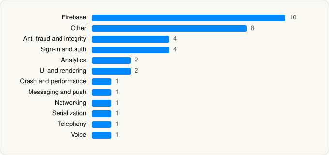

<picture><source media="(prefers-color-scheme: dark)" srcset="../../../../assets/logo/logo-dark.svg"></picture> [Tech Stack](../../../../README.md) / [Revolut Ltd](../../../../companies/revolut-ltd.md) / Revolut

# Revolut: send, spend, and save

<picture><source media="(prefers-color-scheme: dark)" srcset="../../../../assets/badges/ios-dark.svg"></picture> <picture><source media="(prefers-color-scheme: dark)" srcset="../../../../assets/badges/active-dark.svg"></picture> <picture><source media="(prefers-color-scheme: dark)" srcset="../../../../assets/badges/floor-dark.svg"></picture> <picture><source media="(prefers-color-scheme: dark)" srcset="../../../../assets/badges/encrypted-dark.svg"></picture>

[App Store](https://apps.apple.com/app/id932493382) · [latest.json](latest.json)

| | |
|---|---|
| Company | [Revolut Ltd](../../../../companies/revolut-ltd.md) |
| Store id | `932493382` |
| Bundle / package id | `com.revolut.revolut` |
| Latest version | 10.153 (analysed 2026-10-24) |
| Versions tracked | 1 |
| SDKs in latest version | 36 |
| Languages | C/C++, Metal (shaders), Objective-C, Swift |
| UI | Lottie (animations), SwiftUI, UIKit |
| Build | Swift Package Manager (SwiftPM) |
| Minimum OS | iOS 15.0 (built with Xcode 27.1, SDK iphoneos27.1) |
| Devices / ABIs | iPhone, iPad |
| Localisations | 29 |
| Capabilities | 16 |
| Declares tracking | No |
| Tracked | Yes |

## SDKs by category

<picture><source media="(prefers-color-scheme: dark)" srcset="../../../../assets/charts/apps/ios/revolut-ltd/revolut-dark.svg"></picture>

- **Firebase** (10): FBLPromises 2.4.0, Firebase 12.1.0, FirebaseCore 12.1.0, FirebaseCoreInternal 12.1.0, FirebaseInstallations 12.1.0, FirebaseRemoteConfig 12.1.0, GoogleDataTransport 10.1.0, GoogleUtilities 8.1.0, nanopb 3.30910.0, Promises 2.4.0
- **Other** (8): IncdOnboarding 5.44.1-str, LinkSDK, OpenSSL 3.3.3001, runtime 1.0, SeonSDK 5.5.2, TrustdockAPI 1.5.2, TrustdockSDKCommon 1.5.2, TrustKit 3.0.7
- **Anti-fraud and integrity** (4): HCaptcha 2.8.0, ItrustEkycLibrary 1.7.1, Onfido 1.0, TrustdockEkycJapaneseICChipReading 1.5.2
- **Sign-in and auth** (4): AppAuth 2.0.0, GoogleSignIn 9.0.0, GTMAppAuth 5.0.0, GTMSessionFetcher 3.5.0
- **Analytics** (2): Facebook SDK, Kronos 4.3.0
- **UI and rendering** (2): Lottie 4.4.1, SDWebImage 5.19.1
- **Crash and performance** (1): FirebaseCrashlytics 12.1.0
- **Messaging and push** (1): FirebaseMessaging 12.1.0
- **Networking** (1): NIOPosix 1.0
- **Serialization** (1): SwiftProtobuf
- **Telephony** (1): PhoneNumberKit 4.0.1
- **Voice** (1): TwilioVoice 6.13.5

Frameworks (40)

AdSupport (IDFA), App Tracking Transparency (ATT), Authentication Services (Sign in with Apple / passkeys), AVFoundation (audio/video), AVKit, CallKit (VoIP), Combine (reactive), Contacts, Core Bluetooth, Core Data, Core Image, Core Location, Core ML, Core Motion, Core NFC, CryptoKit, DeviceCheck / App Attest, EventKit (Calendar / Reminders), Local Authentication (Face ID / Touch ID), MapKit, MessageUI (mail / SMS compose), MetalKit, MetricKit (diagnostics), Network.framework, PassKit (Wallet / Apple Pay), PDFKit, Photos, PhotosUI, PushKit (VoIP push), SafariServices, SceneKit, SiriKit (Intents), SpriteKit, StoreKit (in-app purchase), SwiftUI, UIKit, User Notifications, Vision, Watch Connectivity, WidgetKit (widgets)

Capabilities (16)

App Attest, App Groups, Apple Pay, Associated Domains (Universal Links), Background Location, Background Push, Bluetooth (central), CloudKit, Communication Notifications, iCloud, iCloud Key-Value Storage, NFC, Push Notifications (APNs), Sign in with Apple, VoIP, Wallet passes

## Version history

| Version | Analysed | Store update | SDKs | Change | SDK list is a floor | Binary encrypted | File |
|---|---|---|---|---|---|---|---|
| 10.153 | 2026-10-24 | 2026-10-23 | 36 |  | Yes | Yes | [10.153.json](10.153.json) |

---

Generated by `scripts/build_readme.py` from the JSON files. Do not edit by hand.
