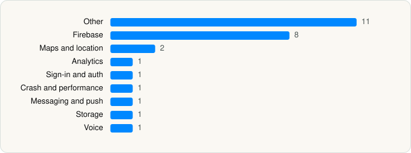

<picture><source media="(prefers-color-scheme: dark)" srcset="../../../../assets/logo/logo-dark.svg"></picture> [Tech Stack](../../../../README.md) / [Rimthan](../../../../companies/rimthan.md) / Masi

# Masi - Trains & More

<picture><source media="(prefers-color-scheme: dark)" srcset="../../../../assets/badges/ios-dark.svg"></picture> <picture><source media="(prefers-color-scheme: dark)" srcset="../../../../assets/badges/inactive-dark.svg"></picture> <picture><source media="(prefers-color-scheme: dark)" srcset="../../../../assets/badges/floor-dark.svg"></picture> <picture><source media="(prefers-color-scheme: dark)" srcset="../../../../assets/badges/encrypted-dark.svg"></picture>

[App Store](https://apps.apple.com/app/id6809328945) · [latest.json](latest.json)

| | |
|---|---|
| Company | [Rimthan](../../../../companies/rimthan.md) |
| Store id | `6809328945` |
| Bundle / package id | `com.rimthan.masi` |
| Latest version | 1.1.1 (analysed 2026-11-22) |
| Versions tracked | 1 |
| SDKs in latest version | 27 |
| Languages | C/C++, Flutter / Dart, Metal (shaders), Objective-C, Swift |
| UI | SwiftUI, UIKit |
| Build | Swift Package Manager (SwiftPM) |
| Minimum OS | iOS 15.5 (built with Xcode 26.6, SDK iphoneos26.5) |
| Devices / ABIs | iPhone, iPad |
| Localisations | 0 |
| Capabilities | 6 |
| Declares tracking | No |
| Tracked | No. Kept for history. |

## SDKs by category

<picture><source media="(prefers-color-scheme: dark)" srcset="../../../../assets/charts/apps/ios/rimthan/masi-dark.svg"></picture>

- **Other** (11): apple, c 1.0, darwin, Flutter 1.0, foundation, links, notifications, OPPWAMobile 7.11.0, passkit, plus, wkwebview
- **Firebase** (8): FBLPromises, Firebase, FirebaseCore, FirebaseCoreInternal, FirebaseInstallations, GoogleDataTransport, GoogleUtilities 8.1.1, nanopb
- **Maps and location** (2): GMSCore 25.0.0, GoogleMaps 9.4.0
- **Analytics** (1): Amplitude 1.0
- **Sign-in and auth** (1): GTMSessionFetcher 3.5.0
- **Crash and performance** (1): Sentry 8.58.4
- **Messaging and push** (1): FirebaseMessaging
- **Storage** (1): GoogleToolboxForMac 4.2.1
- **Voice** (1): WebRTC 1.0

Frameworks (29)

ActivityKit (Live Activities), App Intents, Authentication Services (Sign in with Apple / passkeys), AVFoundation (audio/video), Combine (reactive), Contacts, Core Data, Core Image, Core Location, Core Motion, CryptoKit, Local Authentication (Face ID / Touch ID), MapKit, MessageUI (mail / SMS compose), MetalKit, MetricKit (diagnostics), Network.framework, PassKit (Wallet / Apple Pay), PDFKit, Photos, PhotosUI, SafariServices, SiriKit (Intents), Speech (recognition), SwiftUI, UIKit, User Notifications, Vision, WidgetKit (widgets)

Capabilities (6)

App Groups, Apple Pay, Associated Domains (Universal Links), Background App Refresh, Background Push, Push Notifications (APNs)

## Version history

| Version | Analysed | Store update | SDKs | Change | SDK list is a floor | Binary encrypted | File |
|---|---|---|---|---|---|---|---|
| 1.1.1 | 2026-11-22 |  | 27 |  | Yes | Yes | [1.1.1.json](1.1.1.json) |

---

Generated by `scripts/build_readme.py` from the JSON files. Do not edit by hand.
