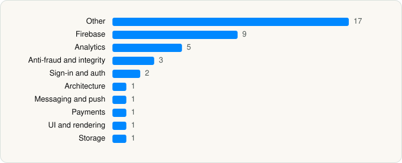

<picture><source media="(prefers-color-scheme: dark)" srcset="../../../../assets/logo/logo-dark.svg"></picture> [Tech Stack](../../../../README.md) / [ROADGET BUSINESS PTE. LTD.](../../../../companies/roadget-business-pte-ltd.md) / SHEIN

# SHEIN - Shopping Online

<picture><source media="(prefers-color-scheme: dark)" srcset="../../../../assets/badges/ios-dark.svg"></picture> <picture><source media="(prefers-color-scheme: dark)" srcset="../../../../assets/badges/active-dark.svg"></picture> <picture><source media="(prefers-color-scheme: dark)" srcset="../../../../assets/badges/floor-dark.svg"></picture> <picture><source media="(prefers-color-scheme: dark)" srcset="../../../../assets/badges/encrypted-dark.svg"></picture>

[App Store](https://apps.apple.com/app/id878577184) · [latest.json](latest.json)

| | |
|---|---|
| Company | [ROADGET BUSINESS PTE. LTD.](../../../../companies/roadget-business-pte-ltd.md) |
| Store id | `878577184` |
| Bundle / package id | `zzkko.com.ZZKKO` |
| Latest version | 15.5.6 (analysed 2026-10-24) |
| Versions tracked | 1 |
| SDKs in latest version | 41 |
| Languages | C/C++, Objective-C, Swift |
| UI | SwiftUI, UIKit |
| Build | Swift Package Manager (SwiftPM) |
| Minimum OS | iOS 15.0 (built with Xcode 27.0, SDK iphoneos27.0) |
| Devices / ABIs | iPhone, iPad |
| Localisations | 46 |
| Capabilities | 11 |
| Declares tracking | Yes |
| Tracked | Yes |

## SDKs by category

<picture><source media="(prefers-color-scheme: dark)" srcset="../../../../assets/charts/apps/ios/roadget-business-pte-ltd/shein-dark.svg"></picture>

- **Other** (17): api 15.2.2, browser 15.5.0, bundle 15.5.6, CardinalMobile 2.2.5, live, message, MJRefresh, order, photo, popup, PrivacyInfo, saver 15.5.6, service 15.0.2, share, TDCorePlugin 4.3, TMXProfiling 1.0, TMXProfilingConnections 1.0
- **Firebase** (9): FBLPromises 2.4.0, Firebase 11.15.0, FirebaseCore 11.15.0, FirebaseCoreInternal 11.15.0, FirebaseInstallations 11.15.0, FirebaseRemoteConfig 11.15.0, GoogleDataTransport 10.0.0, GoogleUtilities 8.1.0, nanopb 3.30910.0
- **Analytics** (5): AppsFlyerLib 6.17.1, Branch, Facebook SDK, TikTokOpenSDK 2.5.0, TikTokOpenShareSDK 2.5.0
- **Anti-fraud and integrity** (3): Forter 2.3.3, GT3Captcha 8.1.0, RiskifiedBeacon 1.0
- **Sign-in and auth** (2): GoogleSignIn 1.0, NaverThirdPartyLogin 4.2.0
- **Architecture** (1): Swinject 2.9.1
- **Messaging and push** (1): FirebaseMessaging 11.15.0
- **Payments** (1): Braintree 6.41.0
- **UI and rendering** (1): SDWebImage 5.18.12
- **Storage** (1): platform 15.5.4

Frameworks (34)

ActivityKit (Live Activities), AdServices (Apple Search Ads attribution), AdSupport (IDFA), App Intents, App Tracking Transparency (ATT), Authentication Services (Sign in with Apple / passkeys), AVFoundation (audio/video), AVKit, CallKit (VoIP), Combine (reactive), Contacts, Core Data, Core Image, Core Location, Core Motion, CryptoKit, DeviceCheck / App Attest, EventKit (Calendar / Reminders), Local Authentication (Face ID / Touch ID), Media Player, MessageUI (mail / SMS compose), Natural Language, Network.framework, PassKit (Wallet / Apple Pay), Photos, PhotosUI, SafariServices, SiriKit (Intents), StoreKit (in-app purchase), SwiftUI, UIKit, User Notifications, Vision, WidgetKit (widgets)

Capabilities (11)

App Attest, App Groups, Apple Pay, Associated Domains (Universal Links), Background App Refresh, Background Audio, Background Push, Communication Notifications, Push Notifications (APNs), Sign in with Apple, Time-Sensitive Notifications

## Version history

| Version | Analysed | Store update | SDKs | Change | SDK list is a floor | Binary encrypted | File |
|---|---|---|---|---|---|---|---|
| 15.5.6 | 2026-10-24 | 2026-10-24 | 41 |  | Yes | Yes | [15.5.6.json](15.5.6.json) |

---

Generated by `scripts/build_readme.py` from the JSON files. Do not edit by hand.
