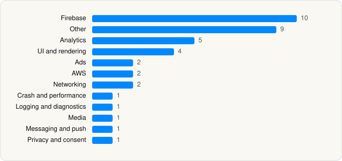

<picture><source media="(prefers-color-scheme: dark)" srcset="../../../../assets/logo/logo-dark.svg"></picture> [Tech Stack](../../../../README.md) / [ROKU INC](../../../../companies/roku-inc.md) / Roku Remote (Official)

# Roku Remote (Official)

<picture><source media="(prefers-color-scheme: dark)" srcset="../../../../assets/badges/ios-dark.svg"></picture> <picture><source media="(prefers-color-scheme: dark)" srcset="../../../../assets/badges/active-dark.svg"></picture> <picture><source media="(prefers-color-scheme: dark)" srcset="../../../../assets/badges/floor-dark.svg"></picture> <picture><source media="(prefers-color-scheme: dark)" srcset="../../../../assets/badges/encrypted-dark.svg"></picture>

[App Store](https://apps.apple.com/app/id482066631) · [latest.json](latest.json)

| | |
|---|---|
| Company | [ROKU INC](../../../../companies/roku-inc.md) |
| Store id | `482066631` |
| Bundle / package id | `com.roku.ios.roku` |
| Latest version | 14.1.2 (analysed 2026-11-02) |
| Versions tracked | 1 |
| SDKs in latest version | 39 |
| Languages | C/C++, Objective-C, Swift |
| UI | Lottie (animations), SwiftUI, UIKit |
| Build | Swift Package Manager (SwiftPM) |
| Minimum OS | iOS 16.0 (built with Xcode 26.2, SDK iphoneos26.2) |
| Devices / ABIs | iPhone, iPad |
| Localisations | 11 |
| Capabilities | 6 |
| Declares tracking | No |
| Tracked | Yes |

## SDKs by category

<picture><source media="(prefers-color-scheme: dark)" srcset="../../../../assets/charts/apps/ios/roku-inc/roku-remote-official-dark.svg"></picture>

- **Firebase** (10): FBLPromises, Firebase, FirebaseCore, FirebaseCoreInternal, FirebaseInstallations, FirebaseRemoteConfig, GoogleDataTransport, GoogleUtilities, nanopb, Promises
- **Other** (9): Bugsee 1.0, CryptoSwift, DebugMenu, DeviceIdentifier, IQKeyboardManagerSwift, MBProgressHUD, MobileProtect 26.0.2, MobileProtectTelemetry 26.0.2, TrustKit
- **Analytics** (5): BrazeKit 14.0.4, FirebaseAnalytics 11.10.0, GoogleAppMeasurement 11.10.0, GoogleAppMeasurementIdentitySupport 11.10.0, UserLeapKit 4.8.5
- **UI and rendering** (4): Lottie, SDWebImage, SkeletonView, SVGKit
- **Ads** (2): Google Mobile Ads (AdMob), GoogleMobileAds 13.2.0
- **AWS** (2): AWSAuthCore 2.34.2, AWSCore 2.34.2
- **Networking** (2): Reachability, Starscream
- **Crash and performance** (1): FirebaseCrashlytics
- **Logging and diagnostics** (1): CocoaLumberjack
- **Media** (1): GoogleInteractiveMediaAds 3.26.1
- **Messaging and push** (1): BrazeUI
- **Privacy and consent** (1): UserMessagingPlatform 3.1.0

Frameworks (28)

ActivityKit (Live Activities), AdSupport (IDFA), App Tracking Transparency (ATT), AVFoundation (audio/video), AVKit, Combine (reactive), Core Image, Core Location, Core Motion, CryptoKit, DeviceCheck / App Attest, Local Authentication (Face ID / Touch ID), MapKit, Media Player, MessageUI (mail / SMS compose), MetricKit (diagnostics), Natural Language, Network.framework, Photos, PhotosUI, SafariServices, SiriKit (Intents), Speech (recognition), StoreKit (in-app purchase), SwiftUI, UIKit, User Notifications, Watch Connectivity

Capabilities (6)

App Groups, Associated Domains (Universal Links), Background Audio, Background Push, Keychain Sharing, Push Notifications (APNs)

## Version history

| Version | Analysed | Store update | SDKs | Change | SDK list is a floor | Binary encrypted | File |
|---|---|---|---|---|---|---|---|
| 14.1.2 | 2026-11-02 | 2026-09-21 | 39 |  | Yes | Yes | [14.1.2.json](14.1.2.json) |

---

Generated by `scripts/build_readme.py` from the JSON files. Do not edit by hand.
