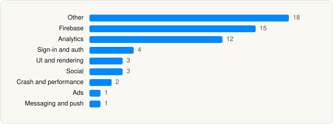

<picture><source media="(prefers-color-scheme: dark)" srcset="../../../../assets/logo/logo-dark.svg"></picture> [Tech Stack](../../../../README.md) / [Romangic Lab LLC](../../../../companies/romangic-lab-llc.md) / WayShot

# WayShot:Aesthetic Photo Editor

<picture><source media="(prefers-color-scheme: dark)" srcset="../../../../assets/badges/ios-dark.svg"></picture> <picture><source media="(prefers-color-scheme: dark)" srcset="../../../../assets/badges/active-dark.svg"></picture> <picture><source media="(prefers-color-scheme: dark)" srcset="../../../../assets/badges/floor-dark.svg"></picture> <picture><source media="(prefers-color-scheme: dark)" srcset="../../../../assets/badges/encrypted-dark.svg"></picture>

[App Store](https://apps.apple.com/app/id6749303003) · [latest.json](latest.json)

| | |
|---|---|
| Company | [Romangic Lab LLC](../../../../companies/romangic-lab-llc.md) |
| Store id | `6749303003` |
| Bundle / package id | `com.romangic.wayshot` |
| Latest version | 2.14.0 (analysed 2026-11-02) |
| Versions tracked | 1 |
| SDKs in latest version | 59 |
| Languages | C/C++, Metal (shaders), Objective-C, Swift |
| UI | Lottie (animations), SwiftUI, UIKit |
| Build | Swift Package Manager (SwiftPM) |
| Minimum OS | iOS 18.0 (built with Xcode 27.0, SDK iphoneos27.0) |
| Devices / ABIs | iPhone |
| Localisations | 12 |
| Capabilities | 6 |
| Declares tracking | Yes |
| Tracked | Yes |

## SDKs by category

<picture><source media="(prefers-color-scheme: dark)" srcset="../../../../assets/charts/apps/ios/romangic-lab-llc/wayshot-aesthetic-photo-editor-dark.svg"></picture>

- **Other** (18): absl 1.20240722.0, abslWrapper, ACCoreKit, ACDarkroomLegacyUI, ACEquityKit, ACFoundation, ACHairRetouchKit, ACHomeKit, ACMediaKit, ACProfileKit, ACProfileKitMembershipFeature, ACRenderKit, ACShootKit, ACWelcomeKit, Adapty, AdaptyUI, opensslWrapper, PHPLCrashReporter
- **Firebase** (15): abseil, ACFirebaseKit, FBLPromises, Firebase, FirebaseAuth, FirebaseCore, FirebaseCoreInternal, FirebaseFirestore, FirebaseInstallations, FirebaseRemoteConfig, GoogleDataTransport, GoogleUtilities, gRPC, leveldb, nanopb
- **Analytics** (12): Adjust 1.0, AdjustSdk, FacebookAEM, FacebookCore, FBAEMKit 1.0, FBSDKCoreKit 1.0, FirebaseAnalytics 12.13.0, GoogleAppMeasurement 12.13.0, GoogleAppMeasurementIdentitySupport 12.13.0, PostHog, TikTokOpenSDK, TikTokOpenShareSDK
- **Sign-in and auth** (4): AppAuth, GoogleSignIn, GTMAppAuth, GTMSessionFetcher
- **UI and rendering** (3): Kingfisher, Lottie 4.6.1, SnapKit
- **Social** (3): FacebookShare, FBSDKShareKit 1.0, SCSDKCreativeKit 2.5.0
- **Crash and performance** (2): DatadogCore, Sentry 8.58.4
- **Ads** (1): GoogleAdsOnDeviceConversion 3.5.0
- **Messaging and push** (1): FirebaseMessaging

Frameworks (26)

AdServices (Apple Search Ads attribution), AdSupport (IDFA), App Tracking Transparency (ATT), Authentication Services (Sign in with Apple / passkeys), AVFoundation (audio/video), AVKit, Combine (reactive), Core Data, Core Image, Core Motion, CryptoKit, Local Authentication (Face ID / Touch ID), MessageUI (mail / SMS compose), MetalKit, MetricKit (diagnostics), Network.framework, PDFKit, Photos, PhotosUI, SafariServices, StoreKit (in-app purchase), SwiftData (persistence), SwiftUI, UIKit, User Notifications, Vision

Capabilities (6)

Associated Domains (Universal Links), Background App Refresh, Background Processing, Background Push, Push Notifications (APNs), Sign in with Apple

## Version history

| Version | Analysed | Store update | SDKs | Change | SDK list is a floor | Binary encrypted | File |
|---|---|---|---|---|---|---|---|
| 2.14.0 | 2026-11-02 | 2026-10-27 | 59 |  | Yes | Yes | [2.14.0.json](2.14.0.json) |

---

Generated by `scripts/build_readme.py` from the JSON files. Do not edit by hand.
