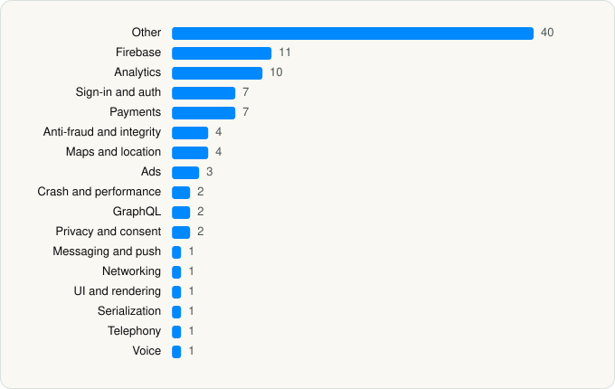

<picture><source media="(prefers-color-scheme: dark)" srcset="../../../../assets/logo/logo-dark.svg"></picture> [Tech Stack](../../../../README.md) / [ROOFOODS LTD](../../../../companies/roofoods-ltd.md) / Deliveroo

# Deliveroo: Food & Shopping

<picture><source media="(prefers-color-scheme: dark)" srcset="../../../../assets/badges/ios-dark.svg"></picture> <picture><source media="(prefers-color-scheme: dark)" srcset="../../../../assets/badges/active-dark.svg"></picture> <picture><source media="(prefers-color-scheme: dark)" srcset="../../../../assets/badges/floor-dark.svg"></picture> <picture><source media="(prefers-color-scheme: dark)" srcset="../../../../assets/badges/encrypted-dark.svg"></picture>

[App Store](https://apps.apple.com/app/id1001501844) · [latest.json](latest.json)

| | |
|---|---|
| Company | [ROOFOODS LTD](../../../../companies/roofoods-ltd.md) |
| Store id | `1001501844` |
| Bundle / package id | `com.deliveroo.orderapp` |
| Latest version | 3.346.0 (analysed 2026-11-01) |
| Versions tracked | 2 |
| SDKs in latest version | 98 |
| Languages | C/C++, Metal (shaders), Objective-C, Swift |
| UI | Lottie (animations), SwiftUI, UIKit |
| Build | Swift Package Manager (SwiftPM) |
| Minimum OS | iOS 17.0 (built with Xcode 26.0.1, SDK iphoneos26.0) |
| Devices / ABIs | iPhone, iPad |
| Localisations | 7 |
| Capabilities | 9 |
| Declares tracking | Yes |
| Tracked | Yes |

## SDKs by category

<picture><source media="(prefers-color-scheme: dark)" srcset="../../../../assets/charts/apps/ios/roofoods-ltd/deliveroo-dark.svg"></picture>

- **Other** (40): AppIntegrationRooConsumer, CommonModelsService, DebugTools, Frames, GooglePlaces 10.0.0, GooglePlacesSwift 10.0.0, GooglePlacesSwiftTarget, GooglePlacesTarget, Home, IconSet, IllustrationBadges, KMPItemPage 2.112.0, LiveActivity, Localisations, MapsCore, Mosaic, MosaicPedregalStoreWebServicePrivate, MosaicSandbox, OrderTrackingContentServicePrivate, PedregalFeedWebServicePrivate, PedregalSearchWebServicePrivate, Prism, PrismIcons, PrismTokens, PrismTokensConsumer, PrismTokensDeliveroo, PrismTokensDeliverooPlus, ProductComponents, RooBlocksConsumer, SelfHelp, Stories, UnifiedADPPrivate, UnifiedConsumerBrandedAssetsRoo, UnifiedConsumerLocalizations, UnifiedLiveActivityViews, UnifiedOrderTrackingPrivate, UnifiedReturnsReceiptCapture, UnifiedStoreCardLocalization, UnifiedStorePrivate, VoiceClient
- **Firebase** (11): FBLPromises 2.4.0, Firebase 11.15.0, FirebaseCore 11.15.0, FirebaseCoreInternal 11.15.0, FirebaseInstallations 11.15.0, FirebasePerformance 11.15.0, FirebaseRemoteConfig 11.15.0, GoogleDataTransport 10.1.0, GoogleUtilities 8.1.0, nanopb 3.30910.0, Promises 2.4.0
- **Analytics** (10): AppsFlyerLib 1.0, Branch, BrazeKit 14.0.1, FacebookAEM, FacebookCore, FBAEMKit 1.0, FBSDKCoreKit 1.0, FirebaseAnalytics 11.15.0, GoogleAppMeasurement 11.15.0, GoogleAppMeasurementIdentitySupport 11.15.0
- **Sign-in and auth** (7): AppAuth, FacebookLogin, FBSDKLoginKit 1.0, GoogleSignIn, GTMAppAuth, GTMSessionFetcher, LoginSignup
- **Payments** (7): Adyen, Braintree, CheckoutEventLoggerKit 1.0, PaymentComponent, Payments, Stripe, UnifiedPostCheckoutAdsPrivate
- **Anti-fraud and integrity** (4): Fingerprint 2.16.0, PPRiskMagnes 1.0, RecaptchaEnterprise 1.0, ShieldFraud 1.0
- **Maps and location** (4): GMSCore 25.23.0, GoogleMaps, Mapbox 23.12.1, MapboxMaps
- **Ads** (3): Google Mobile Ads (AdMob), GoogleAdsOnDeviceConversion 2.1.0, GoogleMobileAds 13.10.0
- **Crash and performance** (2): DatadogCore, FirebaseCrashlytics 11.15.0
- **GraphQL** (2): Apollo, ApolloAPI
- **Privacy and consent** (2): OTPublishersHeadlessSDK 202604.1.0, UserMessagingPlatform 3.1.0
- **Messaging and push** (1): BrazeUI
- **Networking** (1): Reachability
- **UI and rendering** (1): Lottie 4.5.2
- **Serialization** (1): SwiftProtobuf
- **Telephony** (1): PhoneNumberKit
- **Voice** (1): TwilioVoice 6.10.0

Frameworks (40)

ActivityKit (Live Activities), AdServices (Apple Search Ads attribution), AdSupport (IDFA), App Intents, App Tracking Transparency (ATT), Authentication Services (Sign in with Apple / passkeys), AVFoundation (audio/video), AVKit, Background Tasks, CallKit (VoIP), Combine (reactive), Contacts, Core Data, Core Image, Core Location, Core Motion, CryptoKit, DeviceCheck / App Attest, EventKit (Calendar / Reminders), Local Authentication (Face ID / Touch ID), MapKit, MessageUI (mail / SMS compose), MetalKit, MetricKit (diagnostics), Network.framework, PassKit (Wallet / Apple Pay), Photos, PhotosUI, PushKit (VoIP push), SafariServices, SceneKit, SiriKit (Intents), StoreKit (in-app purchase), Swift Charts, SwiftUI, UIKit, User Notifications, Vision, VisionKit (document/data scanning), WidgetKit (widgets)

Capabilities (9)

App Groups, Apple Pay, Associated Domains (Universal Links), Background Push, Keychain Sharing, Push Notifications (APNs), Sign in with Apple, Time-Sensitive Notifications, VoIP

## Version history

| Version | Analysed | Store update | SDKs | Change | SDK list is a floor | Binary encrypted | File |
|---|---|---|---|---|---|---|---|
| 3.346.0 | 2026-11-01 | 2026-10-29 | 98 | +0 / −0 | Yes | Yes | [3.346.0.json](3.346.0.json) |
| 3.345.0 | 2026-10-24 | 2026-10-20 | 98 |  | Yes | Yes | [3.345.0.json](3.345.0.json) |

---

Generated by `scripts/build_readme.py` from the JSON files. Do not edit by hand.
