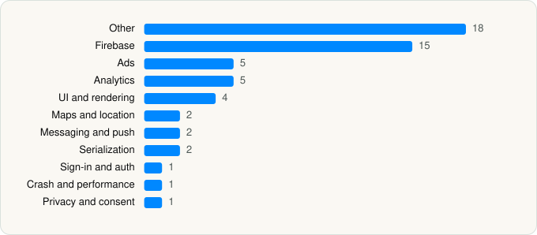

<picture><source media="(prefers-color-scheme: dark)" srcset="../../../../assets/logo/logo-dark.svg"></picture> [Tech Stack](../../../../README.md) / [Roppen Transportation Services Private Limited](../../../../companies/roppen-transportation-services-private-limited.md) / Rapido

# Rapido: Bike-Taxi, Auto & Cabs

<picture><source media="(prefers-color-scheme: dark)" srcset="../../../../assets/badges/ios-dark.svg"></picture> <picture><source media="(prefers-color-scheme: dark)" srcset="../../../../assets/badges/inactive-dark.svg"></picture> <picture><source media="(prefers-color-scheme: dark)" srcset="../../../../assets/badges/floor-dark.svg"></picture> <picture><source media="(prefers-color-scheme: dark)" srcset="../../../../assets/badges/encrypted-dark.svg"></picture>

[App Store](https://apps.apple.com/app/id1198464606) · [latest.json](latest.json)

| | |
|---|---|
| Company | [Roppen Transportation Services Private Limited](../../../../companies/roppen-transportation-services-private-limited.md) |
| Store id | `1198464606` |
| Bundle / package id | `bike.rapido.customer` |
| Latest version | 3.4.4 (analysed 2026-11-06) |
| Versions tracked | 1 |
| SDKs in latest version | 56 |
| Languages | C/C++, Kotlin Multiplatform, Metal (shaders), Objective-C, Swift |
| UI | Lottie (animations), SwiftUI, UIKit |
| Build | Swift Package Manager (SwiftPM) |
| Minimum OS | iOS 17.0 (built with Xcode 26.4.1, SDK iphoneos26.4) |
| Devices / ABIs | iPhone |
| Localisations | 0 |
| Capabilities | 5 |
| Declares tracking | Yes |
| Tracked | No. Kept for history. |

## SDKs by category

<picture><source media="(prefers-color-scheme: dark)" srcset="../../../../assets/charts/apps/ios/roppen-transportation-services-private-limited/rapido-dark.svg"></picture>

- **Other** (18): absl 1.20240722.0, abslWrapper, Airborne 1.0, AmazonPayHardenediOSSDK 1.0, CTNotificationService, GoogleRidesharingConsumer 10.10.1, GoogleRidesharingConsumerTarget, HyperAPay 1.0, HyperCore 1.0, HyperSDK 2.2, InMobiAdapter 10.8.6, JuspaySafeBrowser 1.0, opensslWrapper, OpenWrapHandlerDFP 1.0, OpenWrapSDK 4.5.2, Razorpay 1.0.0, RazorpayCore 1.0.1, RazorpayStandard 1.5.3
- **Firebase** (15): abseil, FBLPromises, Firebase, FirebaseAuth, FirebaseCore, FirebaseCoreInternal, FirebaseFirestore, FirebaseInstallations, FirebaseRemoteConfig, GoogleDataTransport, GoogleUtilities, gRPC, leveldb, nanopb, Promises
- **Ads** (5): Google Mobile Ads (AdMob), GoogleAdsOnDeviceConversion 3.7.0, GoogleMobileAds 12.7.0, InMobiSDK 10.8.6, Pubmatic 1.5.2
- **Analytics** (5): AppsFlyerLib 1.0, Facebook SDK, FirebaseAnalytics 12.19.2, GoogleAppMeasurement 12.19.2, GoogleAppMeasurementIdentitySupport 12.19.2
- **UI and rendering** (4): Kingfisher, Lottie, SDWebImage, SwiftMessages
- **Maps and location** (2): GMSCore 26.07.0, GoogleMaps
- **Messaging and push** (2): CleverTap 1.0, FirebaseMessaging
- **Serialization** (2): SwiftProtobuf, SwiftyJSON
- **Sign-in and auth** (1): GTMSessionFetcher
- **Crash and performance** (1): FirebaseCrashlytics
- **Privacy and consent** (1): UserMessagingPlatform 3.1.0

Frameworks (31)

AdSupport (IDFA), App Intents, App Tracking Transparency (ATT), Authentication Services (Sign in with Apple / passkeys), AVFoundation (audio/video), AVKit, CallKit (VoIP), Combine (reactive), Contacts, Core Data, Core Image, Core Location, Core Motion, CryptoKit, Local Authentication (Face ID / Touch ID), MapKit, MessageUI (mail / SMS compose), MetricKit (diagnostics), Natural Language, Network.framework, PassKit (Wallet / Apple Pay), Photos, PhotosUI, SafariServices, SiriKit (Intents), Speech (recognition), StoreKit (in-app purchase), SwiftData (persistence), SwiftUI, UIKit, User Notifications

Capabilities (5)

App Groups, Associated Domains (Universal Links), Background Location, Background Push, Push Notifications (APNs)

## Version history

| Version | Analysed | Store update | SDKs | Change | SDK list is a floor | Binary encrypted | File |
|---|---|---|---|---|---|---|---|
| 3.4.4 | 2026-11-06 | 2026-11-05 | 56 |  | Yes | Yes | [3.4.4.json](3.4.4.json) |

---

Generated by `scripts/build_readme.py` from the JSON files. Do not edit by hand.
