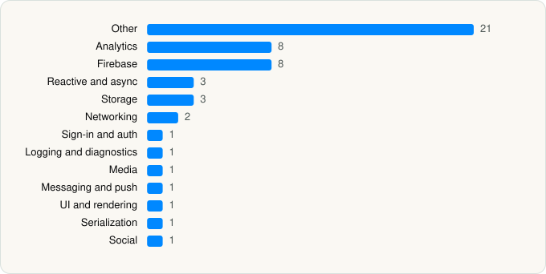

<picture><source media="(prefers-color-scheme: dark)" srcset="../../../../assets/logo/logo-dark.svg"></picture> [Tech Stack](../../../../README.md) / [Samsung Everland Co. Ltd.](../../../../companies/samsung-everland-co-ltd.md) / Everland

# Everland

<picture><source media="(prefers-color-scheme: dark)" srcset="../../../../assets/badges/ios-dark.svg"></picture> <picture><source media="(prefers-color-scheme: dark)" srcset="../../../../assets/badges/inactive-dark.svg"></picture> <picture><source media="(prefers-color-scheme: dark)" srcset="../../../../assets/badges/floor-dark.svg"></picture> <picture><source media="(prefers-color-scheme: dark)" srcset="../../../../assets/badges/encrypted-dark.svg"></picture>

[App Store](https://apps.apple.com/app/id396584034) · [latest.json](latest.json)

| | |
|---|---|
| Company | [Samsung Everland Co. Ltd.](../../../../companies/samsung-everland-co-ltd.md) |
| Store id | `396584034` |
| Bundle / package id | `com.everland.everlandguide` |
| Latest version | 5.0.31 (analysed 2026-11-14) |
| Versions tracked | 1 |
| SDKs in latest version | 52 |
| Languages | C/C++, Objective-C, Swift |
| UI | SwiftUI, UIKit |
| Build | Swift Package Manager (SwiftPM) |
| Minimum OS | iOS 14 (built with Xcode 26.4.1, SDK iphoneos26.4) |
| Devices / ABIs | iPhone |
| Localisations | 2 |
| Capabilities | 6 |
| Declares tracking | Yes |
| Tracked | No. Kept for history. |

## SDKs by category

<picture><source media="(prefers-color-scheme: dark)" srcset="../../../../assets/charts/apps/ios/samsung-everland-co-ltd/everland-dark.svg"></picture>

- **Other** (21): AdCashFramework 1.0, AdPopcornSSP 1.0, AEPCampaignClassic 5.0.0, AEPRulesEngine 5.0.0, AEPSignal 5.5.0, AEPUserProfile 5.0.0, APNGKit 2.3.0, BSImagePicker 3.3.3, BuzzAdBenefitSDK 6.1.0, BuzzAvatyeAdCash 6.1.0, BuzzBoosterSDK 6.1.0, BuzzRxSwift 6.6.0, BuzzvilSDK 6.1.0, CryptoSwift 1.6.0, DefaultsKit 0.3.2, Delegate 1.3.0, DeviceKit 5.6.0, Elephant 0.1.0, PincruxOfferwall 1.0, Swift 5.0.1, TalsecRuntime 6.12.1
- **Analytics** (8): AEPAnalytics 5.0.2, AEPCore 5.5.0, AEPIdentity 5.5.0, AEPLifecycle 5.5.0, AEPServices 5.5.0, Facebook SDK, FBAEMKit 1.0, FBSDKCoreKit 1.0
- **Firebase** (8): FBLPromises 2.4.0, FirebaseCore 11.12.0, FirebaseCoreInternal 11.12.0, FirebaseDynamicLinks 11.12.0, FirebaseInstallations 11.12.0, GoogleDataTransport 10.1.0, GoogleUtilities 8.1.0, nanopb 3.30910.0
- **Reactive and async** (3): RxCocoa 6.2.0, RxRelay 6.2.0, RxSwift 6.2.0
- **Storage** (3): KeychainAccess 4.2.2, Realm 10.51.0, RealmSwift 10.51.0
- **Networking** (2): Alamofire 5.10.2, Reachability 5.2.4
- **Sign-in and auth** (1): FBSDKLoginKit 1.0
- **Logging and diagnostics** (1): AEPAssurance 5.0.1
- **Media** (1): GoogleInteractiveMediaAds 3.26.1
- **Messaging and push** (1): FirebaseMessaging 11.12.0
- **UI and rendering** (1): SnapKit 5.0.1
- **Serialization** (1): SwiftyJSON 5.0.2
- **Social** (1): FBSDKShareKit 1.0

Frameworks (25)

AdSupport (IDFA), App Tracking Transparency (ATT), Authentication Services (Sign in with Apple / passkeys), AVFoundation (audio/video), AVKit, Combine (reactive), Contacts, Core Data, Core Image, Core Location, Core Motion, CryptoKit, HealthKit, Local Authentication (Face ID / Touch ID), Media Player, MessageUI (mail / SMS compose), Network.framework, Photos, PhotosUI, SafariServices, StoreKit (in-app purchase), SwiftUI, UIKit, User Notifications, Vision

Capabilities (6)

Background App Refresh, Background Location, Background Processing, Background Push, Keychain Sharing, Push Notifications (APNs)

## Version history

| Version | Analysed | Store update | SDKs | Change | SDK list is a floor | Binary encrypted | File |
|---|---|---|---|---|---|---|---|
| 5.0.31 | 2026-11-14 |  | 52 |  | Yes | Yes | [5.0.31.json](5.0.31.json) |

---

Generated by `scripts/build_readme.py` from the JSON files. Do not edit by hand.
