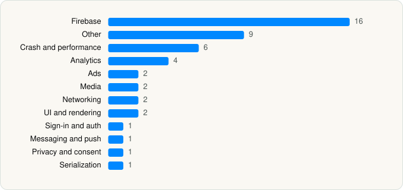

<picture><source media="(prefers-color-scheme: dark)" srcset="../../../../assets/logo/logo-dark.svg"></picture> [Tech Stack](../../../../README.md) / [SBS I&M Co., Ltd.](../../../../companies/sbs-i-m-co-ltd.md) / SBS

# SBS - 온에어 제공, VOD 7만편 제공

<picture><source media="(prefers-color-scheme: dark)" srcset="../../../../assets/badges/ios-dark.svg"></picture> <picture><source media="(prefers-color-scheme: dark)" srcset="../../../../assets/badges/inactive-dark.svg"></picture> <picture><source media="(prefers-color-scheme: dark)" srcset="../../../../assets/badges/floor-dark.svg"></picture> <picture><source media="(prefers-color-scheme: dark)" srcset="../../../../assets/badges/encrypted-dark.svg"></picture>

[App Store](https://apps.apple.com/app/id1020136055) · [latest.json](latest.json)

| | |
|---|---|
| Company | [SBS I&M Co., Ltd.](../../../../companies/sbs-i-m-co-ltd.md) |
| Store id | `1020136055` |
| Bundle / package id | `kr.co.sbs.sbsplayer` |
| Latest version | 3.31.0 (analysed 2026-11-19) |
| Versions tracked | 1 |
| SDKs in latest version | 47 |
| Languages | C/C++, Objective-C, Swift |
| UI | Lottie (animations), SwiftUI, UIKit |
| Build | Swift Package Manager (SwiftPM) |
| Minimum OS | iOS 15.0 (built with Xcode 26.2, SDK iphoneos26.2) |
| Devices / ABIs | iPhone, iPad |
| Localisations | 2 |
| Capabilities | 5 |
| Declares tracking | No |
| Tracked | No. Kept for history. |

## SDKs by category

<picture><source media="(prefers-color-scheme: dark)" srcset="../../../../assets/charts/apps/ios/sbs-i-m-co-ltd/sbs-dark.svg"></picture>

- **Firebase** (16): abseil, FBLPromises, Firebase, FirebaseAuth, FirebaseCore, FirebaseCoreInternal, FirebaseDynamicLinks, FirebaseFirestore, FirebaseInstallations, FirebaseRemoteConfig, GoogleDataTransport, GoogleUtilities, gRPC, leveldb, nanopb, Promises
- **Other** (9): absl 1.20240116.2, abslWrapper, AdFitSDK 3.18.3, APSSPSDK 1.0, CryptoSwift, GFPSDK 1.2.3, NaverAdsServices 1.0, Navercorp 1.6.2, opensslWrapper
- **Crash and performance** (6): Datadog, DatadogCore, DatadogCrashReporting, DatadogRUM, FirebaseCrashlytics, KSCrash
- **Analytics** (4): FirebaseAnalytics 11.4.0, GoogleAppMeasurement 11.4.0, GoogleAppMeasurementIdentitySupport 11.4.0, GoogleAppMeasurementOnDeviceConversion 11.0.0
- **Ads** (2): Google Mobile Ads (AdMob), GoogleMobileAds 11.12.0
- **Media** (2): GoogleCast 4.8.3, GoogleInteractiveMediaAds 3.23.0
- **Networking** (2): Alamofire, Starscream
- **UI and rendering** (2): Lottie 4.5.0, SkeletonView
- **Sign-in and auth** (1): GTMSessionFetcher
- **Messaging and push** (1): FirebaseMessaging
- **Privacy and consent** (1): UserMessagingPlatform 2.7.0
- **Serialization** (1): SwiftProtobuf

Frameworks (23)

AdSupport (IDFA), App Tracking Transparency (ATT), Authentication Services (Sign in with Apple / passkeys), AVFoundation (audio/video), AVKit, Combine (reactive), Core Data, Core Image, Core Location, Core Motion, CryptoKit, DeviceCheck / App Attest, MapKit, Media Player, MessageUI (mail / SMS compose), MetricKit (diagnostics), Network.framework, SafariServices, SceneKit, StoreKit (in-app purchase), SwiftUI, UIKit, User Notifications

Capabilities (5)

App Groups, Background App Refresh, Background Audio, Background Push, Push Notifications (APNs)

## Version history

| Version | Analysed | Store update | SDKs | Change | SDK list is a floor | Binary encrypted | File |
|---|---|---|---|---|---|---|---|
| 3.31.0 | 2026-11-19 |  | 47 |  | Yes | Yes | [3.31.0.json](3.31.0.json) |

---

Generated by `scripts/build_readme.py` from the JSON files. Do not edit by hand.
