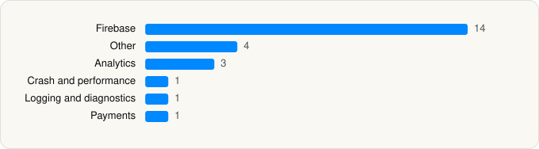

<picture><source media="(prefers-color-scheme: dark)" srcset="../../../../assets/logo/logo-dark.svg"></picture> [Tech Stack](../../../../README.md) / [Shelgaon Ltd](../../../../companies/shelgaon-ltd.md) / Kalo

# Kalo: AI Calorie Counter

<picture><source media="(prefers-color-scheme: dark)" srcset="../../../../assets/badges/ios-dark.svg"></picture> <picture><source media="(prefers-color-scheme: dark)" srcset="../../../../assets/badges/active-dark.svg"></picture> <picture><source media="(prefers-color-scheme: dark)" srcset="../../../../assets/badges/floor-dark.svg"></picture> <picture><source media="(prefers-color-scheme: dark)" srcset="../../../../assets/badges/encrypted-dark.svg"></picture>

[App Store](https://apps.apple.com/app/id6752915724) · [latest.json](latest.json)

| | |
|---|---|
| Company | [Shelgaon Ltd](../../../../companies/shelgaon-ltd.md) |
| Store id | `6752915724` |
| Bundle / package id | `ai.kalories` |
| Latest version | 1.6.9 (analysed 2026-06-23) |
| Versions tracked | 1 |
| SDKs in latest version | 24 |
| Languages | C/C++, Objective-C, Swift |
| UI | SwiftUI, UIKit |
| Build | Swift Package Manager (SwiftPM) |
| Minimum OS | iOS 18.2 (built with Xcode 26.3, SDK iphoneos26.2) |
| Devices / ABIs | iPhone, iPad |
| Localisations | 1 |
| Capabilities | 8 |
| Declares tracking | No |
| Tracked | Yes |

## SDKs by category

<picture><source media="(prefers-color-scheme: dark)" srcset="../../../../assets/charts/apps/ios/shelgaon-ltd/kalo-dark.svg"></picture>

- **Firebase** (14): abseil, FBLPromises, Firebase, FirebaseCore, FirebaseCoreInternal, FirebaseFirestore, FirebaseInstallations, FirebaseRemoteConfig, GoogleDataTransport, GoogleUtilities, gRPC, leveldb, nanopb, Promises
- **Other** (4): absl 1.20240116.2, abslWrapper, BrunoDS, opensslWrapper
- **Analytics** (3): FirebaseAnalytics 10.28.0, GoogleAppMeasurement 10.28.0, GoogleAppMeasurementIdentitySupport 10.28.0
- **Crash and performance** (1): FirebaseCrashlytics
- **Logging and diagnostics** (1): Atlantis
- **Payments** (1): RevenueCat

Frameworks (21)

ActivityKit (Live Activities), AdServices (Apple Search Ads attribution), App Intents, Authentication Services (Sign in with Apple / passkeys), AVFoundation (audio/video), Combine (reactive), CryptoKit, HealthKit, MetricKit (diagnostics), Network.framework, Photos, PhotosUI, SiriKit (Intents), Speech (recognition), StoreKit (in-app purchase), Swift Charts, SwiftData (persistence), SwiftUI, UIKit, User Notifications, WidgetKit (widgets)

Capabilities (8)

Background App Refresh, Background Push, CloudKit, HealthKit, iCloud, iCloud Key-Value Storage, Push Notifications (APNs), Sign in with Apple

## Version history

| Version | Analysed | Store update | SDKs | Change | SDK list is a floor | Binary encrypted | File |
|---|---|---|---|---|---|---|---|
| 1.6.9 | 2026-06-23 |  | 24 |  | Yes | Yes | [1.6.9.json](1.6.9.json) |

---

Generated by `scripts/build_readme.py` from the JSON files. Do not edit by hand.
