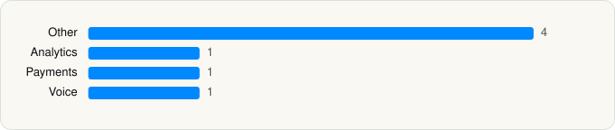

<picture><source media="(prefers-color-scheme: dark)" srcset="../../../../assets/logo/logo-dark.svg"></picture> [Tech Stack](../../../../README.md) / [Shelgaon Ltd](../../../../companies/shelgaon-ltd.md) / Workout Director

# Workout Director - Gym & Home

<picture><source media="(prefers-color-scheme: dark)" srcset="../../../../assets/badges/ios-dark.svg"></picture> <picture><source media="(prefers-color-scheme: dark)" srcset="../../../../assets/badges/active-dark.svg"></picture> <picture><source media="(prefers-color-scheme: dark)" srcset="../../../../assets/badges/floor-dark.svg"></picture> <picture><source media="(prefers-color-scheme: dark)" srcset="../../../../assets/badges/encrypted-dark.svg"></picture>

[App Store](https://apps.apple.com/app/id6813645709) · [latest.json](latest.json)

| | |
|---|---|
| Company | [Shelgaon Ltd](../../../../companies/shelgaon-ltd.md) |
| Store id | `6813645709` |
| Bundle / package id | `fit.workoutdirector` |
| Latest version | 1.0.89 (analysed 2026-11-01) |
| Versions tracked | 1 |
| SDKs in latest version | 7 |
| Languages | C/C++, Metal (shaders), Objective-C, Swift |
| UI | SwiftUI, UIKit |
| Build | Swift Package Manager (SwiftPM) |
| Minimum OS | iOS 18.2 (built with Xcode 26.5, SDK iphoneos26.5) |
| Devices / ABIs | iPhone, iPad |
| Localisations | 1 |
| Capabilities | 4 |
| Declares tracking | No |
| Tracked | Yes |

## SDKs by category

<picture><source media="(prefers-color-scheme: dark)" srcset="../../../../assets/charts/apps/ios/shelgaon-ltd/workout-director-gym-home-dark.svg"></picture>

- **Other** (4): BrunoDS, MediaPipeTasksCommon 1.1.1, MediaPipeTasksVision 1.1.1, PHPLCrashReporter
- **Analytics** (1): PostHog
- **Payments** (1): RevenueCat
- **Voice** (1): WebRTC 1.0

Frameworks (22)

AdServices (Apple Search Ads attribution), App Intents, Authentication Services (Sign in with Apple / passkeys), AVFoundation (audio/video), Combine (reactive), Core Image, Core ML, CryptoKit, HealthKit, MetalKit, Network.framework, Photos, PhotosUI, SiriKit (Intents), Speech (recognition), StoreKit (in-app purchase), Swift Charts, SwiftData (persistence), SwiftUI, UIKit, User Notifications, Vision

Capabilities (4)

Background App Refresh, Background Push, HealthKit, Sign in with Apple

## Version history

| Version | Analysed | Store update | SDKs | Change | SDK list is a floor | Binary encrypted | File |
|---|---|---|---|---|---|---|---|
| 1.0.89 | 2026-11-01 | 2026-10-31 | 7 |  | Yes | Yes | [1.0.89.json](1.0.89.json) |

---

Generated by `scripts/build_readme.py` from the JSON files. Do not edit by hand.
