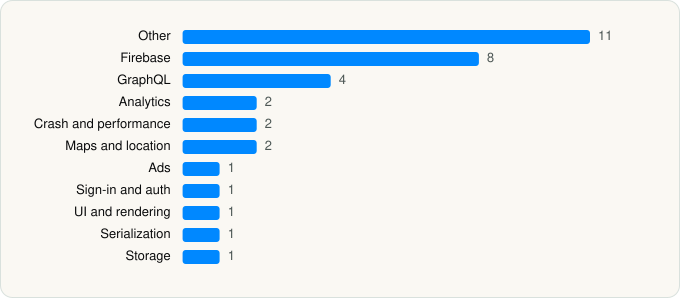

<picture><source media="(prefers-color-scheme: dark)" srcset="../../../../assets/logo/logo-dark.svg"></picture> [Tech Stack](../../../../README.md) / [Shopify Inc.](../../../../companies/shopify-inc.md) / Shop

# Shop: Track, Pay, Discover

<picture><source media="(prefers-color-scheme: dark)" srcset="../../../../assets/badges/ios-dark.svg"></picture> <picture><source media="(prefers-color-scheme: dark)" srcset="../../../../assets/badges/active-dark.svg"></picture> <picture><source media="(prefers-color-scheme: dark)" srcset="../../../../assets/badges/floor-dark.svg"></picture> <picture><source media="(prefers-color-scheme: dark)" srcset="../../../../assets/badges/encrypted-dark.svg"></picture>

[App Store](https://apps.apple.com/app/id1223471316) · [latest.json](latest.json)

| | |
|---|---|
| Company | [Shopify Inc.](../../../../companies/shopify-inc.md) |
| Store id | `1223471316` |
| Bundle / package id | `com.jadedlabs.arrive` |
| Latest version | 3.17.0 (analysed 2026-11-05) |
| Versions tracked | 1 |
| SDKs in latest version | 34 |
| Languages | C/C++, Metal (shaders), Objective-C, Swift |
| UI | Lottie (animations), SwiftUI, UIKit |
| Build | Swift Package Manager (SwiftPM) |
| Minimum OS | iOS 18.0 (built with Xcode 27.2, SDK iphoneos27.2) |
| Devices / ABIs | iPhone |
| Localisations | 19 |
| Capabilities | 6 |
| Declares tracking | No |
| Tracked | Yes |

## SDKs by category

<picture><source media="(prefers-color-scheme: dark)" srcset="../../../../assets/charts/apps/ios/shopify-inc/shop-dark.svg"></picture>

- **Other** (11): AtlasAPI 1.0, CCryptoBoringSSL, CCryptoBoringSSLShims, Crypto, CryptoBoringWrapper, CryptoExtras, Gravity 1.0, MinisAPI 1.0, MLKitCommon 14.0.0, MLKitNaturalLanguage 10.0.0, MLKitTranslate 8.0.0
- **Firebase** (8): FBLPromises, FirebaseCore, FirebaseCoreInternal, FirebaseInstallations, GoogleDataTransport, GoogleUtilities, nanopb, Promises
- **GraphQL** (4): Apollo, ApolloAPI, AtlasGraphQL 1.0, MinisGraphQL 1.0
- **Analytics** (2): FirebaseAnalytics 12.17.0, GoogleAppMeasurement 12.17.0
- **Crash and performance** (2): Bugsnag, MobileObservabilityAnalyticsProto
- **Maps and location** (2): GMSCore 26.30.0, GoogleMaps
- **Ads** (1): GoogleAdsOnDeviceConversion 3.6.0
- **Sign-in and auth** (1): GTMSessionFetcher
- **UI and rendering** (1): Lottie
- **Serialization** (1): SwiftProtobuf
- **Storage** (1): ZipArchive

Frameworks (27)

AdServices (Apple Search Ads attribution), App Intents, ARKit, Authentication Services (Sign in with Apple / passkeys), AVFoundation (audio/video), Combine (reactive), Contacts, Core Data, Core Image, Core Location, Core Motion, CryptoKit, DeviceCheck / App Attest, Local Authentication (Face ID / Touch ID), MapKit, MetricKit (diagnostics), Natural Language, Network.framework, Photos, PhotosUI, SafariServices, SiriKit (Intents), StoreKit (in-app purchase), SwiftUI, UIKit, User Notifications, WidgetKit (widgets)

Capabilities (6)

App Attest, App Groups, Associated Domains (Universal Links), Keychain Sharing, Push Notifications (APNs), Time-Sensitive Notifications

## Version history

| Version | Analysed | Store update | SDKs | Change | SDK list is a floor | Binary encrypted | File |
|---|---|---|---|---|---|---|---|
| 3.17.0 | 2026-11-05 | 2026-11-04 | 34 |  | Yes | Yes | [3.17.0.json](3.17.0.json) |

---

Generated by `scripts/build_readme.py` from the JSON files. Do not edit by hand.
