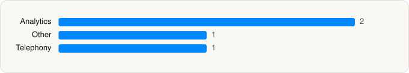

<picture><source media="(prefers-color-scheme: dark)" srcset="../../../../assets/logo/logo-dark.svg"></picture> [Tech Stack](../../../../README.md) / [SHUBHAMKUMAR PATEL](../../../../companies/shubhamkumar-patel.md) / Who Calling Pro

# Who Calling Pro

<picture><source media="(prefers-color-scheme: dark)" srcset="../../../../assets/badges/ios-dark.svg"></picture> <picture><source media="(prefers-color-scheme: dark)" srcset="../../../../assets/badges/inactive-dark.svg"></picture> <picture><source media="(prefers-color-scheme: dark)" srcset="../../../../assets/badges/floor-dark.svg"></picture> <picture><source media="(prefers-color-scheme: dark)" srcset="../../../../assets/badges/encrypted-dark.svg"></picture>

[App Store](https://apps.apple.com/app/id6813012717) · [latest.json](latest.json)

| | |
|---|---|
| Company | [SHUBHAMKUMAR PATEL](../../../../companies/shubhamkumar-patel.md) |
| Store id | `6813012717` |
| Bundle / package id | `com.clph.whclpls` |
| Latest version | 1.1 (analysed 2026-11-17) |
| Versions tracked | 1 |
| SDKs in latest version | 4 |
| Languages | C/C++, Objective-C, Swift |
| UI | SwiftUI, UIKit |
| Build | Swift Package Manager (SwiftPM) |
| Minimum OS | iOS 16.6 (built with Xcode 26.1.1, SDK iphoneos26.1) |
| Devices / ABIs | iPhone |
| Localisations | 0 |
| Capabilities | 1 |
| Declares tracking | Yes |
| Tracked | No. Kept for history. |

## SDKs by category

<picture><source media="(prefers-color-scheme: dark)" srcset="../../../../assets/charts/apps/ios/shubhamkumar-patel/who-calling-pro-dark.svg"></picture>

- **Analytics** (2): Adjust 1.0, AdjustSdk 5.8.0
- **Other** (1): UnityCoherenceLib 0.2.0
- **Telephony** (1): PhoneNumberKit

Frameworks (13)

AdServices (Apple Search Ads attribution), AdSupport (IDFA), App Tracking Transparency (ATT), Authentication Services (Sign in with Apple / passkeys), AVFoundation (audio/video), Combine (reactive), Contacts, Core Motion, CryptoKit, Network.framework, StoreKit (in-app purchase), SwiftUI, UIKit

Capabilities (1)

Sign in with Apple

## Version history

| Version | Analysed | Store update | SDKs | Change | SDK list is a floor | Binary encrypted | File |
|---|---|---|---|---|---|---|---|
| 1.1 | 2026-11-17 |  | 4 |  | Yes | Yes | [1.1.json](1.1.json) |

---

Generated by `scripts/build_readme.py` from the JSON files. Do not edit by hand.
