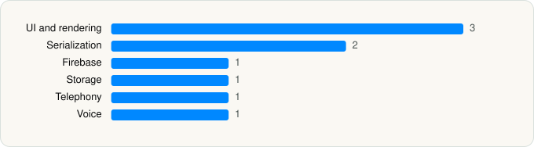

<picture><source media="(prefers-color-scheme: dark)" srcset="../../../../assets/logo/logo-dark.svg"></picture> [Tech Stack](../../../../README.md) / [Signal Messenger, LLC](../../../../companies/signal-messenger-llc.md) / Signal

# Signal - Private Messenger

<picture><source media="(prefers-color-scheme: dark)" srcset="../../../../assets/badges/ios-dark.svg"></picture> <picture><source media="(prefers-color-scheme: dark)" srcset="../../../../assets/badges/inactive-dark.svg"></picture> <picture><source media="(prefers-color-scheme: dark)" srcset="../../../../assets/badges/floor-dark.svg"></picture> <picture><source media="(prefers-color-scheme: dark)" srcset="../../../../assets/badges/encrypted-dark.svg"></picture>

[App Store](https://apps.apple.com/app/id874139669) · [latest.json](latest.json)

| | |
|---|---|
| Company | [Signal Messenger, LLC](../../../../companies/signal-messenger-llc.md) |
| Store id | `874139669` |
| Bundle / package id | `org.whispersystems.signal` |
| Latest version | 8.34 (analysed 2026-10-23) |
| Versions tracked | 2 |
| SDKs in latest version | 9 |
| Languages | C/C++, Metal (shaders), Objective-C, Swift |
| UI | Lottie (animations), SwiftUI, UIKit |
| Build | Swift Package Manager (SwiftPM) |
| Minimum OS | iOS 15.0 (built with Xcode 26.6, SDK iphoneos26.5) |
| Devices / ABIs | iPhone, iPad |
| Localisations | 47 |
| Capabilities | 13 |
| Declares tracking | No |
| Tracked | No. Kept for history. |

## SDKs by category

<picture><source media="(prefers-color-scheme: dark)" srcset="../../../../assets/charts/apps/ios/signal-messenger-llc/signal-private-messenger-dark.svg"></picture>

- **UI and rendering** (3): Down 2.0.2, Lottie, SDWebImage
- **Serialization** (2): Protobuf 2.72.1, SwiftProtobuf
- **Firebase** (1): abseil
- **Storage** (1): GRDB
- **Telephony** (1): libPhoneNumber
- **Voice** (1): WebRTC

Frameworks (31)

Authentication Services (Sign in with Apple / passkeys), AVFoundation (audio/video), AVKit, Background Tasks, CallKit (VoIP), CloudKit, Combine (reactive), Contacts, Core Image, Core Location, Core Motion, CryptoKit, DeviceCheck / App Attest, Local Authentication (Face ID / Touch ID), MapKit, Media Player, MessageUI (mail / SMS compose), MetalKit, Natural Language, Network.framework, PassKit (Wallet / Apple Pay), Photos, PhotosUI, PushKit (VoIP push), SafariServices, SiriKit (Intents), StoreKit (in-app purchase), SwiftUI, UIKit, User Notifications, Vision

Capabilities (13)

App Groups, Apple Pay, Associated Domains (Universal Links), Background App Refresh, Background Audio, Background Processing, Background Push, Communication Notifications, iCloud, iCloud Key-Value Storage, Keychain Sharing, Push Notifications (APNs), VoIP

## Version history

| Version | Analysed | Store update | SDKs | Change | SDK list is a floor | Binary encrypted | File |
|---|---|---|---|---|---|---|---|
| 8.34 | 2026-10-23 | 2026-10-21 | 9 | +0 / −0 | Yes | Yes | [8.34.json](8.34.json) |
| 8.14 | 2026-06-19 |  | 9 |  | Yes | Yes | [8.14.json](8.14.json) |

---

Generated by `scripts/build_readme.py` from the JSON files. Do not edit by hand.
