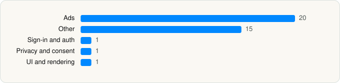

<picture><source media="(prefers-color-scheme: dark)" srcset="../../../../assets/logo/logo-dark.svg"></picture> [Tech Stack](../../../../README.md) / [Simon Zvara](../../../../companies/simon-zvara.md) / YouPlay

# YouPlay: AdBlock Video Browser

<picture><source media="(prefers-color-scheme: dark)" srcset="../../../../assets/badges/ios-dark.svg"></picture> <picture><source media="(prefers-color-scheme: dark)" srcset="../../../../assets/badges/inactive-dark.svg"></picture> <picture><source media="(prefers-color-scheme: dark)" srcset="../../../../assets/badges/floor-dark.svg"></picture> <picture><source media="(prefers-color-scheme: dark)" srcset="../../../../assets/badges/encrypted-dark.svg"></picture>

[App Store](https://apps.apple.com/app/id6751497996) · [latest.json](latest.json)

| | |
|---|---|
| Company | [Simon Zvara](../../../../companies/simon-zvara.md) |
| Store id | `6751497996` |
| Bundle / package id | `app.youplay.YouPlay` |
| Latest version | 1.3.12 (analysed 2026-11-27) |
| Versions tracked | 1 |
| SDKs in latest version | 38 |
| Languages | C/C++, Objective-C, Swift |
| UI | SwiftUI, UIKit |
| Build | Swift Package Manager (SwiftPM) |
| Minimum OS | iOS 18.0 (built with Xcode 27.2, SDK iphoneos27.2) |
| Devices / ABIs | iPhone, iPad |
| Localisations | 35 |
| Capabilities | 5 |
| Declares tracking | Yes |
| Tracked | No. Kept for history. |

## SDKs by category

<picture><source media="(prefers-color-scheme: dark)" srcset="../../../../assets/charts/apps/ios/simon-zvara/youplay-dark.svg"></picture>

- **Ads** (20): AppLovin 13.6.3, CASMediationAppLovin 1.0, CASMediationAudienceNetwork 1.0, CASMediationExchange 1.0, CASMediationGoogleAds 1.0, CASMediationInMobi 1.0, CASMediationIronSource 1.0, CASMediationLiftoffMonetize 1.0, CASMediationMintegral 1.0, CASMediationMoloco 1.0, CASMediationPangle 1.0, CASMediationUnityAds 1.0, CASMediationYsoNetwork 1.0, FBAudienceNetwork 1.0, Google Mobile Ads (AdMob), GoogleMobileAds 13.7.0, InMobiSDK 11.4.0, MolocoSDK 4.9.0, MTGSDKInterstitialVideo 1.0, MTGSDKNewInterstitial 1.0
- **Other** (15): AdsGlobalPackage, HgSdkLib 2.1.0, IronSource 9.5.0, MintegralAdSDK, MTGSDK 1.0, MTGSDKBanner 1.0, MTGSDKBidding 1.0, MTGSDKNativeAdvanced 1.0, MTGSDKReward 1.0, MTGSDKSplash 1.0, PAGAdSDK 8.2.8, SwifterSwift, UnityAds 1.0, VungleAdsSDK 1.0, YsoNetwork 1.2.1
- **Sign-in and auth** (1): CleverAdsSolutions 1.0
- **Privacy and consent** (1): UserMessagingPlatform 3.1.0
- **UI and rendering** (1): Kingfisher

Frameworks (29)

AdSupport (IDFA), App Tracking Transparency (ATT), AVFoundation (audio/video), AVKit, Combine (reactive), Core Image, Core Location, Core ML, Core Motion, CryptoKit, DeviceCheck / App Attest, Local Authentication (Face ID / Touch ID), MapKit, Media Player, MessageUI (mail / SMS compose), MetricKit (diagnostics), Network.framework, PassKit (Wallet / Apple Pay), Photos, PhotosUI, SafariServices, SceneKit, SpriteKit, StoreKit (in-app purchase), SwiftData (persistence), SwiftUI, UIKit, User Notifications, WidgetKit (widgets)

Capabilities (5)

Background Audio, Background Push, CloudKit, iCloud, Push Notifications (APNs)

## Version history

| Version | Analysed | Store update | SDKs | Change | SDK list is a floor | Binary encrypted | File |
|---|---|---|---|---|---|---|---|
| 1.3.12 | 2026-11-27 |  | 38 |  | Yes | Yes | [1.3.12.json](1.3.12.json) |

---

Generated by `scripts/build_readme.py` from the JSON files. Do not edit by hand.
