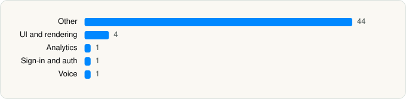

<picture><source media="(prefers-color-scheme: dark)" srcset="../../../../assets/logo/logo-dark.svg"></picture> [Tech Stack](../../../../README.md) / [SINA Corporation](../../../../companies/sina-corporation.md) / 微博

# 微博

<picture><source media="(prefers-color-scheme: dark)" srcset="../../../../assets/badges/ios-dark.svg"></picture> <picture><source media="(prefers-color-scheme: dark)" srcset="../../../../assets/badges/active-dark.svg"></picture> <picture><source media="(prefers-color-scheme: dark)" srcset="../../../../assets/badges/floor-dark.svg"></picture> <picture><source media="(prefers-color-scheme: dark)" srcset="../../../../assets/badges/encrypted-dark.svg"></picture>

[App Store](https://apps.apple.com/app/id350962117) · [latest.json](latest.json)

| | |
|---|---|
| Company | [SINA Corporation](../../../../companies/sina-corporation.md) |
| Store id | `350962117` |
| Bundle / package id | `com.sina.weibo` |
| Latest version | 16.10.2 (analysed 2026-10-24) |
| Versions tracked | 1 |
| SDKs in latest version | 51 |
| Languages | C/C++, Flutter / Dart, Metal (shaders), Objective-C, Swift |
| UI | Lottie (animations), SwiftUI, UIKit |
| Build | Unknown / Xcode native |
| Minimum OS | iOS 15.0 (built with Xcode 27.1, SDK iphoneos27.1) |
| Devices / ABIs | iPhone, iPad |
| Localisations | 3 |
| Capabilities | 11 |
| Declares tracking | Yes |
| Tracked | Yes |

## SDKs by category

<picture><source media="(prefers-color-scheme: dark)" srcset="../../../../assets/charts/apps/ios/sina-corporation/weibo-dark.svg"></picture>

- **Other** (44): AgoraCore 3.4.7, Agoraffmpeg 3.4.7, AlibabaAuthSDK, AlipaySDK, APBToygerFacade, APBToygerFacadeSuitable, CameraRenderShaders 1.0.0, CKSDK, Emoticons, Flutter 1.0, highlightjs, KKWebView, libpag 4.5.84, LiveRoomSDK, MegLiveV5Detect, MovieSDK, MultiFactorFacade, NebulaWK, OCRXMedia, QRModel, res, SmartLink, TBLiveSDK, TBLiveUIKitIOS, ToygerService, VIPPW, VIVerifyCore, WBCronet 114.5735.246, WBExtCard, WBFreshNews, WBGLRenderEngine, WBLoupe, WBMediaEditing, WBoxSDK, WBPay, WBS3EModel, WBS3Playground, WBSportSticker, WBVideoDebugConsole, WBVideoPicInPic, WBWebBrowserConsole, WBWebBrowserJSBridge, WindVaneBasic, WTAsset
- **UI and rendering** (4): AntMarkdown, Highlight.js 11.10.0, Lottie 1.0, React Native
- **Analytics** (1): Facebook SDK
- **Sign-in and auth** (1): BioAuthEngine
- **Voice** (1): AgoraRtcKit 3.4.7

Frameworks (39)

ActivityKit (Live Activities), AdServices (Apple Search Ads attribution), AdSupport (IDFA), App Intents, App Tracking Transparency (ATT), ARKit, Authentication Services (Sign in with Apple / passkeys), AVFoundation (audio/video), AVKit, Combine (reactive), Contacts, Core Bluetooth, Core Image, Core Location, Core ML, Core Motion, EventKit (Calendar / Reminders), MapKit, Media Player, MessageUI (mail / SMS compose), MetalKit, MetricKit (diagnostics), Network.framework, PassKit (Wallet / Apple Pay), Photos, PhotosUI, PushKit (VoIP push), SafariServices, SceneKit, SiriKit (Intents), Speech (recognition), StoreKit (in-app purchase), Swift Charts, SwiftUI, UIKit, User Notifications, Vision, Watch Connectivity, WidgetKit (widgets)

Capabilities (11)

App Groups, Apple Pay, Associated Domains (Universal Links), Background Audio, Background Push, Communication Notifications, Keychain Sharing, Push Notifications (APNs), Sign in with Apple, SiriKit, Time-Sensitive Notifications

## Version history

| Version | Analysed | Store update | SDKs | Change | SDK list is a floor | Binary encrypted | File |
|---|---|---|---|---|---|---|---|
| 16.10.2 | 2026-10-24 | 2026-10-21 | 51 |  | Yes | Yes | [16.10.2.json](16.10.2.json) |

---

Generated by `scripts/build_readme.py` from the JSON files. Do not edit by hand.
