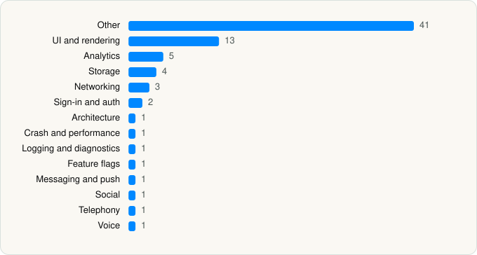

<picture><source media="(prefers-color-scheme: dark)" srcset="../../../../assets/logo/logo-dark.svg"></picture> [Tech Stack](../../../../README.md) / [Skype Communications S.a.r.l](../../../../companies/skype-communications-s-a-r-l.md) / GroupMe

# GroupMe

<picture><source media="(prefers-color-scheme: dark)" srcset="../../../../assets/badges/ios-dark.svg"></picture> <picture><source media="(prefers-color-scheme: dark)" srcset="../../../../assets/badges/active-dark.svg"></picture> <picture><source media="(prefers-color-scheme: dark)" srcset="../../../../assets/badges/floor-dark.svg"></picture> <picture><source media="(prefers-color-scheme: dark)" srcset="../../../../assets/badges/encrypted-dark.svg"></picture>

[App Store](https://apps.apple.com/app/id392796698) · [latest.json](latest.json)

| | |
|---|---|
| Company | [Skype Communications S.a.r.l](../../../../companies/skype-communications-s-a-r-l.md) |
| Store id | `392796698` |
| Bundle / package id | `com.groupme.iphone-app` |
| Latest version | 15.76.3 (analysed 2026-06-19) |
| Versions tracked | 1 |
| SDKs in latest version | 76 |
| Languages | C/C++, Kotlin Multiplatform, Metal (shaders), Objective-C, Swift |
| UI | Lottie (animations), SwiftUI, UIKit |
| Build | Swift Package Manager (SwiftPM) |
| Minimum OS | iOS 16.0 (built with Xcode 26.1.1, SDK iphoneos26.1) |
| Devices / ABIs | iPhone, iPad |
| Localisations | 17 |
| Capabilities | 12 |
| Declares tracking | Yes |
| Tracked | Yes |

## SDKs by category

<picture><source media="(prefers-color-scheme: dark)" srcset="../../../../assets/charts/apps/ios/skype-communications-s-a-r-l/groupme-dark.svg"></picture>

- **Other** (41): ACReuseQueue 0.0.1, AzureCommunicationCommon 1.2.0, AzureCommunicationUICalling 1.4.0, AzureCore 1.0.0, CameraCommon 1.32.0, CameraDevice 1.32.0, CameraIO 1.32.0, CameraTelemetry 1.32.0, CHTCollectionViewWaterfallLayout 0.9.7, CropViewController 2.6.1, DefaultFilter 1.32.0, EffectBackground 1.32.0, EffectBitmapOverlay 1.32.0, EffectCommon 1.32.0, EffectFilter 1.32.0, EffectFrame 1.32.0, EffectMicOnly 1.32.0, EffectPen 1.32.0, EffectPhoto 1.32.0, EffectSticker 1.32.0, EffectText 1.32.0, FoundationExtensions, HKCircularProgressView 1.1.0, InterfaceCommon 1.32.0, InterfaceEdit 1.32.0, InterfaceRecord 1.32.0, InterfaceSelfie 1.32.0, JSON 1.2.3, jsonlogic 1.2.4, MediaCanvas 1.0.19, OfficeFloodgateSDK 7.4.0, OneCamera 1.32.0, OneCameraCommon 1.32.0, OneCameraGradientFilter 1.32.0, OneCameraMediaImporter 1.32.0, OneCameraPhotoEdit 1.32.0, SDAVAssetExportSession 0.0.4, ServiceCalls 0.1.0, SharedConfiguration 0.1.0, SwiftECS 0.1.0, Telemetry 0.1.0
- **UI and rendering** (13): DifferenceKit 1.3.0, Disintegrate 0.1.0, EasyTipView 2.1.0, FluentIcons 1.1.316, FluentUI 0.10.0, Hero 1.6.4, Highlight.js 11.7.0, iosMath 0.9.5, KaTeX, Lottie 4.4.3, MathJax, SDWebImage 5.21.0, SkeletonView 1.30.4
- **Analytics** (5): Facebook SDK, FBAEMKit 1.0, FBSDKCoreKit 1.0, Mixpanel 1.0.1, SCSDKCoreKit 2.5.0
- **Storage** (4): CameraTransform 1.32.0, Gifu 3.4.1, KeychainAccess 4.2.2, SAMKeychain 1.5.3
- **Networking** (3): AFNetworking 2.7.0, Alamofire 5.8.1, Starscream 4.0.6
- **Sign-in and auth** (2): FBSDKLoginKit 1.0, MSAL 1.4.0
- **Architecture** (1): Swinject 2.8.3
- **Crash and performance** (1): AppCenter 5.0.5
- **Logging and diagnostics** (1): CocoaLumberjack 3.8.1
- **Feature flags** (1): Statsig 1.29.1
- **Messaging and push** (1): OneSignal 1.0
- **Social** (1): SCSDKCreativeKit 2.5.0
- **Telephony** (1): libPhoneNumber 0.9.15
- **Voice** (1): AzureCommunicationCalling 2.12.0

Frameworks (33)

ActivityKit (Live Activities), AdSupport (IDFA), App Tracking Transparency (ATT), Authentication Services (Sign in with Apple / passkeys), AVFoundation (audio/video), AVKit, CallKit (VoIP), Combine (reactive), Contacts, Core Data, Core Image, Core Location, Core ML, Core Motion, CryptoKit, DeviceCheck / App Attest, EventKit (Calendar / Reminders), Local Authentication (Face ID / Touch ID), MapKit, MessageUI (mail / SMS compose), MetalKit, Network.framework, Photos, PhotosUI, PushKit (VoIP push), SafariServices, SiriKit (Intents), StoreKit (in-app purchase), SwiftUI, UIKit, User Notifications, Vision, WidgetKit (widgets)

Capabilities (12)

App Attest, App Groups, Associated Domains (Universal Links), Background App Refresh, Background Audio, Background Processing, Background Push, Communication Notifications, Keychain Sharing, Push Notifications (APNs), Sign in with Apple, VoIP

## Version history

| Version | Analysed | Store update | SDKs | Change | SDK list is a floor | Binary encrypted | File |
|---|---|---|---|---|---|---|---|
| 15.76.3 | 2026-06-19 |  | 76 |  | Yes | Yes | [15.76.3.json](15.76.3.json) |

---

Generated by `scripts/build_readme.py` from the JSON files. Do not edit by hand.
