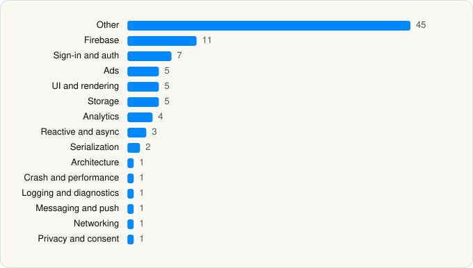

<picture><source media="(prefers-color-scheme: dark)" srcset="../../../../assets/logo/logo-dark.svg"></picture> [Tech Stack](../../../../README.md) / [SKYWORK AI PTE LTD](../../../../companies/skywork-ai-pte-ltd.md) / DramaWave

# DramaWave - Dramas & Reels

<picture><source media="(prefers-color-scheme: dark)" srcset="../../../../assets/badges/ios-dark.svg"></picture> <picture><source media="(prefers-color-scheme: dark)" srcset="../../../../assets/badges/inactive-dark.svg"></picture> <picture><source media="(prefers-color-scheme: dark)" srcset="../../../../assets/badges/floor-dark.svg"></picture> <picture><source media="(prefers-color-scheme: dark)" srcset="../../../../assets/badges/encrypted-dark.svg"></picture>

[App Store](https://apps.apple.com/app/id6670430706) · [latest.json](latest.json)

| | |
|---|---|
| Company | [SKYWORK AI PTE LTD](../../../../companies/skywork-ai-pte-ltd.md) |
| Store id | `6670430706` |
| Bundle / package id | `com.dramabuzz.app` |
| Latest version | 2.0.30 (analysed 2026-10-24) |
| Versions tracked | 1 |
| SDKs in latest version | 93 |
| Languages | C/C++, Objective-C, Swift |
| UI | Lottie (animations), SwiftUI, UIKit |
| Build | Swift Package Manager (SwiftPM) |
| Minimum OS | iOS 15.0 (built with Xcode 26.3, SDK iphoneos26.2) |
| Devices / ABIs | iPhone, iPad |
| Localisations | 25 |
| Capabilities | 9 |
| Declares tracking | Yes |
| Tracked | No. Kept for history. |

## SDKs by category

<picture><source media="(prefers-color-scheme: dark)" srcset="../../../../assets/charts/apps/ios/skywork-ai-pte-ltd/dramawave-dark.svg"></picture>

- **Other** (45): AdsGlobalSDK 7.5.8, AlexMaxAdapter 1.0.0, AnyThinkSDK 1.0, Base64 1.0.0, CHIPageControl 0.2.0, DAUIKit 1.0.0, FCUUID 1.3.1, FMDB 2.7.9, IQKeyboardCore 1.0.9, IQKeyboardManagerSwift 8.0.1, IQKeyboardNotification 1.0.7, IQKeyboardReturnManager 1.0.6, IQKeyboardToolbar 1.1.5, IQKeyboardToolbarManager 1.1.6, IQTextInputViewNotification 1.0.9, IQTextView 1.0.5, JKSwiftExtension 2.7.2, JXSegmentedView 1.3.1, KakaJSON 1.1.2, libwebp 1.5.0, Masonry 1.1.0, MBProgressHUD 1.1.0, MJRefresh 3.7.9, MQTTClient 0.15.4, NVActivityIndicatorView 5.2.0, PAGAdSDK 7.5.8, Premium, ProtocolBuffers 1.9.9, QMIM 2.1.31, RegExCategories 1.0.0, SmartdigimktSDK 1.0, SMToastTools 1.0.0, sqlcipher 1.2.1, SwiftTip 0.1.0, TradPlusAds 11.2.0, TradPlusADX, TXFFmpeg 1.0, TXSoundTouch 1.0, TXVodPlayer, UICKeyChainStore 2.1.2, VisualEffectView 4.1.5, WCDBSwift 1.0.8, YYCache 1.0.4, YYModel 1.0.4, YYText 1.0.7
- **Firebase** (11): FBLPromises 2.4.1, Firebase 12.13.0, FirebaseCore 12.13.0, FirebaseCoreInternal 12.13.0, FirebaseInstallations 12.13.0, FirebasePerformance 12.13.0, FirebaseRemoteConfig 12.13.0, GoogleDataTransport 10.1.0, GoogleUtilities 8.1.2, nanopb 3.30910.0, Promises 2.4.1
- **Sign-in and auth** (7): AppAuth 1.7.6, Facebook Login, FBSDKLoginKit 1.0, GoogleSignIn 7.1.0, GTMAppAuth 4.1.1, GTMSessionFetcher 3.5.0, OAuthCore 0.0.1
- **Ads** (5): AppLovin 7.12.8, FBAudienceNetwork 1.0, Google Mobile Ads (AdMob), GoogleMobileAds 13.4.0, VungleAds 7.7.1
- **UI and rendering** (5): Lottie 4.5.0, SDWebImage 0.14.6, SkeletonView 1.31.0, SnapKit 5.7.1, SwiftSoup 2.7.2
- **Storage** (5): MMKV 2.2.4, MMKVCore 2.2.4, SAMKeychain 1.5.2, sqliterk 1.2.2, SSZipArchive 2.4.3
- **Analytics** (4): AppsFlyerLib 6.18.0, Facebook SDK, FBAEMKit 1.0, FBSDKCoreKit 1.0
- **Reactive and async** (3): RxCocoa 6.9.0, RxRelay 6.9.0, RxSwift 6.9.0
- **Serialization** (2): Protobuf 3.25.3, SwiftyJSON 5.0.2
- **Architecture** (1): Resolver 1.5.1
- **Crash and performance** (1): FirebaseCrashlytics 12.13.0
- **Logging and diagnostics** (1): CocoaLumberjack 3.9.0
- **Messaging and push** (1): FirebaseMessaging 12.13.0
- **Networking** (1): AFNetworking 4.0.2
- **Privacy and consent** (1): UserMessagingPlatform 2.7.0

Frameworks (29)

ActivityKit (Live Activities), AdSupport (IDFA), App Tracking Transparency (ATT), Authentication Services (Sign in with Apple / passkeys), AVFoundation (audio/video), AVKit, Combine (reactive), Core Data, Core Image, Core Location, Core ML, Core Motion, CryptoKit, DeviceCheck / App Attest, EventKit (Calendar / Reminders), Local Authentication (Face ID / Touch ID), Media Player, MessageUI (mail / SMS compose), MetalKit, MetricKit (diagnostics), Network.framework, Photos, PushKit (VoIP push), SafariServices, StoreKit (in-app purchase), SwiftUI, UIKit, User Notifications, WidgetKit (widgets)

Capabilities (9)

App Groups, Associated Domains (Universal Links), Background App Refresh, Background Audio, Background Push, Keychain Sharing, Push Notifications (APNs), Sign in with Apple, Time-Sensitive Notifications

## Version history

| Version | Analysed | Store update | SDKs | Change | SDK list is a floor | Binary encrypted | File |
|---|---|---|---|---|---|---|---|
| 2.0.30 | 2026-10-24 | 2026-10-09 | 93 |  | Yes | Yes | [2.0.30.json](2.0.30.json) |

---

Generated by `scripts/build_readme.py` from the JSON files. Do not edit by hand.
